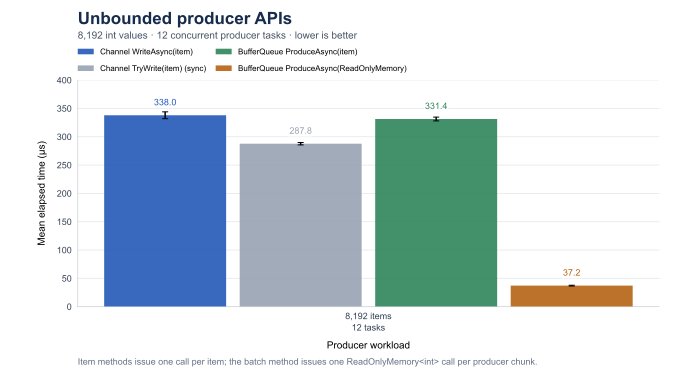
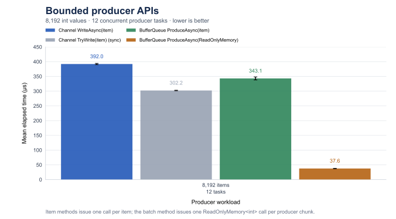
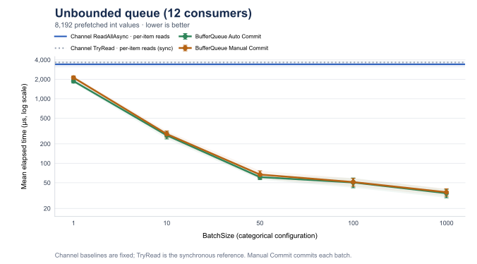
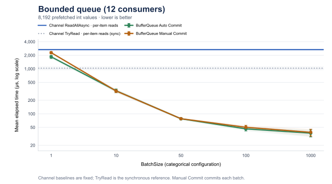
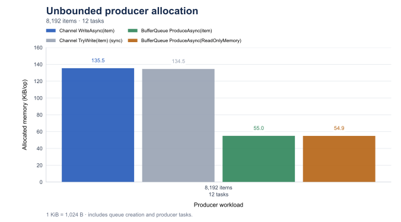
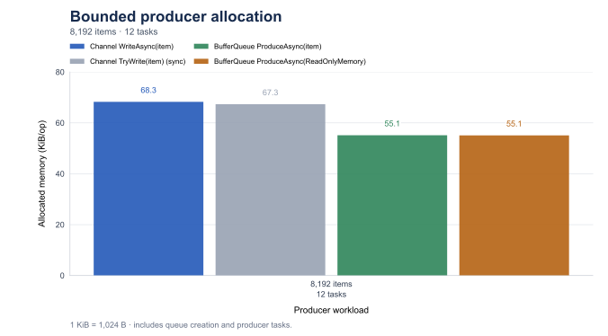
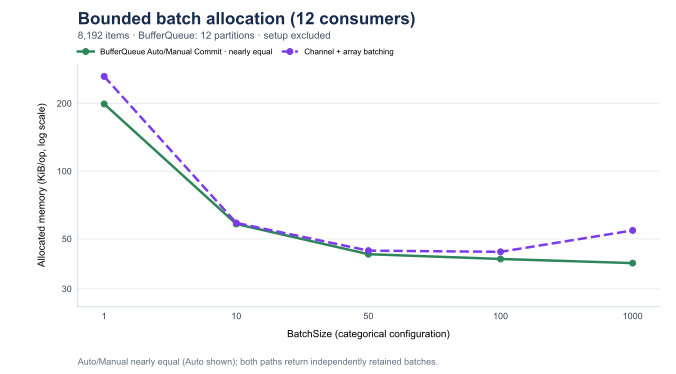
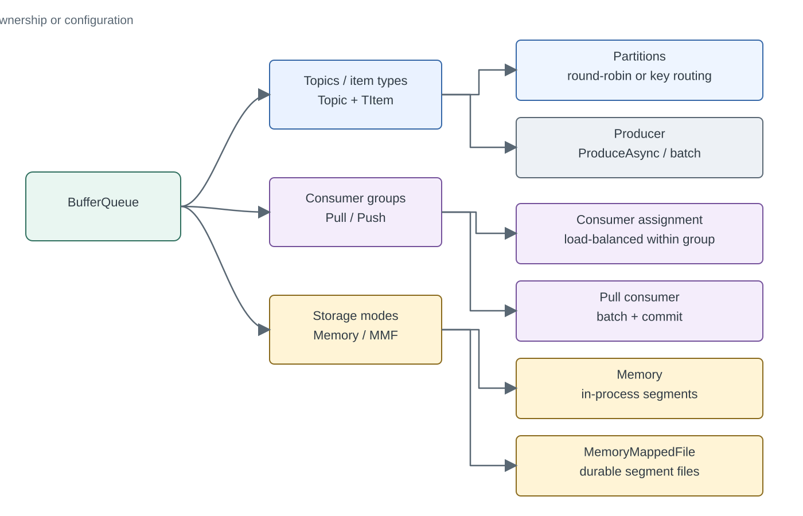
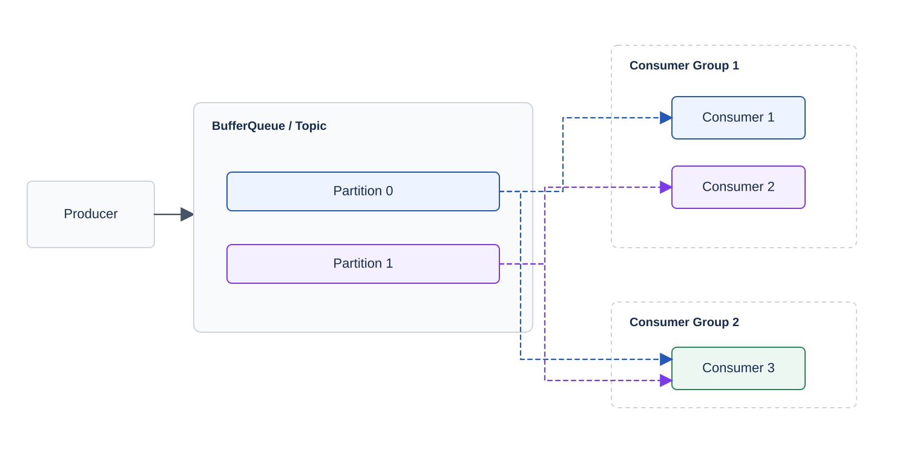
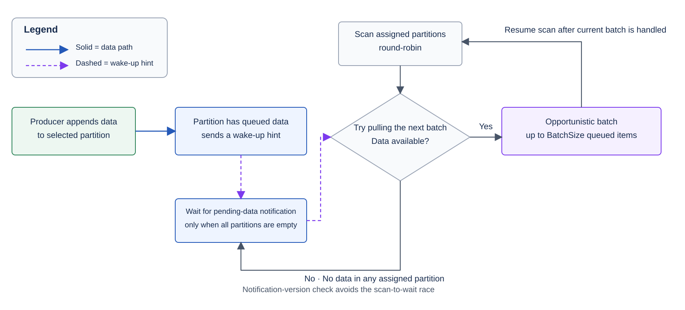

BufferQueue
===========

[](https://codecov.io/gh/eventhorizon-cli/BufferQueue)
[](https://github.com/eventhorizon-cli/BufferQueue/actions/workflows/dotnet-build.yml)
[](https://www.nuget.org/packages/BufferQueue/)
[](https://www.nuget.org/packages/BufferQueue.MemoryMappedFile/)

English | [简体中文](./README.zh-CN.md)

Design docs: [English](./docs/README.md) | [简体中文](./docs/README.zh-CN.md)

BufferQueue is a high-performance buffer queue implementation written in .NET, which supports multi-threaded concurrent operations.
The packages target .NET 8 and .NET 10.
A consumer entering an idle wait is awakened when new data becomes available.

BufferQueue currently provides two storage modes:

- Memory: in-process segmented memory storage, optimized for high-throughput batch consumption.
- MemoryMappedFile: local memory-mapped segment files with persisted producer and consumer offsets.

## Comparison with Channel

### Functional Differences

| Aspect | `System.Threading.Channels` | BufferQueue |
|---|---|---|
| Focus | In-process asynchronous producer/consumer handoff | Batch processing with partitions, consumer groups, and tracked progress |
| Batch APIs | Item-based reads/writes; applications can assemble batches | Batch production and consumption; reads return up to BatchSize available items |
| Partitions | No built-in partition concept | A topic can have multiple partitions |
| Multiple consumers | Readers compete for items from one queue | At most one consumer per partition within a group; different groups consume independently |
| Acknowledgement and replay | Reading removes an item; no built-in processing acknowledgement or replay | Auto Commit or **Manual Commit**; an uncommitted batch can be delivered again |
| Ordering | FIFO reads; parallel processing may finish out of order | Ordering within each partition; no global order across partitions |
| Capacity and backpressure | bounded / unbounded; bounded supports waiting or dropping items | Memory supports bounded / unbounded, waiting or failing; capacity follows the slowest group's committed progress |
| Persistence | No built-in persistence | Memory is in-process; the optional MemoryMappedFile package persists data and committed progress locally |

Channel suits a shared work queue when per-item handoff is sufficient. BufferQueue adds batch APIs and independent
consumer progress when processing needs explicit acknowledgement or multiple consumer groups. See [Channel documentation](https://learn.microsoft.com/en-us/dotnet/core/extensions/channels)
and the [BufferQueue consumer model](docs/design/consumer-model.md) for the respective semantics.

The following sections compare Memory BufferQueue with `System.Threading.Channels`: production first, then consumption.
MemoryMappedFile is not included.

**Partitions and consumers:** within one BufferQueue consumer group, a partition can be assigned to at most one
consumer. Therefore, **partition count must be >= consumer count within that group**; one consumer can handle multiple partitions.
Different groups can consume the same partition independently, each tracking its own progress.
Channel has no partition concept; multiple readers compete for items from one instance.

This assignment also supports **consumption progress management**. BufferQueue tracks progress per
`consumer group + partition`, with that group's assigned consumer responsible for reads and commits. This avoids
having multiple consumers share one commit position and coordinate how to advance it when batches finish out of order.
With manual commit, the application can finish processing a batch before committing it, preserving replay for an
uncommitted batch. Different groups can advance independently at their own pace.

Consumers in the same group do not compete for a partition's read position. They can read their own data in parallel,
reducing contention associated with reading from a shared queue. Memory mode reads published data without taking the
append lock, but commits and capacity management still require synchronization; partition assignment does not make the
entire consumption path lock-free. Actual throughput also depends on BatchSize, data distribution across partitions, and
business processing costs. See [partitioning and concurrency](docs/design/partitioning-and-concurrency.md) for the concurrency rules.

**Both tested configurations, with one and twelve partitions, show advantages for batch writes and consumption**:
BufferQueue batch writes take less time than Channel `WriteAsync`. When draining prefilled queues at the measured
BatchSize values of 10, 50, 100, and 1000, both Auto and Manual Commit also take less time than `Channel.ReadAllAsync`,
in both Unbounded and Bounded modes. See the [single-partition report](docs/benchmarks/memory-single-partition.md) and
[12-partition report](docs/benchmarks/memory-multi-partition.md) for the configurations and data.

**The main charts use twelve partitions** to show twelve consumers each responsible for one partition and to keep
the partition count the same in production and consumption. One partition supports only one consumer within a group;
its charts and report remain linked below as supplementary results. The main chart configurations are:

| Test | BufferQueue | Channel |
|---|---|---|
| Production | 12 partitions, 12 producer tasks | One instance, 12 producer tasks |
| Consumption | 12 partitions, 12 consumers in one group, each assigned one partition | One instance, 12 competing readers |

Both sides use the same number of concurrent tasks, but distribute consumption work differently; the results reflect
that difference. Production and consumption are measured separately, not as an end-to-end workload running both at once.

Benchmark environment: Apple M2 Max (12 cores), macOS 27.0.1 / Arm64, .NET 10.0.0, runtime-provided `System.Threading.Channels` 10.0.0, BenchmarkDotNet 0.15.8 (Release).

### Production Benchmarks

These charts compare asynchronous Channel `WriteAsync` with asynchronous BufferQueue item and batch writes;
`TryWrite` is shown as a synchronous reference. The workload writes 8,192 values from 12 producer tasks into
one Channel or a BufferQueue with **12 partitions**. Producer concurrency remains 12 on both sides.
BufferQueue producer tasks share the topic producer, routing items round-robin rather than binding each task to a partition.
Each batch call submits one task's chunk (683 items, or 679 for the final chunk).





The timed operation includes queue creation and task scheduling. Bounded capacity fits the complete workload,
so this measures writing into available capacity, not waiting for space.

In the [12-partition measurements](docs/benchmarks/memory-multi-partition.md#production-benchmarks), BufferQueue batch writes take
about 89–90% less time than Channel `WriteAsync` across Unbounded and Bounded modes, reflecting the different number
of API calls as well.

Single-partition results are also available: [unbounded production chart](docs/benchmarks/memory-single-partition-produce-unbounded-time.svg)
and [bounded production chart](docs/benchmarks/memory-single-partition-produce-bounded-time.svg), still with twelve producer tasks on each side.
In that single-partition run, BufferQueue single-item async writes take about 14–18% less time than Channel `WriteAsync`,
and batch writes about 80–83% less.

### Consumption Benchmarks

These charts drain prefilled queues through asynchronous BufferQueue consumption and `Channel.ReadAllAsync`.
Each operation consumes `8,192` `int` messages with **12 consumers** on each side, each running in its own task.
BufferQueue consumers in one group each read their assigned partition; twelve Channel readers share one instance.
These results reflect both batch APIs and the different ways the two queues distribute work.

In these time charts, `BatchSize` affects BufferQueue only. Auto Commit and Manual Commit are measured separately,
with a gray `Channel<T>.TryRead` synchronous reference.

This comparison measures batch consumption capability when draining a backlog: BufferQueue retrieves batches and
adds their `Count()`, while Channel retrieves and counts individual items without collecting them into arrays. This captures the reduction in API calls
and asynchronous iterations from batching. BufferQueue's batch creation and element copying are included; application-side
per-item traversal and business processing are excluded. [Separate traversal measurements](docs/benchmarks/batch-enumeration.md)
cover that additional cost. [Channel array-batching results](docs/benchmarks/channel-batch-aggregation.md) separately
record the elapsed time and allocation when Channel also returns batches. The [single-partition report](docs/benchmarks/memory-single-partition.md)
retains time and allocation measurements with one consumer on each side.
The time charts below compare the native APIs. Array batching adds application-side work to Channel; its extra
elapsed time is not a slowdown of Channel's native read API, so those timings remain in the linked report.

See the [consumption allocation charts](#consumption-allocations) below for the Channel + array batching curve.
Those charts also use twelve consumers and measure the cost of returning independently owned batches on both sides.

#### 12 Consumers

BufferQueue uses twelve partitions; Channel uses one shared instance. Data comes from the
[12-partition measurements](docs/benchmarks/memory-multi-partition.md#consumption-benchmarks).





Manual Commit measurements include `CommitAsync` after every returned batch.

**Manual Commit is a BufferQueue feature advantage:** an application can process a batch successfully before calling
`CommitAsync`, preserving a replay opportunity for an uncommitted batch. `Channel<T>` has no built-in equivalent
acknowledgement, checkpoint, or replay.

In this twelve-consumer prefilled workload, both Auto and Manual Commit take less time than `Channel.ReadAllAsync`
at the measured BatchSize values of 10–1000, in both Unbounded and Bounded modes. Short iterations have visible
uncertainty; the report retains the errors and complete configuration.

The single-partition results are also available directly: [unbounded consumption chart](docs/benchmarks/memory-single-partition-consume-unbounded-1-consumer-time.svg)
and [bounded consumption chart](docs/benchmarks/memory-single-partition-consume-bounded-1-consumer-time.svg), each with one consumer on both sides.
In this prefilled workload, **batch consumption with one partition is also faster than `Channel.ReadAllAsync`**:
with Auto Commit, mean time is about 49–53% lower at BatchSize 10 and 85–93% lower at BatchSize 50 and 100,
across Unbounded and Bounded modes. Channel remains faster at BatchSize 1, where BufferQueue takes about 2.5–2.7× its mean time.
See the [one-partition / one-consumer report](docs/benchmarks/memory-single-partition.md) for configuration and uncertainty;
these conclusions do not apply to the twelve-consumer charts above.

Batching provides the clearest benefit when messages are already available. A larger configured BatchSize does not
ensure a full batch under sparse traffic; these results measure draining a backlog, not per-message delivery latency.

### Allocations

The consumption allocation charts compare retained-batch work: BufferQueue Auto / Manual Commit and Channel array
batching. They show cumulative managed allocations per 8,192-item operation, not peak memory usage. BufferQueue
consumption uses each batch's `Count()`; Channel array batching uses each batch's `Length`. Application-side per-item
traversal and business processing are excluded. The queues are prefilled, but batches can still be partial at partition
tails, where allocation is reduced.

#### Production Allocations





With twelve partitions, BufferQueue's two write APIs allocate about 54.9–55.1 KiB across Unbounded and Bounded modes,
versus about 135.5 / 68.3 KiB respectively for Channel `WriteAsync`.

Single-partition production allocation charts: [unbounded](docs/benchmarks/memory-single-partition-produce-unbounded-allocations.svg)
and [bounded](docs/benchmarks/memory-single-partition-produce-bounded-allocations.svg). In that configuration, both BufferQueue
write APIs allocate about 36.4 / 36.6 KiB in Unbounded / Bounded modes.

#### Consumption Allocations

The main charts show one `Auto/Manual Commit` curve because their allocations are nearly equal; the curve uses Auto Commit measurements. They compare BufferQueue with **Channel + array batching**. The added Channel path uses
`ReadAllAsync` to fill a fresh `int[BatchSize]` for each batch and exposes only the filled prefix of the last partial
batch; it never pools or reuses returned arrays. BatchSize controls both BufferQueue and this added Channel path, and
array creation and filling are included in allocation.

BufferQueue likewise returns independent snapshots that remain valid after later pulls, commits, and segment recycling.
The charts below use the same **12-consumer** configuration: each BufferQueue consumer reads its own partition,
while twelve Channel readers share one instance and each builds batches. This difference affects the number of
partial tail batches and their allocations. The raw Channel per-item allocation reference remains useful
for native item handoff, but it does not materialize retained batches and is therefore a limited reference for this
batch-consumption comparison. See the [per-item Channel allocation reference](docs/benchmarks/memory-multi-partition.md#per-item-channel-reference)
and the complete [single-partition](docs/benchmarks/memory-single-partition.md) and [12-partition array-batching measurements](docs/benchmarks/channel-batch-aggregation.md)
for elapsed times, allocation at every configuration, and the different partition/tail-batch behavior.

##### 12 Consumers




As a one-consumer reference, with 1 partition / 1 consumer, BufferQueue allocates about 193 / 35.3 / 33.5 KiB at
BatchSize 1 / 100 / 1000, with similar Auto / Manual results; Channel array batching allocates about 257 / 35.1 / 36.5 KiB.
With one consumer at BatchSize 10–100, allocations are approximately equal in both the one-partition and twelve-partition
records. This does not imply equal elapsed time.

See the [12-partition benchmark report](docs/benchmarks/memory-multi-partition.md) and
[Channel array-batching measurements](docs/benchmarks/channel-batch-aggregation.md) for the complete setup and data.
The [single-partition benchmark report](docs/benchmarks/memory-single-partition.md) retains the single-partition production data and
one-consumer reference. The one-partition and twelve-partition runs were measured separately and do not establish
a partition-scaling speedup.

## Applicable Scenarios

Scenarios that require concurrent batch processing of data when the speed between producers and consumers is inconsistent.

Use Memory mode when the queue only needs to buffer data inside the current process and maximum consumption throughput is the priority.

Use MemoryMappedFile mode when produced data and committed consumer offsets need to survive process restarts. MemoryMappedFile mode is a local persistence mechanism for one active queue instance; it does not coordinate multiple processes writing to the same topic directory.

To combine concurrent requests into batches while letting callers await their individual results, see
[RequestBatcher](https://github.com/eventhorizon-cli/RequestBatcher), a higher-level project built on BufferQueue.
It adds request coalescing, handler-batch concurrency control, and result delivery on top of batch consumption,
for database, cache, and downstream API operations that support processing multiple items together.

## Functional Design

1. Supports creating multiple topics, each of which can have multiple data types. Each pair of topics and data types corresponds to an independent buffer.

2. Supports batch production and consumption of data, allowing multiple pieces of data to be written or obtained at once.

3. Supports creating multiple consumer groups, each with independent consumption progress. Supports multiple consumer groups to consume the same topic concurrently.

4. Supports creating multiple consumers for the same consumer group to consume data in a load-balanced manner.

5. Supports two consumption modes: pull mode and push mode.

6. Both pull and push modes support Auto Commit and Manual Commit. Auto Commit advances progress after a successful pull, before application processing, so a processing failure does not trigger replay. Manual Commit lets the application advance progress after successful processing; an uncommitted batch may be delivered again.

7. Supports multiple storage modes. Memory mode keeps data and offsets in process memory. MemoryMappedFile mode stores records in memory-mapped segment files and persists producer and committed consumer offsets to disk.



## High-Performance Design

### Partitioned Concurrency

Memory-mode published-slot reads avoid the append lock, so consumer groups can read independently. Consumer
registration, commits, and segment recycling still use the partition's synchronization.

### Multi-Partition Design

Each topic can have multiple partitions, each of which has an independent consumption progress, supporting multiple consumer groups to consume concurrently.

The producer writes data to each partition in a round-robin manner by default. A topic can instead enable
partition-key routing so items with equal keys are written to the same partition.

**The number of consumers must not exceed the number of partitions, and partitions are assigned as evenly as possible within the group**.

When a consumer is assigned multiple partitions, it consumes in a round-robin manner.

Different consumption groups' consumption progress is recorded on each partition, and the consumption progress of different groups does not interfere with each other.



### Segmented Memory

Memory mode stores records in fixed-size segments. Unbounded topics allocate additional segments as needed; bounded
topics enforce their configured total capacity and release it as all consumer groups commit.

### Opportunistic Batching

BufferQueue forms batches from data that is already available when a consumer scans a partition. A pull returns up
to `BatchSize` items from one readable partition. Items already queued in the same partition may be combined
opportunistically into that batch; the consumer does not hold the first item for a fixed collection window. Low
traffic can therefore produce a one-item batch, while a burst can produce a larger batch from the same partition.

With `AutoCommit`, the consumer commits immediately after a successful pull. With manual commit, it returns the batch
to the caller and advances only after `CommitAsync`; an uncommitted batch may be delivered again. Push consumers use
the same delivery and commit semantics.



“Opportunistic” describes when items are collected into a batch; it is not a business-level merge or deduplication
guarantee. Batch composition depends on enqueue timing, partition routing, `BatchSize`, and consumer scheduling. See
[Consumer model](docs/design/consumer-model.md) for delivery and wake-up details.

## Usage Example

Install the core NuGet package:

```shell
dotnet add package BufferQueue
```

The project is based on Microsoft.Extensions.DependencyInjection, and services need to be registered before use.

BufferQueue supports two consumption modes: pull mode and push mode.

### Memory Mode Registration

Memory mode stores data in process memory. It supports optional bounded capacity.

```csharp
using BufferQueue.Memory;

builder.Services.AddBufferQueue(bufferOptionsBuilder =>
{
    bufferOptionsBuilder
        .UseMemory(memoryBufferOptionsBuilder =>
        {
            // Each pair of Topic and data type corresponds to an independent buffer, and partitionNumber can be set
            memoryBufferOptionsBuilder
                .AddTopic<Foo>(options =>
                {
                    options.TopicName = "topic-foo1";
                    options.PartitionNumber = 6;
                    // The same Foo.Id is always routed to the same partition.
                    options.UsePartitionKey(foo => foo.Id);
                })
                .AddTopic<Foo>(options =>
                {
                    options.TopicName = "topic-foo2";
                    options.PartitionNumber = 4;
                })
                .AddTopic<Bar>(options =>
                {
                    options.TopicName = "topic-bar";
                    options.PartitionNumber = 8;
                    // You can set the maximum capacity of the buffer
                    options.BoundedCapacity = 100_000;
                    options.FullMode = BufferQueueFullMode.Wait;
                });
        })
        // Add push mode consumers,
        // scan the specified assembly for classes marked with
        // BufferPushCustomerAttribute and register them as push mode consumers
        .AddPushCustomers(typeof(Program).Assembly);
});

// Pull mode consumers can be implemented as HostedService.
builder.Services.AddHostedService<Foo1PullConsumerHostService>();
```

`UsePartitionKey` requires a selector delegate. Numeric selectors support the built-in
`INumber<TNumber>` types when their result is a finite integer; they route with
the normalized mathematical modulo of `(key - 1)` and `PartitionNumber`. This also accepts
zero and negative keys. String selectors hash the complete UTF-16 key deterministically
to choose a partition. Equal keys therefore keep their per-partition ordering, while
different keys can share a partition. When `UsePartitionKey` is not called, production
continues to use round-robin routing. The selector must be deterministic and safe for concurrent calls.
In Memory mode, concurrent producers can append to different key-selected partitions in parallel; appends to the
same partition remain serialized.

String routing hashes the complete UTF-16 key deterministically. Empty strings are accepted, null keys are rejected,
and code units are used without Unicode normalization. On supported little-endian .NET targets, the mapping is stable
across restarts; MMF topics are not intended to move between platforms with different byte order. Existing MMF data
remains readable after a routing implementation change, but new messages for a key may use another partition, so
per-key ordering across that upgrade is not preserved. See [Partitioning and concurrency](docs/design/partitioning-and-concurrency.md)
for the routing contract and persistence constraints.

See the [retained partition-key routing benchmark](docs/benchmarks/memory-multi-partition.md#partition-key-routing-benchmark)
for the historical measurements, methodology, and reproduction commands.

### MemoryMappedFile Mode Registration

MemoryMappedFile mode stores serialized records in memory-mapped files and persists offsets. The default serializer is an internal `System.Text.Json` implementation. Built-in MessagePack and unmanaged-struct serializers, as well as custom serializers, are available through `MemoryMappedFileBufferQueueOptions<T>.Serializer`.

`SegmentSizeInBytes` configures each memory-mapped segment in bytes and defaults to `256L * 1024 * 1024` (256 MiB).

`MaxRetainedConsumedSegments` optionally deletes fully consumed segments per partition. Its default is `null`, which disables deletion. `0` retains no reclaimable consumed segments; a positive value retains that many of the newest consumed segments. A segment is reclaimable only after every known consumer group has committed past it, so this setting is not a hard limit on total segment count or disk usage.

MemoryMappedFile support is distributed as a separate package:

```shell
dotnet add package BufferQueue.MemoryMappedFile
```

`BufferQueue.MemoryMappedFile` depends on the core `BufferQueue` package. The public namespaces and the `.UseMemoryMappedFile(...)` registration call are unchanged.

```csharp
builder.Services.AddBufferQueue(bufferOptionsBuilder =>
{
    bufferOptionsBuilder
        .UseMemoryMappedFile(memoryMappedFileBufferOptionsBuilder =>
        {
            memoryMappedFileBufferOptionsBuilder
                .AddTopic<Foo>(options =>
                {
                    options.TopicName = "topic-foo";
                    options.PartitionNumber = 4;
                    options.SegmentSizeInBytes = 64L * 1024 * 1024;
                    options.MaxRetainedConsumedSegments = 2;
                    options.DataDirectory = "/var/lib/bufferqueue";
                    options.FlushStrategy = MemoryMappedFileFlushStrategy.Batch;
                    options.FlushBatchSize = 100;
                    options.Serializer = new MessagePackMemoryMappedFileSerializer<Foo>();
                    options.UsePartitionKey(foo => foo.Id);
                });
        });
});
```

For MemoryMappedFile topics, keep both the selector and `PartitionNumber` unchanged while
existing records must preserve per-key ordering. Numeric and string routing are deterministic
across process restarts; string routing does not use `string.GetHashCode()`.

### Using Memory and MemoryMappedFile Together

Memory and MemoryMappedFile topics can be registered in the same `AddBufferQueue` call. Register each
`(T, TopicName)` pair in only one storage mode so the selected storage does not depend on registration order.

```csharp
builder.Services.AddBufferQueue(bufferOptionsBuilder =>
{
    bufferOptionsBuilder
        .UseMemory(memoryBufferOptionsBuilder =>
        {
            memoryBufferOptionsBuilder.AddTopic<Foo>(options =>
            {
                options.TopicName = "topic-foo-memory";
                options.PartitionNumber = 4;
            });
        })
        .UseMemoryMappedFile(memoryMappedFileBufferOptionsBuilder =>
        {
            memoryMappedFileBufferOptionsBuilder.AddTopic<Foo>(options =>
            {
                options.TopicName = "topic-foo-mmf";
                options.PartitionNumber = 4;
                options.DataDirectory = "/var/lib/bufferqueue";
            });
        });
});
```

With the default `MessagePackSerializerOptions.Standard` options, custom types should declare an explicit MessagePack contract with stable numeric keys:

```shell
dotnet add package MessagePack --version 3.1.8
```

Applications should reference MessagePack directly so its analyzer and source generator run in the application project; the `BufferQueue.MemoryMappedFile` package's transitive runtime dependency on MessagePack does not supply these build assets.

```csharp
using MessagePack;

[MessagePackObject]
public sealed class Foo
{
    [Key(0)]
    public int Id { get; set; }

    [Key(1)]
    public string Name { get; set; } = string.Empty;
}
```

`MessagePackMemoryMappedFileSerializer<T>` also accepts `MessagePackSerializerOptions`, so callers can configure a resolver, compression, or `MessagePackSecurity.UntrustedData`. Any configured resolver and formatter must be safe for concurrent use. Configuring `Serializer` is optional. If it is not configured, MemoryMappedFile mode uses the internal `System.Text.Json` implementation by default. Other formats can be integrated by implementing `IMemoryMappedFileSerializer<T>`.

For fixed-layout unmanaged structs, `UnmanagedMemoryMappedFileSerializer<T>` copies the value's in-memory representation without JSON or MessagePack encoding:

```csharp
using System.Runtime.InteropServices;

[StructLayout(LayoutKind.Sequential, Pack = 1)]
public struct Quote
{
    public long Sequence;
    public double Price;
    public int Quantity;
}

options.Serializer = UnmanagedMemoryMappedFileSerializer<Quote>.Instance;
```

The `unmanaged` constraint rejects reference fields at compile time. `[StructLayout]` is not required, but explicitly fixing the layout and packing is recommended for persisted data. Native endianness, padding, field order, packing, runtime, and process architecture are part of this raw format; avoid pointer-sized or process-specific fields and do not change the layout while existing records remain. Payload length is validated exactly during reads. This serializer removes format encoding and decoding, but the current queue contract still materializes a payload `byte[]`, so it is not a zero-copy MMF reader.

The configured serializer, numeric keys, resolver, compression, and other wire-format options must remain compatible with records already stored for the topic. Do not reuse removed numeric keys. Changing the persisted format can make existing records impossible to consume after recovery.

One serializer instance is shared by the topic partitions and can be called concurrently. Custom `IMemoryMappedFileSerializer<T>` implementations must be thread-safe and must not return `null`.

`FlushStrategy` defaults to `MemoryMappedFileFlushStrategy.Immediate`, which explicitly flushes every record. `MemoryMappedFileFlushStrategy.Batch` explicitly flushes after `FlushBatchSize` records in a partition; `FlushBatchSize` defaults to `100`. A segment rollover and a consumer commit are always flush boundaries, regardless of the configured batch size. At each boundary, the partition flushes the log successfully before advancing `producer.offset`.

Batch flushing reduces the number of explicit flushes, but a partial tail batch is not guaranteed to have been explicitly flushed when there is no subsequent production, segment rollover, or consumer commit. Applications that require every successful produce call to be an explicit durability boundary should use the default `Immediate` strategy.

MemoryMappedFile stores records and producer/consumer checkpoints under the configured data directory, with group names
escaped when used as path components. Consumer creation persists an initial offset for every assigned partition, so
slow, uncommitted, offline, or obsolete groups can prevent retention. Stop the queue and remove an obsolete group's
escaped offsets directory before deleting that group's retained state.

Recovery scans missing or stale producer checkpoints
forward from the retained boundary, but fails fast for corrupted, ahead-of-log, non-record-boundary checkpoints or
missing retained segments. In `Batch` mode, an unflushed partial tail may be absent after abnormal termination. Do
not reduce `PartitionNumber` for an existing topic; startup fails if existing partition directories exceed the
configured count. See [Memory-mapped-file storage](docs/design/memory-mapped-file.md) for the layout, retention, and
recovery rules.

### Producer

There are two ways to obtain a Producer:

- If the topic is fixed when declaring the dependency, inject `IBufferProducer<T>` with
  `[FromKeyedServices("topic-name")]`.
- If the topic is selected at runtime, inject `IBufferQueue` and call `GetProducer<T>(topicName)`.

In Memory mode, `FullMode` defaults to `Wait` for bounded topics. Both `ProduceAsync` and
`TryProduceAsync` then asynchronously wait until capacity becomes available; `TryProduceAsync`
returns `true` after the complete input is accepted. Pass a `CancellationToken` so that backpressure
can be canceled. Set `FullMode` to `Fail` when immediate rejection is required; `ProduceAsync` then
throws `BufferQueueFullException`, while `TryProduceAsync` returns `false`. A batch no larger than
the configured capacity is admitted as a whole. A larger `Wait` batch is split into consecutive
capacity-sized slices; each slice is admitted as a whole, and cancellation can leave prior completed
slices visible. `Fail` rejects an oversized batch as a whole.

```csharp
using Microsoft.Extensions.DependencyInjection;

[ApiController]
[Route("/api/[controller]")]
public class TestController(
    [FromKeyedServices("topic-foo1")] IBufferProducer<Foo> foo1Producer,
    [FromKeyedServices("topic-foo2")] IBufferProducer<Foo> foo2Producer,
    IBufferQueue bufferQueue) : ControllerBase
{
    [HttpPost("foo1")]
    public async Task<IActionResult> PostFoo1([FromBody] Foo foo)
    {
        await foo1Producer.ProduceAsync(foo, HttpContext.RequestAborted);
        return Ok();
    }

    [HttpPost("foo2")]
    public async Task<IActionResult> PostFoo2([FromBody] Foo foo)
    {
        await foo2Producer.ProduceAsync(foo, HttpContext.RequestAborted);
        return Ok();
    }

    [HttpPost("bar")]
    public async Task<IActionResult> PostBar([FromBody] Bar bar)
    {
        var producer = bufferQueue.GetProducer<Bar>("topic-bar");
        await producer.ProduceAsync(bar, HttpContext.RequestAborted);
        // TryProduceAsync will return a boolean indicating whether the data was successfully sent.
        // bool success = await producer.TryProduceAsync(bar, HttpContext.RequestAborted);
        return Ok();
    }
}
```

#### Batch production

`IBufferProducer<T>` exposes four core methods, each accepting an optional `CancellationToken`:

- `TryProduceAsync(T item, CancellationToken cancellationToken = default)`
- `TryProduceAsync(ReadOnlyMemory<T> items, CancellationToken cancellationToken = default)`
- `ProduceAsync(T item, CancellationToken cancellationToken = default)`
- `ProduceAsync(ReadOnlyMemory<T> items, CancellationToken cancellationToken = default)`

`BufferProducerExtensions` provides only the `IEnumerable<T>` convenience overloads, which also accept a
cancellation token. A non-array sequence is materialized before it invokes the core batch method. The core
`ProduceAsync` methods are interface methods, not extensions.

```csharp
Order[] orders = GetOrders();

await producer.ProduceAsync(orders.AsMemory());
await producer.ProduceAsync(orders.Where(order => order.Total > 0));

if (!await producer.TryProduceAsync(orders.AsMemory()))
{
    // A bounded Memory topic configured with FullMode.Fail could not admit the batch.
}
```

Routing remains per item. A round-robin batch advances once for every item, and a partition-key batch applies its
selector to every item, so one batch can write to multiple partitions. The same routing continues across the
capacity-sized slices used by an oversized `Wait` batch; equal keys retain input order within their selected
partition. The capacity limit is shared by all partitions. Each partition returns capacity as the minimum committed
position across all known consumer groups advances, including within a segment. A consumer group created later starts
at the current logical earliest position and cannot read records whose capacity has already been released.

For bounded `Wait` topics, start consumption and commit progress before writing beyond the available capacity.

### Consumers

The primary asynchronous comparison uses `ReadAllAsync` because both APIs expose streams consumed with `await foreach`:

```csharp
// ChannelReader<T>: one item per iteration
IAsyncEnumerable<T> ReadAllAsync(CancellationToken cancellationToken = default);
// IBufferPullConsumer<T>: one batch per iteration
IAsyncEnumerable<IReadOnlyList<T>> ConsumeAsync(CancellationToken cancellationToken = default);
```

Channel yields one item per iteration; BufferQueue yields one batch. Each BufferQueue batch is an already materialized
`IReadOnlyList<T>` with `Count` and indexed access, while `foreach` and LINQ remain available. `ReadAllAsync` continues
until the Channel completes and is drained; it does not collect all items into one batch. The public batch signature
change requires every binary consumer to be rebuilt; source code that only enumerates batches usually needs no change,
but consumer implementations, mocks, and push handlers must update their parameter or return signatures.

#### Consumer Groups

Consumers rotate among readable assigned partitions, starting after the partition that supplied the
previous batch. Empty partitions do not favor lower partition indices. This balances pull
opportunities, not processing time; partition-local order and manual-commit replay are preserved.

Create each named group once per topic queue instance. `CreatePullConsumer<T>` creates a group with one consumer;
use `CreatePullConsumers<T>(options, consumerNumber)` to create the entire group with multiple consumers.
The count must be between one and the topic's partition count. The group's consumer count and partition assignments
are fixed after creation; creating the same group again throws `InvalidOperationException`.

Each partition has one consumer within a group. Changing the consumer count at runtime would require reassigning
partitions and coordinating the handoff with unfinished batches and uncommitted progress. Fixing the count at
creation keeps each partition's reads and commits with the same consumer and avoids a runtime rebalance protocol.

Because groups have independent partition assignments and consumption progress, creating a new group does not
rebalance existing groups or add consumers to them.

Creating a group assigns its partitions; consumption starts when its consumers' `ConsumeAsync` sequences are
enumerated. Memory topics allow writing before creating a group, and group creation can run concurrently with
production. A new group starts at each partition's earliest available position and cannot read records whose capacity
has already been released or whose segments have been recycled. It is not guaranteed to receive the topic's complete
history.

For a bounded Memory topic in `Wait` mode, writes wait when capacity is unavailable. Start consumption and commit
progress to release capacity instead of waiting for writes beyond the available capacity to finish first.

#### Pull Mode Consumer

Pull mode consumer example:

```csharp
public class Foo1PullConsumerHostService(
    IBufferQueue bufferQueue,
    ILogger<Foo1PullConsumerHostService> logger) : IHostedService
{
    private readonly CancellationTokenSource _cancellationTokenSource = new();

    public Task StartAsync(CancellationToken cancellationToken)
    {
        var token = CancellationTokenSource
            .CreateLinkedTokenSource(cancellationToken, _cancellationTokenSource.Token)
            .Token;

        var consumers = bufferQueue.CreatePullConsumers<Foo>(
            new BufferPullConsumerOptions
            {
                TopicName = "topic-foo1", GroupName = "group-foo1", AutoCommit = true, BatchSize = 100,
            }, consumerNumber: 4);

        foreach (var consumer in consumers)
        {
            _ = ConsumeAsync(consumer, token);
        }

        return Task.CompletedTask;
    }

    public Task StopAsync(CancellationToken cancellationToken)
    {
        _cancellationTokenSource.Cancel();
        return Task.CompletedTask;
    }

    private async Task ConsumeAsync(IBufferPullConsumer<Foo> consumer, CancellationToken cancellationToken)
    {
        await foreach (var buffer in consumer.ConsumeAsync(cancellationToken))
        {
            foreach (var foo in buffer)
            {
                // Process the foo
                logger.LogInformation("Foo1PullConsumerHostService.ConsumeAsync: {Foo}", foo);
            }
        }
    }
}
```

#### Push Mode Consumer

Push mode consumer example:

Use the BufferPushCustomer attribute to register push mode consumers.

Push consumers are registered in the DI container, and other services can be injected through the constructor. A Singleton consumer is reused across batches and concurrent consumer loops, so it must be thread-safe. Scoped and Transient consumers are resolved in a new asynchronous DI scope for each batch and are disposed after the handler completes or throws.

The concurrency parameter in the BufferPushCustomer attribute is used to set the consumption concurrency of the push consumer, corresponding to the consumerNumber of the pull consumer.

```csharp

[BufferPushCustomer(
    topicName: "topic-foo2",
    groupName: "group-foo2",
    batchSize: 100,
    serviceLifetime: ServiceLifetime.Singleton,
    concurrency: 2)]
public class Foo2PushConsumer(ILogger<Foo2PushConsumer> logger) : IBufferAutoCommitPushConsumer<Foo>
{
    public Task ConsumeAsync(IReadOnlyList<Foo> buffer, CancellationToken cancellationToken)
    {
        for (var i = 0; i < buffer.Count; i++)
        {
            logger.LogInformation("Foo2PushConsumer.ConsumeAsync: {Foo}", buffer[i]);
        }

        return Task.CompletedTask;
    }
}
```

```csharp
[BufferPushCustomer(
    "topic-bar",
    "group-bar",
    100,
    ServiceLifetime.Scoped,
    2)]
public class BarPushConsumer(ILogger<BarPushConsumer> logger) : IBufferManualCommitPushConsumer<Bar>
{
    public async Task ConsumeAsync(IReadOnlyList<Bar> buffer, IBufferConsumerCommitter committer,
        CancellationToken cancellationToken)
    {
        foreach (var bar in buffer)
        {
            logger.LogInformation("BarPushConsumer.ConsumeAsync: {Bar}", bar);
        }

        await committer.CommitAsync();
    }
}
```

## Samples

See [`samples/WebAPI`](samples/WebAPI/) for a runnable ASP.NET Core example of BufferQueue registration, production, and pull/push consumption.
