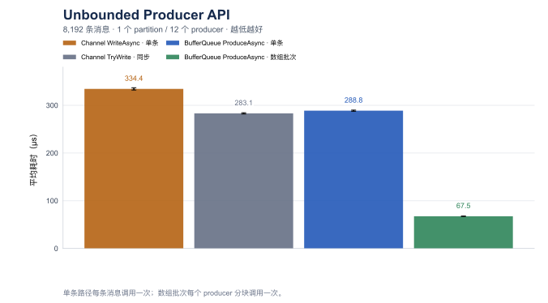
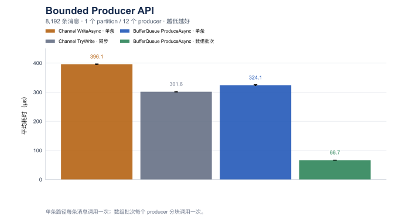
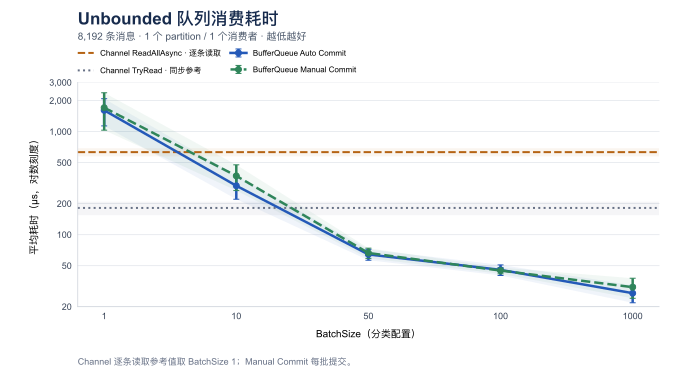
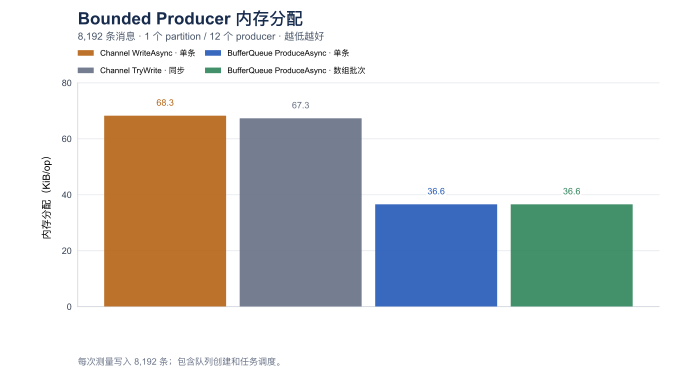
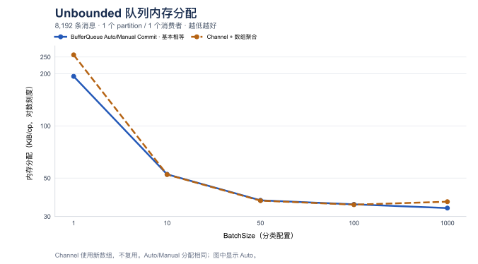
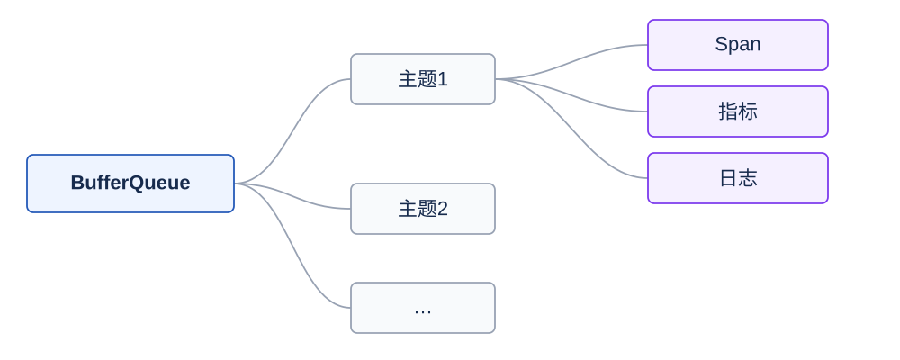
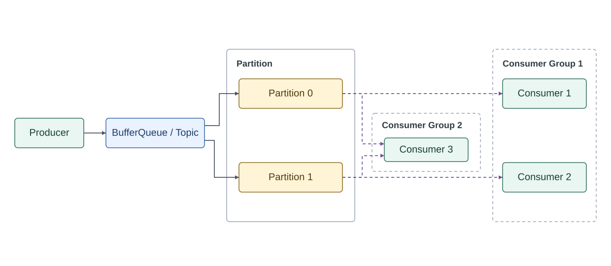
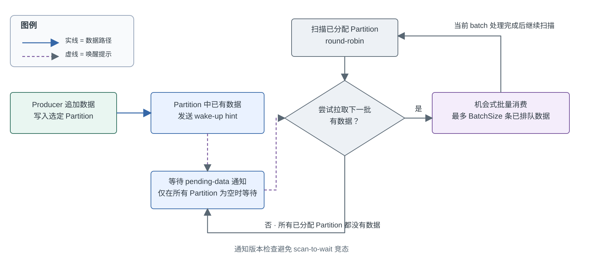

BufferQueue
===========

[](https://codecov.io/gh/eventhorizon-cli/BufferQueue)
[](https://github.com/eventhorizon-cli/BufferQueue/actions/workflows/dotnet-build.yml)
[](https://www.nuget.org/packages/BufferQueue/)
[](https://www.nuget.org/packages/BufferQueue.MemoryMappedFile/)

[English](./README.md) | 简体中文

设计文档：[English](./docs/README.md) | [简体中文](./docs/README.zh-CN.md)

BufferQueue 是一个用 .NET 编写的高性能的缓冲队列实现，支持多线程并发操作。
包同时支持 .NET 8 和 .NET 10。
Consumer 进入空闲等待后，新数据到达会直接唤醒消费流程。

BufferQueue 当前提供两种存储模式：

- Memory：进程内分段内存存储，主要优化批量消费吞吐。
- MemoryMappedFile：本地内存映射分段文件存储，并持久化 producer offset 和 consumer offset。

## 与 Channel 的对比

### 功能差异

| 对比项 | `System.Threading.Channels` | BufferQueue |
|---|---|---|
| 主要定位 | 进程内生产者与消费者之间的异步数据交接 | 带分区、消费组和进度管理的批量处理 |
| 批量 API | 逐条读写，应用可以自行组 batch | 支持批量生产和消费，每次最多返回 BatchSize 条已可用数据 |
| 多消费者 | 多个 reader 竞争读取同一个队列 | 组内按 partition 分工，不同 group 独立消费 |
| 消费确认与重放 | 读取即移除，没有内建的处理确认和重放机制 | 支持 Auto Commit 和 **Manual Commit**，未提交的 batch 可以再次交付 |
| 顺序 | FIFO 读取，并行处理的完成顺序可能不同 | partition 内有序，跨 partition 不保证全局顺序 |
| 容量与背压 | bounded / unbounded；bounded 支持等待或丢弃策略 | Memory 支持 bounded / unbounded、等待或失败；容量释放取决于最慢 group 的已提交进度 |
| 持久化 | 无内建持久化 | Memory 仅在进程内保存；可选 MemoryMappedFile 包支持本地数据和已提交进度持久化 |

只需要共享工作队列、逐条交接数据时，Channel 更直接；需要批量 API、明确的消费确认或多个独立消费组时，BufferQueue 提供对应能力。
具体语义参见 [Channel 文档](https://learn.microsoft.com/en-us/dotnet/core/extensions/channels)和 [BufferQueue 消费模型](docs/design/consumer-model.zh-CN.md)。

下面按写入、消费的顺序展示 Memory BufferQueue 与 `System.Threading.Channels` 的性能对比，不包含 MemoryMappedFile。
主图统一比较 **一个 BufferQueue Partition 与一个 Channel**；[12 Partition 结果](docs/benchmarks/memory-queues.zh-CN.md#12-partition-图表)中，
批量写入和实测 BatchSize 10～1000 的消费也比 Channel 对应的 async API 耗时更低，Unbounded 和 Bounded 均如此。

测试环境：Apple M2 Max（12 核），macOS 27.0.1 / Arm64，.NET 10.0.0，内置 `System.Threading.Channels` 10.0.0，BenchmarkDotNet 0.15.8（Release）。

### 写入性能

这些图表比较异步 Channel `WriteAsync` 与异步 BufferQueue 单条和 batch 写入；`TryWrite` 作为同步参考。
测试由 12 个 producer task 向一个 Channel 或包含 **1 个 partition** 的 BufferQueue 写入 8,192 条数据，两边 producer 并发数均为 12。
每次 batch 调用提交一个 task 的数据块：通常为 683 条，最后一块为 679 条。





计时包含队列创建和任务调度。bounded 容量足够容纳全部数据，因此测量的是有可用容量时的写入成本，不包含等待空间的耗时。

单 Partition 下，BufferQueue 单条 async 写入比 Channel `WriteAsync` 耗时约少 14–18%，batch 写入约少 80–83%，
其中也体现了 API 调用次数的差异。范围涵盖 Unbounded 和 Bounded 两种模式；
[12 Partition 测量](docs/benchmarks/memory-queues.zh-CN.md#12-partition-图表)中，batch 写入同样更快，比 Channel `WriteAsync` 耗时约少 89–90%。

### 消费性能

这些图表通过异步 BufferQueue 消费和 `Channel.ReadAllAsync` 消费预填充队列中的 `8,192` 条 `int` 消息。
BufferQueue 使用 **1 Partition / 1 Consumer**，Channel 使用一个实例和一个 reader。
耗时图中的 `BatchSize` 只影响 BufferQueue；Auto Commit、Manual Commit 分别测量，灰色的 `Channel<T>.TryRead` 为同步参考。
[12 Partition 结果](docs/benchmarks/memory-queues.zh-CN.md#12-partition-图表)分别展示一个 consumer 轮询多个 partition，
以及 12 个 consumer 读取各自 partition 的情况。Channel 的 reader 共享同一个队列，因此多 consumer 结果也包含并发组织方式的差异。
12 Partition 下，在实测 BatchSize 10～1000、1 或 12 个 consumer 的配置中，Auto 和 Manual Commit
都比 `Channel.ReadAllAsync` 耗时更低，Unbounded 和 Bounded 均如此。

这项对比衡量积压数据的批量消费能力：BufferQueue 按批取出并累加 `Count()`，Channel 逐条取出并计数，不聚合成数组，
体现批量 API 减少调用和异步迭代次数的收益。BufferQueue 创建批次和复制元素的成本已计入；
不包含应用侧逐条遍历和业务处理，这部分额外成本见[单独的遍历测量](docs/benchmarks/batch-enumeration.zh-CN.md)。
Channel 也返回批次时的耗时和分配，单独记录在[数组聚合测量](docs/benchmarks/channel-batch-aggregation.zh-CN.md)中；
新增 1 Partition 场景下的同一聚合路径记录在[单 Partition 测量](docs/benchmarks/single-partition.zh-CN.md)中。
下方耗时图比较原生 API。数组聚合是在 Channel 之上增加的应用侧工作，额外耗时不能归因于 Channel 原生读取变慢，
因此这组耗时仅放在链接文档中。

**本次单 consumer、BatchSize 10～100 时，Channel 加上应用侧数组聚合后，内存分配与 BufferQueue 基本持平。
理解分配差距，请看下方[消费内存分配图](#消费分配量)中的“Channel + 应用侧数组聚合”曲线；此结论不代表耗时持平。**

#### 1 Partition / 1 Consumer

一个 BufferQueue partition 对比一个 Channel，两边各用一个 consumer。这组结果展示不涉及跨 partition 并行消费时的
批量 API 差异；两者的批次所有权和 commit 语义仍然不同。




Manual Commit 的计时包含每批读取后的 `CommitAsync`。

**手动提交（Manual Commit）是 BufferQueue 的功能优势**：应用可以先成功处理 batch，再调用 `CommitAsync`，未提交的 batch
保留重放机会。`Channel<T>` 没有内建的等价确认、checkpoint 或重放机制。

在这组预填充队列测试中，启用 Auto Commit 的 BufferQueue 与 `Channel.ReadAllAsync` 相比：

- **1 Partition / 1 Consumer，BatchSize = 1**：平均耗时约为 Channel 的 2.5–2.7 倍，逐条消费场景仍是 Channel 更快。
- **1 Partition / 1 Consumer，增大 batch**：BatchSize = 10 时平均耗时减少约 49–53%；BatchSize = 50–100 时减少约 85–93%，
  涵盖 Bounded 和 Unbounded 两种模式。短迭代存在可见波动，尤其是 Unbounded 的小 batch 测量。

数据已经积累时，批量消费的收益更明显。低流量下，调大 BatchSize 不代表每次都能取满；这里测量的是消费积压数据的耗时，
不是单条消息的交付延迟。

### 内存分配

消费内存分配图只比较需要保留 batch 的工作：BufferQueue Auto / Manual Commit 和 Channel 数组聚合。以下数值均表示
每次 benchmark operation 处理 8,192 条消息产生的累计托管分配量（allocated bytes），不是峰值驻留内存。BufferQueue
消费测量使用 `Count()` 统计批次条数，Channel 数组聚合使用每批的 `Length`；不包含应用侧逐条遍历和业务处理的分配。
测试消费预填充数据；分区尾部仍可能取不满 batch，这种情况下也会减少内存分配。

#### 写入分配量

单 Partition 下，BufferQueue 两种写入 API 在 Unbounded / Bounded 下分别约分配 36.4 / 36.6 KiB，
Channel `WriteAsync` 分别约为 135.5 / 68.3 KiB。




#### 消费分配量

Auto / Manual Commit 分配量基本一致，主图合并为一条 `Auto/Manual Commit` 曲线，采用 Auto Commit 测量值，
与 **Channel + 应用侧数组聚合** 对比。Channel 通过 `ReadAllAsync` 逐条读取，
每批填入一个新建的 `int[BatchSize]`，最后不满的一批只返回已填充前缀，不池化或复用已返回数组。BatchSize 同时
控制 BufferQueue 和新增的 Channel 数组聚合路径，数组创建和填充的成本计入测量。

BufferQueue 同样返回独立快照，在后续 pull、commit 和 segment 回收后仍然有效。1 Partition / 1 Consumer、BatchSize 100 时，
Channel 数组聚合约分配 **35.1 KiB**，BufferQueue 约 **35.3 KiB**；这是分配对比，不代表耗时持平。Channel 逐条读取的
分配量仍能反映原生数据交接的成本，但未包含生成可保留批次的成本，因此对本批量消费对比的参考有限。详见
[Channel 逐条读取内存分配参考](docs/benchmarks/memory-queues.zh-CN.md#channel-逐条读取参考)，以及完整的
[单 Partition 测量](docs/benchmarks/single-partition.zh-CN.md)和[12 Partition 数组聚合测量](docs/benchmarks/channel-batch-aggregation.zh-CN.md)，
其中记录各配置的耗时、分配，以及分区和尾部批次行为的差异。12 Partition、单 consumer 下，
BatchSize 10～100 的分配量也与 Channel 加上数组聚合后基本持平。

1 Partition / 1 Consumer 下，BatchSize 1 / 100 / 1000 的 BufferQueue 分配约为 193 / 35.3 / 33.5 KiB，Auto / Manual 结果接近；
Channel 数组聚合约为 257 / 35.1 / 36.5 KiB。

##### 1 Partition / 1 Consumer




完整配置和测量数据见[单 Partition benchmark 报告](docs/benchmarks/single-partition.zh-CN.md)，其他拓扑见
[12 Partition 图表](docs/benchmarks/memory-queues.zh-CN.md#12-partition-图表)，其中批量写入和批量消费在上述配置下也比 Channel 对应的 async API 耗时更低。
两组数据来自独立测量，不能据此计算增加 partition 带来的加速比。

## 适用场景

生产者和消费者之间的速度不一致，需要并发批量处理数据的场景。

如果只需要在当前进程内缓存数据，并且优先考虑消费吞吐，可以使用 Memory 模式。

如果生产的数据和已提交消费进度需要在进程重启后保留，可以使用 MemoryMappedFile 模式。MemoryMappedFile 模式是面向单个 active queue 实例的本地持久化机制，不负责协调多个进程同时写入同一个 topic directory。

## 功能设计
1. 支持创建多个 Topic，每个 Topic 可以有多种数据类型。每一对 Topic 和数据类型对应一个独立的缓冲区。

2. 支持批量写入和批量消费，可以一次写入或获取多条数据。

3. 支持创建多个 Consumer Group，每个 Consumer Group 的消费进度都是独立的。支持多个 Consumer Group 并发消费同一个 Topic。

4. 支持同一个 Consumer Group 创建多个 Consumer，以负载均衡的方式消费数据。

5. 支持 pull 模式和 push 模式两种消费模式。

6. Pull 和 Push 模式都支持 Auto Commit 和 Manual Commit。Auto Commit 在成功读取后、应用处理前推进进度，处理失败不会触发重放；Manual Commit 允许应用处理成功后再提交，未提交的 batch 可以再次交付。

7. 支持多种存储模式。Memory 模式把数据和 offset 保存在进程内存中。MemoryMappedFile 模式把记录写入内存映射分段文件，并把 producer offset 和已提交的 consumer offset 持久化到磁盘。



## 高性能设计

### Partition 并发设计

Memory 模式对已发布 slot 的读取不会持有追加锁，因此不同 Consumer Group 可以独立读取数据。
Consumer 注册、提交以及 segment 回收仍使用 partition 的同步机制。

### 多 partition 设计
每个 Topic 可以有多个 partition，每个 partition 都有独立的消费进度，支持多个 Consumer Group 并发消费。

Producer 默认以轮询方式往每个 Partition 中写入数据。Topic 也可以启用 PartitionKey 路由，
让相同 key 的数据写入同一个 Partition。

**Consumer 数量不能超过 Partition 数量，Partition 会尽可能均衡地分配给组内各个 Consumer**。

当一个 Consumer 被分配了多个 Partition 时，以轮训的方式进行消费。

每个 Partition 上会记录不同消费组的消费进度，不同组之间的消费进度互不干扰。



### Segment 存储
Memory 模式使用固定大小的 segment 保存记录。unbounded topic 会按需分配新的 segment；bounded topic 遵守配置的总容量，
并在所有 consumer group 提交进度后释放容量。

### 机会式批量消费（Opportunistic Batching）

BufferQueue 会在 Consumer 扫描 Partition 时，把当时已经可读的数据组成 batch。一次 pull 最多从一个有数据的
Partition 返回 `BatchSize` 条记录。同一 Partition 中已经排队的数据可能被机会式地合并到这个 batch 中；它不会为了凑满
`BatchSize` 而等待固定时间窗口。因此低流量可能得到只有一条数据的 batch，突发流量则可能得到同一 Partition 中已经排队的更大 batch。

开启 `AutoCommit` 时，Consumer 在成功 pull 后立即提交进度。手动提交时，batch 会先返回给调用方，只有调用
`CommitAsync` 后才推进进度；未提交的 batch 可能再次交付。Push Consumer 复用相同的交付和提交语义。



“机会式”描述的是数据何时被收集进 batch，不代表业务层面的合并或去重保证。具体 batch 受入队时机、Partition 路由、
`BatchSize` 和 Consumer 调度影响。交付和唤醒细节参见[Consumer 模型](docs/design/consumer-model.zh-CN.md)。

## 使用示例

安装核心 NuGet 包：

```shell
dotnet add package BufferQueue
```

项目基于 Microsoft.Extensions.DependencyInjection，使用时需要先注册服务。

BufferQueue 支持两种消费模式：pull 模式和 push 模式。

### Memory 模式注册

Memory 模式把数据保存在进程内存中，并支持可选的 bounded 容量。

```csharp
using BufferQueue.Memory;

builder.Services.AddBufferQueue(bufferOptionsBuilder =>
{
    bufferOptionsBuilder
        .UseMemory(memoryBufferOptionsBuilder =>
        {
            // 每一对 Topic 和数据类型对应一个独立的缓冲区，可以设置 partitionNumber
            memoryBufferOptionsBuilder
                .AddTopic<Foo>(options =>
                {
                    options.TopicName = "topic-foo1";
                    options.PartitionNumber = 6;
                    // 相同 Foo.Id 的数据始终路由到同一个 partition。
                    options.UsePartitionKey(foo => foo.Id);
                })
                .AddTopic<Foo>(options =>
                {
                    options.TopicName = "topic-foo2";
                    options.PartitionNumber = 4;
                })
                .AddTopic<Bar>(options =>
                {
                    options.TopicName = "topic-bar";
                    options.PartitionNumber = 8;
                    // 可以设置缓冲区的最大容量
                    options.BoundedCapacity = 100_000;
                    options.FullMode = BufferQueueFullMode.Wait;
                });
        })
        // 添加 push 模式的消费者
        // 扫描指定程序集中的标记了 BufferPushCustomerAttribute 的类，
        // 注册为 push 模式的消费者
        .AddPushCustomers(typeof(Program).Assembly);
});

// 在 HostedService 中使用 pull模式 消费数据
builder.Services.AddHostedService<Foo1PullConsumerHostService>();
```

`UsePartitionKey` 必须传入 selector 委托。数值 selector 支持内置的
`INumber<TNumber>` 类型，但结果必须是有限的整数，路由使用 `(key - 1)` 对 `PartitionNumber`
的归一化数学取模，因此零和负数也可作为 key。字符串 selector 对完整 UTF-16 key 执行确定性哈希来选择 partition。
相同 key 因此能保持 partition 内顺序，不同 key 仍可能进入同一个 partition。未调用 `UsePartitionKey` 时，Producer 继续使用默认的轮询路由。Selector 必须保持确定性，
并能安全地被并发调用。Memory 模式下，并发 Producer 可以并行写入不同 key 选中的 partition；写入同一个 partition 仍会串行执行。

字符串路由对完整 UTF-16 key 执行确定性哈希。空字符串合法，null key 会被拒绝，路由保留原始码元且不执行
Unicode 规范化。在受支持的小端 .NET 环境中，重启前后映射保持稳定；MMF topic 不计划在字节序不同的平台之间迁移。
已有 MMF 数据仍可读取，但路由实现升级后同 key 的新消息可能进入其他 partition，因此不保证跨升级的按 key 顺序。
路由契约和持久化约束参见[分区与并发设计](docs/design/partitioning-and-concurrency.zh-CN.md)。

详细的历史测量、方法和复现命令见[保留的 PartitionKey 路由 benchmark](docs/benchmarks/memory-queues.zh-CN.md#partitionkey-路由性能)。

### MemoryMappedFile 模式注册

MemoryMappedFile 模式把序列化后的记录写入内存映射文件，并持久化 offset。默认序列化器是基于 `System.Text.Json` 的 internal 实现，也可以通过 `MemoryMappedFileBufferQueueOptions<T>.Serializer` 使用内置 MessagePack、unmanaged struct 序列化器或自定义序列化器。

`SegmentSizeInBytes` 以字节为单位配置每个 memory-mapped segment，默认值为 `256L * 1024 * 1024`（256 MiB）。

`MaxRetainedConsumedSegments` 可按 partition 删除已经完整消费的 segment。默认值为 `null`，表示不删除；`0` 表示不保留任何可回收的已消费 segment；正数表示保留最新的对应数量。只有所有已知 consumer group 都已经提交越过某个 segment 后，该 segment 才可回收，因此该配置不是总 segment 数或磁盘占用的硬上限。

MemoryMappedFile 支持通过独立包发布，使用前需要安装：

```shell
dotnet add package BufferQueue.MemoryMappedFile
```

`BufferQueue.MemoryMappedFile` 依赖核心 `BufferQueue` 包。公共 namespace 和 `.UseMemoryMappedFile(...)` 注册调用保持不变。

```csharp
builder.Services.AddBufferQueue(bufferOptionsBuilder =>
{
    bufferOptionsBuilder
        .UseMemoryMappedFile(memoryMappedFileBufferOptionsBuilder =>
        {
            memoryMappedFileBufferOptionsBuilder
                .AddTopic<Foo>(options =>
                {
                    options.TopicName = "topic-foo";
                    options.PartitionNumber = 4;
                    options.SegmentSizeInBytes = 64L * 1024 * 1024;
                    options.MaxRetainedConsumedSegments = 2;
                    options.DataDirectory = "/var/lib/bufferqueue";
                    options.FlushStrategy = MemoryMappedFileFlushStrategy.Batch;
                    options.FlushBatchSize = 100;
                    options.Serializer = new MessagePackMemoryMappedFileSerializer<Foo>();
                    options.UsePartitionKey(foo => foo.Id);
                });
        });
});
```

MemoryMappedFile topic 已有记录仍需保持同 key 顺序时，selector 和 `PartitionNumber` 都不能改变。
数值与字符串路由在进程重启后保持确定；字符串路由不使用 `string.GetHashCode()`。

### 同时使用 Memory 和 MemoryMappedFile

可以在同一个 `AddBufferQueue` 调用中同时注册 Memory 和 MemoryMappedFile topic。每个 `(T, TopicName)`
组合只应注册到一种存储模式，避免最终使用的存储实现依赖注册顺序。

```csharp
builder.Services.AddBufferQueue(bufferOptionsBuilder =>
{
    bufferOptionsBuilder
        .UseMemory(memoryBufferOptionsBuilder =>
        {
            memoryBufferOptionsBuilder.AddTopic<Foo>(options =>
            {
                options.TopicName = "topic-foo-memory";
                options.PartitionNumber = 4;
            });
        })
        .UseMemoryMappedFile(memoryMappedFileBufferOptionsBuilder =>
        {
            memoryMappedFileBufferOptionsBuilder.AddTopic<Foo>(options =>
            {
                options.TopicName = "topic-foo-mmf";
                options.PartitionNumber = 4;
                options.DataDirectory = "/var/lib/bufferqueue";
            });
        });
});
```

使用默认的 `MessagePackSerializerOptions.Standard` 时，自定义类型应声明显式 MessagePack contract，并使用稳定的数字 key：

```shell
dotnet add package MessagePack --version 3.1.8
```

应用项目应直接引用 MessagePack，以便它的 analyzer 和 source generator 在应用项目中运行；`BufferQueue.MemoryMappedFile` 包对 MessagePack 的传递 runtime 依赖不会提供这些构建资产。

```csharp
using MessagePack;

[MessagePackObject]
public sealed class Foo
{
    [Key(0)]
    public int Id { get; set; }

    [Key(1)]
    public string Name { get; set; } = string.Empty;
}
```

`MessagePackMemoryMappedFileSerializer<T>` 也可以接收 `MessagePackSerializerOptions`，用于配置 resolver、压缩或 `MessagePackSecurity.UntrustedData`。配置的 resolver 和 formatter 必须能够安全并发使用。`Serializer` 是可选配置；如果不配置，MemoryMappedFile 模式默认使用基于 `System.Text.Json` 的 internal 实现。其他格式可以通过实现 `IMemoryMappedFileSerializer<T>` 接入。

对于布局固定的 unmanaged struct，`UnmanagedMemoryMappedFileSerializer<T>` 会直接复制值的内存表示，不经过 JSON 或 MessagePack 编解码：

```csharp
using System.Runtime.InteropServices;

[StructLayout(LayoutKind.Sequential, Pack = 1)]
public struct Quote
{
    public long Sequence;
    public double Price;
    public int Quantity;
}

options.Serializer = UnmanagedMemoryMappedFileSerializer<Quote>.Instance;
```

`unmanaged` 约束会在编译期排除引用字段。`[StructLayout]` 不是使用要求，但对于持久化数据，建议显式固定 layout 和 packing。Native endianness、padding、字段顺序、packing、runtime 和进程架构都属于这种原始格式的一部分；应避免 pointer-sized 或进程相关字段，并且在旧记录仍然存在时不能修改结构布局。读取时会严格校验 payload 长度。该序列化器可以消除格式编解码，但当前队列契约仍会创建 payload `byte[]`，因此它不是 MMF 零拷贝读取。

配置的 serializer、数字 key、resolver、压缩及其他 wire-format options 必须与该 topic 已存储的记录保持兼容；已删除字段的数字 key 不能复用。修改持久化格式可能导致恢复后无法消费已有记录。

同一个 serializer 实例会由该 topic 的多个 partition 共享，并且可能被并发调用。自定义 `IMemoryMappedFileSerializer<T>` 实现必须是线程安全的，并且不能返回 `null`。

`FlushStrategy` 默认为 `MemoryMappedFileFlushStrategy.Immediate`，即每写入一条记录都显式 flush。`MemoryMappedFileFlushStrategy.Batch` 会在一个 partition 累积写入 `FlushBatchSize` 条记录后显式 flush；`FlushBatchSize` 默认为 `100`。无论配置的 batch size 是多少，segment rollover 和 consumer commit 都始终是强制 flush 边界。每次到达边界时，partition 都会先成功 flush 日志，再推进 `producer.offset`。

Batch flush 可以减少显式 flush 次数，但如果后续没有继续生产、segment rollover 或 consumer commit，未满一批的尾部记录不保证已经被显式 flush。要求每次成功 produce 都形成显式持久化边界的应用应使用默认的 `Immediate` 策略。

MemoryMappedFile 会在配置的数据目录下保存记录以及 producer/consumer checkpoint；group name 作为路径组件使用时会进行转义。
创建 consumer 时会为每个已分配 partition 持久化初始 offset，因此慢速、未提交、离线或废弃的 group 都可能阻止 retention。
删除废弃 group 的保留状态前，必须先停止 queue，再删除该 group 转义后的 offsets 目录。

恢复时会从保留边界向后扫描缺失或落后的 producer checkpoint，但损坏、超过日志范围、未对齐 record boundary 的 checkpoint，
以及保留区间内缺失的 segment 都会快速失败。`Batch` 模式下，异常终止后未 flush 的尾部记录可能不存在。已有 topic 不能调小
`PartitionNumber`；如果已有 partition 目录超过当前配置数量，启动会抛出 `InvalidDataException`。布局、retention 和恢复规则参见
[MemoryMappedFile 存储](docs/design/memory-mapped-file.zh-CN.md)。

### Producer

创建 Producer 有两种可选的方式：

- 在声明依赖时 topic 已固定：使用 `[FromKeyedServices("topic-name")]` 注入 `IBufferProducer<T>`。
- topic 需要在运行时确定：注入 `IBufferQueue`，再调用 `GetProducer<T>(topicName)` 获取 Producer。

在 Memory 模式下，bounded topic 的 `FullMode` 默认为 `Wait`。此时 `ProduceAsync` 和 `TryProduceAsync` 都会
异步等待容量可用；输入完整接纳后，`TryProduceAsync` 返回 `true`。生产代码应传入 `CancellationToken`，以便
取消背压等待。需要立即拒绝写入时，可将 `FullMode` 设为 `Fail`：`ProduceAsync` 会抛出
`BufferQueueFullException`，`TryProduceAsync` 返回 `false`。大小不超过配置容量的批次会整批接纳；超过容量的
`Wait` 批次会按输入顺序切成容量大小的连续切片，每个切片整批接纳，取消时此前完成的切片可能已经可见。`Fail`
模式会整批拒绝超过容量的批次。

```csharp
using Microsoft.Extensions.DependencyInjection;

[ApiController]
[Route("/api/[controller]")]
public class TestController(
    [FromKeyedServices("topic-foo1")] IBufferProducer<Foo> foo1Producer,
    [FromKeyedServices("topic-foo2")] IBufferProducer<Foo> foo2Producer,
    IBufferQueue bufferQueue) : ControllerBase
{
    [HttpPost("foo1")]
    public async Task<IActionResult> PostFoo1([FromBody] Foo foo)
    {
        await foo1Producer.ProduceAsync(foo, HttpContext.RequestAborted);
        return Ok();
    }

    [HttpPost("foo2")]
    public async Task<IActionResult> PostFoo2([FromBody] Foo foo)
    {
        await foo2Producer.ProduceAsync(foo, HttpContext.RequestAborted);
        return Ok();
    }

    [HttpPost("bar")]
    public async Task<IActionResult> PostBar([FromBody] Bar bar)
    {
        var producer = bufferQueue.GetProducer<Bar>("topic-bar");
        await producer.ProduceAsync(bar, HttpContext.RequestAborted);
        // TryProduceAsync 会返回一个布尔值，表示数据是否成功发送
        // bool success = await producer.TryProduceAsync(bar, HttpContext.RequestAborted);
        return Ok();
    }
}
```

#### 批量写入

`IBufferProducer<T>` 的核心接口提供四个方法，每个方法都接收可选的 `CancellationToken`：

- `TryProduceAsync(T item, CancellationToken cancellationToken = default)`
- `TryProduceAsync(ReadOnlyMemory<T> items, CancellationToken cancellationToken = default)`
- `ProduceAsync(T item, CancellationToken cancellationToken = default)`
- `ProduceAsync(ReadOnlyMemory<T> items, CancellationToken cancellationToken = default)`

`BufferProducerExtensions` 只提供接收 `IEnumerable<T>` 的便捷重载，这些重载同样接收 `CancellationToken`。
传入的序列不是数组时，会先转换为数组，再进入核心批量写入路径。核心 `ProduceAsync` 方法属于接口本身，
不是扩展方法。

```csharp
Order[] orders = GetOrders();

await producer.ProduceAsync(orders.AsMemory());
await producer.ProduceAsync(orders.Where(order => order.Total > 0));

if (!await producer.TryProduceAsync(orders.AsMemory()))
{
    // 配置为 FullMode.Fail 的 bounded Memory 队列无法接纳该批次。
}
```

路由仍以单条数据为单位：Round-robin 每写入一条数据都会向前轮转一次；PartitionKey 会为批次中的每条数据
调用 selector。因此，一个批次可以写入多个 partition。超过容量的 `Wait` 批次按容量切片后，仍会沿用同样的
逐条路由规则；相同 PartitionKey 在选定 partition 内保持输入顺序。容量上限由 topic 下的所有 partition 共享；
每个 partition 会在所有已知 consumer group 的最小 committed position 向前推进时归还容量，包括只推进到
segment 中间位置的情况。较晚创建的 consumer group 会从当前逻辑上的最早位置开始消费，无法读取容量已经释放的数据。

对于采用 `Wait` 模式的 bounded topic，应先启动消费并提交进度，再写入超过当前可用容量的数据。

### Consumer

主要异步对比选择 `ReadAllAsync`，因为两边的方法都返回可以通过 `await foreach` 消费的异步流：

```csharp
// ChannelReader<T>: one item per iteration
IAsyncEnumerable<T> ReadAllAsync(CancellationToken cancellationToken = default);
// IBufferPullConsumer<T>: one batch per iteration
IAsyncEnumerable<IReadOnlyList<T>> ConsumeAsync(CancellationToken cancellationToken = default);
```

Channel 每轮返回一条消息，BufferQueue 每轮返回一个 batch。每个 BufferQueue batch 都是已生成的
`IReadOnlyList<T>`，可以直接使用 `Count` 和索引，同时继续支持 `foreach` 和 LINQ。`ReadAllAsync` 会持续读取直到已完成的
Channel 被读空，并不是把全部数据收集成一个 batch。公开 batch 签名变化后，所有已编译的 consumer 都必须重新编译；
只枚举 batch 的源代码通常不需要改动，但 consumer 实现、mock 和 push handler 必须更新参数或返回类型签名。

#### Consumer Group

Consumer 在已分配的可读 partition 之间轮转，每次从上一批数据所在 partition 之后开始。
空 partition 不会使低编号 partition 获得更多机会。这均衡的是拉取机会，不是处理时间；
partition 内顺序和手动提交的重放语义保持不变。

在同一个 topic queue 实例内，同名 group 只能创建一次。`CreatePullConsumer<T>` 创建包含一个 consumer 的
group；需要多个 consumer 时，使用 `CreatePullConsumers<T>(options, consumerNumber)` 一次创建整个 group。
consumer 数量必须介于 1 和该 topic 的 partition 数量之间。创建后，该组的 consumer 数量和 partition 分配固定；
再次创建同名 group 会抛出 `InvalidOperationException`。

同一个 group 内，每个 partition 由一个 consumer 负责。运行中改变 consumer 数量，需要重新分配 partition，
并协调尚未处理完的批次、未提交的进度和 partition 交接。创建时固定 consumer 数量，使每个 partition 的读取
和提交始终由同一个 consumer 负责，避免引入运行时 rebalance 流程。

不同 group 拥有独立的 partition 分配和消费进度，因此创建新 group 不会触发已有 group 的重新分配，也不会
向已有 group 添加 consumer。

创建 group 时会完成 partition 分配；枚举各 consumer 的 `ConsumeAsync` 序列时才开始消费。Memory topic 允许
先写入数据再创建 group，也支持 group 创建与生产并发进行。新 group 从各 partition 当前仍可读的最早位置开始，
无法读取容量已经释放或 segment 已经回收的数据，因此不保证能读取该 topic 的完整历史。

对于采用 `Wait` 模式的 bounded Memory topic，容量不足时写入会等待。应启动消费并提交进度来释放容量，避免先等待
超过可用容量的写入全部完成后才开始消费。

#### Pull 模式消费者

pull 模式的消费者示例：

```csharp
public class Foo1PullConsumerHostService(
    IBufferQueue bufferQueue,
    ILogger<Foo1PullConsumerHostService> logger) : IHostedService
{
    private readonly CancellationTokenSource _cancellationTokenSource = new();

    public Task StartAsync(CancellationToken cancellationToken)
    {
        var token = CancellationTokenSource
            .CreateLinkedTokenSource(cancellationToken, _cancellationTokenSource.Token)
            .Token;

        var consumers = bufferQueue.CreatePullConsumers<Foo>(
            new BufferPullConsumerOptions
            {
                TopicName = "topic-foo1", GroupName = "group-foo1", AutoCommit = true, BatchSize = 100,
            }, consumerNumber: 4);

        foreach (var consumer in consumers)
        {
            _ = ConsumeAsync(consumer, token);
        }

        return Task.CompletedTask;
    }

    public Task StopAsync(CancellationToken cancellationToken)
    {
        _cancellationTokenSource.Cancel();
        return Task.CompletedTask;
    }

    private async Task ConsumeAsync(IBufferPullConsumer<Foo> consumer, CancellationToken cancellationToken)
    {
        await foreach (var buffer in consumer.ConsumeAsync(cancellationToken))
        {
            foreach (var foo in buffer)
            {
                // Process the foo
                logger.LogInformation("Foo1PullConsumerHostService.ConsumeAsync: {Foo}", foo);
            }
        }
    }
}
```

#### Push 模式消费者

push 模式的消费者示例：

通过 BufferPushCustomer 特性注册 push 模式的消费者。

Push consumer 会注册到 DI 容器中，并支持通过构造函数注入其他服务。Singleton consumer 会在多个 batch 和并发消费循环之间复用，因此实现必须线程安全。Scoped 和 Transient consumer 会为每个 batch 创建新的异步 DI Scope，并在 Handler 完成或抛出异常后释放。

BufferPushCustomerAttribute 中的 concurrency 参数用于设置 push consumer 的消费并发数，对应 pull consumer 的 consumerNumber。

```csharp
[BufferPushCustomer(
    topicName: "topic-foo2",
    groupName: "group-foo2",
    batchSize: 100,
    serviceLifetime: ServiceLifetime.Singleton,
    concurrency: 2)]
public class Foo2PushConsumer(ILogger<Foo2PushConsumer> logger) : IBufferAutoCommitPushConsumer<Foo>
{
    public Task ConsumeAsync(IReadOnlyList<Foo> buffer, CancellationToken cancellationToken)
    {
        for (var i = 0; i < buffer.Count; i++)
        {
            logger.LogInformation("Foo2PushConsumer.ConsumeAsync: {Foo}", buffer[i]);
        }

        return Task.CompletedTask;
    }
}
```

```csharp
[BufferPushCustomer(
    "topic-bar",
    "group-bar",
    100,
    ServiceLifetime.Scoped,
    2)]
public class BarPushConsumer(ILogger<BarPushConsumer> logger) : IBufferManualCommitPushConsumer<Bar>
{
    public async Task ConsumeAsync(IReadOnlyList<Bar> buffer, IBufferConsumerCommitter committer,
        CancellationToken cancellationToken)
    {
        foreach (var bar in buffer)
        {
            logger.LogInformation("BarPushConsumer.ConsumeAsync: {Bar}", bar);
        }

        await committer.CommitAsync();
    }
}
```

## 示例项目

可参考 [`samples/WebAPI`](samples/WebAPI/) 中可直接运行的 ASP.NET Core 示例，了解 BufferQueue 的注册、生产以及 pull/push 消费方式。
