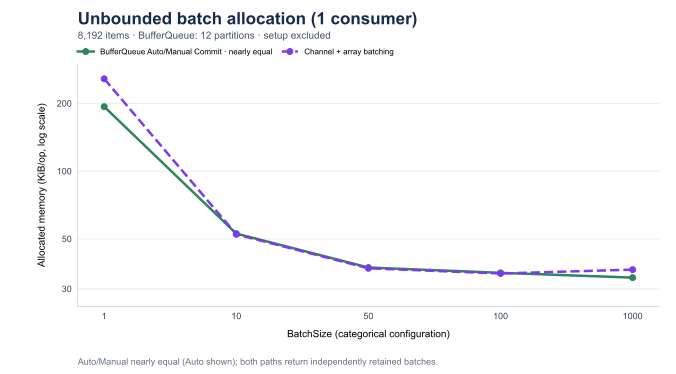

# Channel Batch Aggregation

[简体中文](channel-batch-aggregation.zh-CN.md)

The additional [single-partition report](memory-single-partition.md) measures this same adapter alongside BufferQueue with
1 partition / 1 consumer. The results in this report retain the original 12-partition comparison.

This report records the Channel array-batching comparator whose allocation appears alongside the
[memory queue benchmark](memory-multi-partition.md). The ordinary Channel `ReadAllAsync` rows remain the raw single-item
baseline. This additional workload represents an application that reads those items and materializes independent
arrays before processing them as batches; it does not change the Channel API or replace the existing baseline.

The complete measured rows are stored in
[channel-batch-aggregation-results.csv](channel-batch-aggregation-results.csv), with the run configuration and
source fingerprints in [channel-batch-aggregation-run.json](channel-batch-aggregation-run.json).

## Why This Comparator Exists

`ChannelReader<T>.ReadAllAsync` returns one item per iteration, while BufferQueue `ConsumeAsync` returns an already
materialized batch. Comparing the raw Channel stream with a batch-returning API explains the API-level difference,
but it does not include the cost an application pays when it needs Channel data in batch form. This comparator adds
that missing allocation case without claiming that the two implementations are identical.

The Channel helper reads each item once through `ReadAllAsync`. Each reader lazily allocates a fresh fixed-size
`int[BatchSize]` on the first item of a batch, fills it sequentially, and yields it as `ReadOnlyMemory<int>`. A full
batch exposes the whole array; the final short batch exposes only the populated prefix. Arrays are never pooled,
reused, or trim-copied. The timed consumer adds `ReadOnlyMemory<int>.Length` for every yielded batch and validates the
aggregate total of 8,192 items. It does not add per-item business processing or a second application-side traversal.

This models the ownership requirement of a retained batch: each yielded value remains backed by an independent array.
It is still only an aggregation comparator. Channel readers share one reader topology, while BufferQueue consumers
read assigned partitions, so the number and distribution of final partial batches can differ. `Auto Commit` and
`Manual Commit` do not apply to Channel, which has no acknowledgement or replay contract. The original standalone
Channel baseline remains the primary raw-stream comparison. No `SingleReader` batched measurement is included here.

## Workload

Both sides use the existing prefilled consumption workload: 12 partitions for BufferQueue, 8,192 `int` values, and
either one or twelve consumers. The Channel comparator uses one completed prefilled Channel; its readers share that
Channel. The matrix covers `bounded` capacity 8,192 and `unbounded` mode, with `BatchSize` values `1`, `10`, `50`,
`100`, and `1000`.

The helper returns a full batch or flushes a final partial batch when the completed Channel is drained. It does not
implement BufferQueue's opportunistic partial pulls under sparse live traffic. These results therefore apply to the
prefilled workload, not batch-fill latency or a general-purpose Channel batching policy. The extra elapsed time
belongs to the application-side adapter and must not be attributed to Channel's native read API.

Queue/channel creation and prefill are outside the timed operation. The timed method includes one `Task.Run` per
reader, the async iterators, and the fresh arrays yielded by the comparator. Each reader counts its own yielded
memory lengths, and the aggregate is checked against 8,192 so a missing tail cannot produce a plausible allocation
result.

The benchmark uses Apple M2 Max (12 cores), macOS 27.0.1 / Arm64, .NET 10.0.0, the runtime-provided
`System.Threading.Channels` 10.0.0.0, and BenchmarkDotNet 0.15.8 in Release mode. The run uses one launch, six
warmups, twenty measured iterations, invocation count one, and unroll factor one. These short operations can show
BenchmarkDotNet minimum-iteration-time and high-priority warnings; the raw CSV and run record retain the measured
configuration and uncertainty rather than treating those warnings as a performance conclusion.

## Results

The measured matrix contains the bounded/unbounded, consumer-count, and batch-size combinations above. The CSV retains
all 20 configurations with mean, error, standard deviation, and allocated bytes; the tables below show all 20 rows as mean +/- 99.9% confidence-interval half-width,
standard deviation, and allocation.

### Bounded

| Consumers | BatchSize | Mean (us) | Error (us) | StdDev (us) | Allocated (KiB) |
|---:|---:|---:|---:|---:|---:|
| 1 | 1 | 1,197.836 | 12.061 | 11.846 | 257.15 |
| 1 | 10 | 900.465 | 29.514 | 33.989 | 52.40 |
| 1 | 50 | 793.739 | 18.644 | 20.722 | 37.02 |
| 1 | 100 | 779.517 | 15.272 | 17.588 | 35.10 |
| 1 | 1000 | 810.886 | 23.922 | 27.548 | 36.52 |
| 12 | 1 | 2,525.362 | 152.856 | 169.899 | 263.38 |
| 12 | 10 | 2,777.501 | 162.398 | 187.017 | 58.88 |
| 12 | 50 | 2,807.492 | 240.245 | 276.666 | 44.34 |
| 12 | 100 | 2,699.128 | 131.536 | 146.202 | 43.81 |
| 12 | 1000 | 2,696.101 | 220.518 | 253.949 | 54.53 |

### Unbounded

| Consumers | BatchSize | Mean (us) | Error (us) | StdDev (us) | Allocated (KiB) |
|---:|---:|---:|---:|---:|---:|
| 1 | 1 | 1,227.838 | 27.349 | 30.398 | 257.15 |
| 1 | 10 | 929.907 | 23.680 | 26.321 | 52.40 |
| 1 | 50 | 837.535 | 24.350 | 28.041 | 37.02 |
| 1 | 100 | 812.735 | 18.946 | 21.059 | 35.10 |
| 1 | 1000 | 847.898 | 25.181 | 27.989 | 36.52 |
| 12 | 1 | 3,220.943 | 335.153 | 385.963 | 263.38 |
| 12 | 10 | 3,555.212 | 193.549 | 222.891 | 58.81 |
| 12 | 50 | 3,542.770 | 206.239 | 237.504 | 44.34 |
| 12 | 100 | 3,607.383 | 202.344 | 233.020 | 44.64 |
| 12 | 1000 | 3,654.890 | 204.607 | 235.626 | 50.53 |

For one consumer, the array-aggregating Channel allocation is close to the existing BufferQueue `Auto Commit`
allocation from `BatchSize=10` through `100`; the raw Channel single-item baseline is not that comparison. Values are
per 8,192-item operation:

| BatchSize | Channel array aggregation (KiB) | BufferQueue Auto Commit (KiB) |
|---:|---:|---:|
| 1 | 257.15 | 193.34 |
| 10 | 52.40 | 52.77 |
| 50 | 37.02 | 37.30 |
| 100 | 35.10 | 35.34 |
| 1000 | 36.52 | 33.65 |

This removes most of the apparent allocation gap for the middle batch sizes. It does not make the workloads
identical: the Channel helper creates a fresh `int[BatchSize]` for each nonempty batch, while BufferQueue's snapshot
representation and tail behavior differ. At `BatchSize=1`, the array comparator pays for one array per item; at
`BatchSize=1000`, the final partial-array and reader-topology details affect the result. With twelve consumers, shared
Channel scheduling and different partial-batch distribution affect time and allocation. The reported Error and StdDev
describe elapsed time only; they are not allocation error bars.

README consumption allocation charts compare this adapter with BufferQueue batch snapshots. The
[per-item Channel allocation charts](memory-multi-partition.md#per-item-channel-reference) remain available separately; elapsed-time
charts continue to use the existing raw Channel baseline. The array-comparator times are recorded here for completeness, not as a replacement
for the primary asynchronous time comparison or as a general throughput claim.
Chart legends distinguish `per-item reads` from `array batching`.

The new methods are [`Channel_ReadAllAsync_Batched`](../../tests/BufferQueue.Benchmarks/UnboundedChannelVsMemoryBufferQueueConsumeBenchmark.cs)
and its bounded counterpart in
[`BoundedChannelVsMemoryBufferQueueConsumeBenchmark`](../../tests/BufferQueue.Benchmarks/BoundedChannelVsMemoryBufferQueueConsumeBenchmark.cs).
The shared aggregation helper is [`ChannelBatchConsumption`](../../tests/BufferQueue.Benchmarks/ChannelBatchConsumption.cs).

## Batch Allocation Charts




## Reproduce

```sh
dotnet run -c Release --project tests/BufferQueue.Benchmarks -- --filter '*ChannelVsMemoryBufferQueueConsumeBenchmark.Channel_ReadAllAsync_Batched' --warmupCount 6 --iterationCount 20 --launchCount 1 --exporters json
```

The code uses `Environment.ProcessorCount` for the multi-consumer count and BufferQueue partition count. The recorded
machine has 12 logical processors; rerunning elsewhere may change that topology. The original series in the README
retain their recorded values; all 113 original cases were rerun successfully before this separate 20-case measurement.
