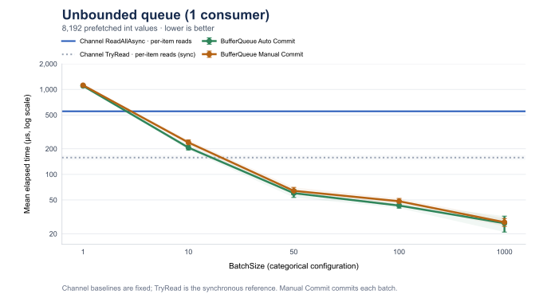
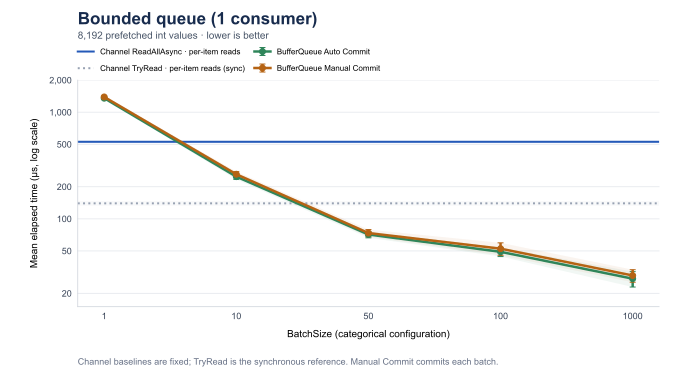
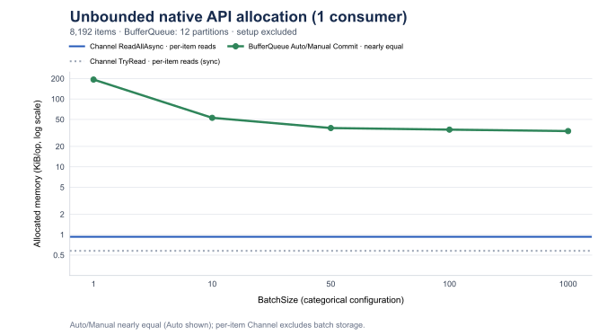
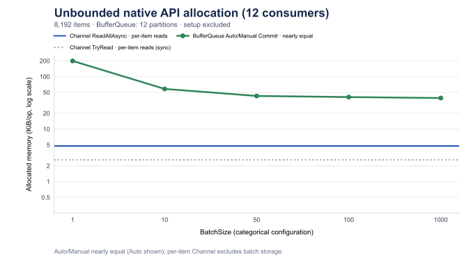
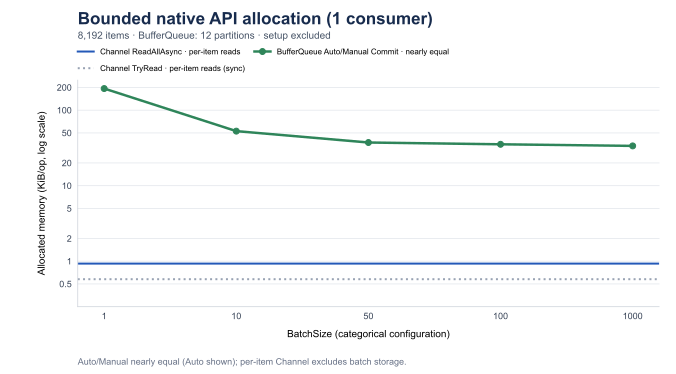

# Multi-Partition Produce and Consume Benchmarks

[简体中文](memory-multi-partition.zh-CN.md)

[Single Partition](memory-single-partition.md) | [Multiple Partitions](memory-multi-partition.md)

## Scope and Data

This report retains the 12-partition measurements used by the root README's production and twelve-consumer charts.
The consumption allocation charts also use the [Channel array-batching measurements](channel-batch-aggregation.md).
The separate [single-partition report](memory-single-partition.md) provides supplementary results. The checked-in summary file is
[memory-multi-partition-results.csv](memory-multi-partition-results.csv). It contains the eight producer rows and the 105 rows from the
three consume benchmark classes. The CSV retains the measured mean, error, standard deviation, allocation, and every
configuration used for the charts; the primary comparison tables below show mean, error, standard deviation, and allocation consistently.

| Configuration | BufferQueue | Channel |
| --- | --- | --- |
| Partition | 12 | None; one shared instance |
| Producer tasks | 12 | 12 |
| Consumers | 1 or 12 (one group) | 1 or 12 |
| Messages / operation | 8,192 int | 8,192 int |

Production and consumption are measured separately. Single- and multi-partition results come from different runs and do not establish a partition-scaling speedup.

## Environment

Unless noted otherwise, the measurements in this report use Apple M2 Max (12 cores), macOS 27.0.1 / Arm64,
.NET 10.0.0, the runtime-provided `System.Threading.Channels` assembly 10.0.0.0 (file version 10.0.25.52411),
and BenchmarkDotNet 0.15.8 in Release mode. The benchmark project has no separate `System.Threading.Channels`
package reference, so these Channel rows use the framework assembly shipped with the tested runtime.

The producer's fixed job uses one launch, six warmups and fifteen measured iterations. The three consumer jobs
use one launch, six warmups and twenty measured iterations; `IterationSetup` requires invocation count and unroll
factor one. The [run record](memory-multi-partition-run.json) retains source fingerprints, exact configuration and result counts.
All 113 rows were refreshed on combined checkout `e63d152b388a99069602a76131b9589bfd8b472c`.

BenchmarkDotNet reported short-iteration and environment-priority warnings. The CSV retains error and standard
deviation; `Error` is the half-width of the reported 99.9% confidence interval. Consumer task scheduling, especially
with twelve readers, adds variance. These measurements do not establish production throughput or backpressure latency.
The historical routing and read-path experiments in Supplementary Comparisons retain their original measurements and configurations.

## Production Benchmarks

### Workload

The producer benchmark writes 8,192 `int` values using 12 concurrent `Task.Run` producer tasks on each side.
BufferQueue uses 12 partitions; Channel uses one shared instance. Queue creation and
task scheduling are inside the timed method. The primary Channel comparison uses asynchronous `WriteAsync`; synchronous
`TryWrite` is retained as a reference. BufferQueue uses asynchronous `ProduceAsync` for both item and
`ReadOnlyMemory<int>` batch calls. Bounded capacity is sufficient for the complete workload, so this measurement does
not include producer backpressure waiting.

Source:[ChannelVsMemoryBufferQueueProduceBenchmark.cs](../../tests/BufferQueue.Benchmarks/ChannelVsMemoryBufferQueueProduceBenchmark.cs).

Producer allocation includes queue/channel creation and producer task scheduling inside the timed operation. It uses
12 tasks and 8,192 items; `Channel WriteAsync` is the async baseline, `Channel TryWrite` is a synchronous reference,
and the two BufferQueue bars are the item and batch producer APIs. These are not peak resident-memory or per-item
allocation measurements.

### Measurements

`Mean`, `Error`, and `StdDev` are in µs, rounded to three decimals; `Error` is the 99.9% confidence-interval half-width.
Allocation is `Allocated_B / 1024` in KiB, rounded to two decimals: cumulative managed allocation per 8,192-item operation, not peak resident memory. The CSV retains its original precision.

| Mode | Method | Mean (µs) | Error (µs) | StdDev (µs) | Allocated (KiB) |
| --- | --- | ---: | ---: | ---: | ---: |
| unbounded | `Channel_TryWrite_Concurrent` | 287.757 | 2.142 | 1.899 | 134.53 |
| unbounded | `Channel_WriteAsync_Concurrent` | 337.960 | 6.016 | 5.024 | 135.47 |
| unbounded | `MemoryBufferQueue_Produce_Concurrent` | 331.357 | 3.343 | 3.127 | 54.96 |
| unbounded | `MemoryBufferQueue_Produce_ReadOnlyMemoryBatch_Concurrent` | 37.201 | 0.715 | 0.634 | 54.90 |
| bounded | `Channel_TryWrite_Concurrent` | 302.205 | 0.827 | 0.773 | 67.33 |
| bounded | `Channel_WriteAsync_Concurrent` | 391.972 | 2.162 | 1.917 | 68.27 |
| bounded | `MemoryBufferQueue_Produce_Concurrent` | 343.133 | 5.064 | 4.737 | 55.13 |
| bounded | `MemoryBufferQueue_Produce_ReadOnlyMemoryBatch_Concurrent` | 37.588 | 0.636 | 0.595 | 55.08 |

### Time Charts


### Allocation Charts


## Consumption Benchmarks

### Workload

The README's main consumption charts use this report's twelve-consumer results. This report also retains results
with twelve partitions and one consumer; consumer count must not be used to infer partition count.
Time and allocation charts appear below. The
[single-partition report](memory-single-partition.md) provides a separate one-partition, one-consumer reference.

This section measures prefilled queue draining through asynchronous BufferQueue consumption and Channel references.
The tables include Auto Commit, Manual Commit, and native Channel references.

Native Channel `TryRead` and `ReadAllAsync` do not use `BatchSize`; one representative is shown per mode and consumer count.
BufferQueue and Channel array batching use five settings: `1, 10, 50, 100, 1000`.

Each run drains 8,192 prefetched `int` values. The BufferQueue topic uses 12 partitions and either 1 or 12
consumers. The benchmark completes the Channel writer after prefill so `ReadAllAsync` has a finite workload. Every
consumer runs in its own `Task.Run`. All Channel readers share one channel; BufferQueue consumers read their assigned
partitions. Channel readers count locally and the result is aggregated after all readers finish.
BufferQueue counts each assigned consumer's batches and validates both its assigned count and the aggregate total.
There is no business work per item. The measured time includes the task scheduling used to run the readers.

The main CSV's producer, Auto Commit, Manual Commit, and native Channel rows were rerun on checkout `e63d152`, which combines the
singleton-enumerator and partial-array optimizations. The [run record](memory-multi-partition-run.json) identifies the exact
source and job configuration. Manual Commit calls `CommitAsync` after every batch. BufferQueue uses each batch's
`Count()` rather than enumerating its items; neither business processing nor application-side item enumeration is
included. The [foreach measurements](batch-enumeration.md) and [sparse-batch measurements](partial-batch-allocation.md)
measure those separate workloads.

For one consumer at `BatchSize = 10`, the asynchronous unbounded BufferQueue row is 206.557 µs versus the fixed
Channel `ReadAllAsync` reference at 552.609 µs; the bounded values are 248.727 µs versus 528.048 µs. This is one
measured configuration, not a claim that BufferQueue is faster at every batch size or consumer count. Comparing it
with `TryRead` would compare an asynchronous BufferQueue path with the synchronous reference.

Chart reading: the horizontal axis uses equally spaced BatchSize configurations; spacing does not represent numeric
distance. The time axis is logarithmic. Points and lines are means, while error bars or bands use BenchmarkDotNet's
reported `Error`. Channel baselines are fixed at representative `BatchSize = 1` and do not depend on BufferQueue's
`BatchSize`.

The consumer charts show both async BufferQueue modes, with `ReadAllAsync` as the primary Channel comparison and
`TryRead` as a gray synchronous reference. Manual Commit uses the same `ConsumeAsync` workload with
`AutoCommit = false` and calls `CommitAsync` after each batch; Channel has no built-in acknowledgement, checkpoint, or
replay equivalent.

`ChannelReader<T>.ReadAllAsync` is the primary asynchronous comparison because both methods expose streams consumed
with `await foreach`:

```csharp
// ChannelReader<T>
IAsyncEnumerable<T> ReadAllAsync(CancellationToken cancellationToken = default);
// IBufferPullConsumer<T>
IAsyncEnumerable<IReadOnlyList<T>> ConsumeAsync(CancellationToken cancellationToken = default);
```

Channel yields one item per iteration; BufferQueue yields one batch. The current batch is an already materialized
`IReadOnlyList<T>` with `Count` and indexed access; it still supports `foreach` and LINQ. `ReadAllAsync` continues until the channel
completes and is drained; it does not collect all items into one batch. `ChannelReader<T>.ReadAsync` is a separate single-item `ValueTask<T>` comparison,
and `TryRead` is a synchronous reference rather than the primary asynchronous baseline.

The 113 rows retained in the main CSV were measured before the public batch signature changed from `IEnumerable<T>`
to `IReadOnlyList<T>`. The original cases were rerun to validate that change, while their recorded values were retained.
The 20 Channel array-batching rows below come from a separate run after the signature change; see the
[array-batching run record](channel-batch-aggregation-run.json).

Both bounded queues have capacity 8,192 and are prefilled; capacity waiting is not measured.

### Measurements

`Mean`, `Error`, and `StdDev` are in µs, rounded to three decimals; `Error` is the 99.9% confidence-interval half-width.
Allocation is `Allocated_B / 1024` in KiB, rounded to two decimals: cumulative managed allocation per 8,192-item operation, not peak resident memory. The CSV retains its original precision.

`Channel_ReadAllAsync_Batched` rows come from the separate [Channel array-batching measurements](channel-batch-aggregation.md);
all other rows come from this report's main CSV. Each run retains its own provenance record. Native Channel methods show only representative `BatchSize=1` rows.

#### unbounded / 1 Consumer

| BatchSize | Method | Mean (µs) | Error (µs) | StdDev (µs) | Allocated (KiB) |
| ---: | --- | ---: | ---: | ---: | ---: |
| 1 | `Channel_ReadAllAsync_Batched` | 1227.838 | 27.349 | 30.398 | 257.15 |
| 1 | `BufferQueue_ConsumeAsync_AutoCommit` | 1099.643 | 20.685 | 22.133 | 193.34 |
| 1 | `BufferQueue_ConsumeAsync_ManualCommit` | 1120.218 | 22.587 | 26.011 | 193.34 |
| 10 | `Channel_ReadAllAsync_Batched` | 929.907 | 23.680 | 26.321 | 52.40 |
| 10 | `BufferQueue_ConsumeAsync_AutoCommit` | 206.557 | 12.821 | 14.250 | 52.77 |
| 10 | `BufferQueue_ConsumeAsync_ManualCommit` | 237.301 | 16.931 | 19.498 | 52.77 |
| 50 | `Channel_ReadAllAsync_Batched` | 837.535 | 24.350 | 28.041 | 37.02 |
| 50 | `BufferQueue_ConsumeAsync_AutoCommit` | 60.115 | 6.639 | 7.104 | 37.30 |
| 50 | `BufferQueue_ConsumeAsync_ManualCommit` | 63.995 | 6.303 | 7.259 | 37.30 |
| 100 | `Channel_ReadAllAsync_Batched` | 812.735 | 18.946 | 21.059 | 35.10 |
| 100 | `BufferQueue_ConsumeAsync_AutoCommit` | 42.929 | 2.912 | 2.991 | 35.34 |
| 100 | `BufferQueue_ConsumeAsync_ManualCommit` | 48.254 | 3.807 | 4.232 | 35.34 |
| 1000 | `Channel_ReadAllAsync_Batched` | 847.898 | 25.181 | 27.989 | 36.52 |
| 1000 | `BufferQueue_ConsumeAsync_AutoCommit` | 26.591 | 5.656 | 6.514 | 33.65 |
| 1000 | `BufferQueue_ConsumeAsync_ManualCommit` | 27.331 | 2.957 | 3.406 | 33.65 |

Native Channel representatives (`BatchSize=1` rows; this parameter does not affect either method):

| Method | Mean (µs) | Error (µs) | StdDev (µs) | Allocated (KiB) |
| --- | ---: | ---: | ---: | ---: |
| `Channel_TryRead` | 157.512 | 9.936 | 11.442 | 0.58 |
| `Channel_ReadAllAsync` | 552.609 | 11.754 | 13.064 | 0.93 |

#### unbounded / 12 Consumers

| BatchSize | Method | Mean (µs) | Error (µs) | StdDev (µs) | Allocated (KiB) |
| ---: | --- | ---: | ---: | ---: | ---: |
| 1 | `Channel_ReadAllAsync_Batched` | 3220.943 | 335.153 | 385.963 | 263.38 |
| 1 | `BufferQueue_ConsumeAsync_AutoCommit` | 1875.452 | 127.558 | 146.897 | 198.78 |
| 1 | `BufferQueue_ConsumeAsync_ManualCommit` | 2120.025 | 134.066 | 154.391 | 198.78 |
| 10 | `Channel_ReadAllAsync_Batched` | 3555.212 | 193.549 | 222.892 | 58.81 |
| 10 | `BufferQueue_ConsumeAsync_AutoCommit` | 271.154 | 33.109 | 38.129 | 58.22 |
| 10 | `BufferQueue_ConsumeAsync_ManualCommit` | 284.029 | 32.821 | 37.797 | 58.22 |
| 50 | `Channel_ReadAllAsync_Batched` | 3542.770 | 206.238 | 237.504 | 44.34 |
| 50 | `BufferQueue_ConsumeAsync_AutoCommit` | 61.096 | 5.389 | 5.990 | 42.75 |
| 50 | `BufferQueue_ConsumeAsync_ManualCommit` | 66.911 | 9.503 | 10.562 | 42.75 |
| 100 | `Channel_ReadAllAsync_Batched` | 3607.383 | 202.344 | 233.020 | 44.64 |
| 100 | `BufferQueue_ConsumeAsync_AutoCommit` | 50.456 | 8.731 | 10.054 | 40.72 |
| 100 | `BufferQueue_ConsumeAsync_ManualCommit` | 51.163 | 7.182 | 7.982 | 40.72 |
| 1000 | `Channel_ReadAllAsync_Batched` | 3654.890 | 204.607 | 235.626 | 50.53 |
| 1000 | `BufferQueue_ConsumeAsync_AutoCommit` | 34.381 | 5.178 | 5.963 | 39.03 |
| 1000 | `BufferQueue_ConsumeAsync_ManualCommit` | 35.608 | 4.696 | 4.822 | 39.09 |

Native Channel representatives (`BatchSize=1` rows; this parameter does not affect either method):

| Method | Mean (µs) | Error (µs) | StdDev (µs) | Allocated (KiB) |
| --- | ---: | ---: | ---: | ---: |
| `Channel_TryRead` | 3656.109 | 178.713 | 198.639 | 2.59 |
| `Channel_ReadAllAsync` | 3411.669 | 352.095 | 405.473 | 4.77 |

#### bounded / 1 Consumer

| BatchSize | Method | Mean (µs) | Error (µs) | StdDev (µs) | Allocated (KiB) |
| ---: | --- | ---: | ---: | ---: | ---: |
| 1 | `Channel_ReadAllAsync_Batched` | 1197.835 | 12.061 | 11.846 | 257.15 |
| 1 | `BufferQueue_ConsumeAsync_AutoCommit` | 1353.710 | 26.258 | 28.096 | 193.34 |
| 1 | `BufferQueue_ConsumeAsync_ManualCommit` | 1390.612 | 29.802 | 31.887 | 193.34 |
| 10 | `Channel_ReadAllAsync_Batched` | 900.465 | 29.514 | 33.989 | 52.40 |
| 10 | `BufferQueue_ConsumeAsync_AutoCommit` | 248.727 | 14.206 | 16.360 | 52.77 |
| 10 | `BufferQueue_ConsumeAsync_ManualCommit` | 261.925 | 15.151 | 17.448 | 52.77 |
| 50 | `Channel_ReadAllAsync_Batched` | 793.739 | 18.644 | 20.722 | 37.02 |
| 50 | `BufferQueue_ConsumeAsync_AutoCommit` | 71.242 | 4.861 | 5.403 | 37.30 |
| 50 | `BufferQueue_ConsumeAsync_ManualCommit` | 73.574 | 5.701 | 6.337 | 37.30 |
| 100 | `Channel_ReadAllAsync_Batched` | 779.517 | 15.272 | 17.588 | 35.10 |
| 100 | `BufferQueue_ConsumeAsync_AutoCommit` | 49.041 | 4.777 | 5.309 | 35.34 |
| 100 | `BufferQueue_ConsumeAsync_ManualCommit` | 52.502 | 7.014 | 8.078 | 35.34 |
| 1000 | `Channel_ReadAllAsync_Batched` | 810.886 | 23.922 | 27.548 | 36.52 |
| 1000 | `BufferQueue_ConsumeAsync_AutoCommit` | 27.448 | 4.515 | 5.199 | 33.65 |
| 1000 | `BufferQueue_ConsumeAsync_ManualCommit` | 29.387 | 3.965 | 4.072 | 33.65 |

Native Channel representatives (`BatchSize=1` rows; this parameter does not affect either method):

| Method | Mean (µs) | Error (µs) | StdDev (µs) | Allocated (KiB) |
| --- | ---: | ---: | ---: | ---: |
| `Channel_TryRead` | 139.754 | 7.058 | 8.128 | 0.58 |
| `Channel_ReadAllAsync` | 528.048 | 17.013 | 18.910 | 0.93 |

#### bounded / 12 Consumers

| BatchSize | Method | Mean (µs) | Error (µs) | StdDev (µs) | Allocated (KiB) |
| ---: | --- | ---: | ---: | ---: | ---: |
| 1 | `Channel_ReadAllAsync_Batched` | 2525.362 | 152.856 | 169.899 | 263.38 |
| 1 | `BufferQueue_ConsumeAsync_AutoCommit` | 1847.269 | 157.508 | 181.387 | 198.78 |
| 1 | `BufferQueue_ConsumeAsync_ManualCommit` | 2284.660 | 128.442 | 147.914 | 198.78 |
| 10 | `Channel_ReadAllAsync_Batched` | 2777.501 | 162.398 | 187.017 | 58.88 |
| 10 | `BufferQueue_ConsumeAsync_AutoCommit` | 325.134 | 32.184 | 37.063 | 58.22 |
| 10 | `BufferQueue_ConsumeAsync_ManualCommit` | 322.325 | 27.473 | 31.637 | 58.22 |
| 50 | `Channel_ReadAllAsync_Batched` | 2807.492 | 240.244 | 276.666 | 44.34 |
| 50 | `BufferQueue_ConsumeAsync_AutoCommit` | 77.631 | 4.574 | 5.268 | 42.75 |
| 50 | `BufferQueue_ConsumeAsync_ManualCommit` | 77.823 | 2.274 | 2.234 | 42.75 |
| 100 | `Channel_ReadAllAsync_Batched` | 2699.128 | 131.536 | 146.202 | 43.81 |
| 100 | `BufferQueue_ConsumeAsync_AutoCommit` | 46.269 | 4.805 | 5.533 | 40.72 |
| 100 | `BufferQueue_ConsumeAsync_ManualCommit` | 50.216 | 5.591 | 5.742 | 40.78 |
| 1000 | `Channel_ReadAllAsync_Batched` | 2696.101 | 220.518 | 253.949 | 54.53 |
| 1000 | `BufferQueue_ConsumeAsync_AutoCommit` | 37.191 | 6.692 | 7.707 | 39.03 |
| 1000 | `BufferQueue_ConsumeAsync_ManualCommit` | 38.730 | 6.940 | 7.714 | 39.09 |

Native Channel representatives (`BatchSize=1` rows; this parameter does not affect either method):

| Method | Mean (µs) | Error (µs) | StdDev (µs) | Allocated (KiB) |
| --- | ---: | ---: | ---: | ---: |
| `Channel_TryRead` | 1033.320 | 111.448 | 128.344 | 2.59 |
| `Channel_ReadAllAsync` | 2669.361 | 183.512 | 203.973 | 4.84 |

### Time Charts

Time charts use this report's native Channel references and BufferQueue measurements.







### Allocation Charts

Consumer charts normalize BenchmarkDotNet's allocation display to `KiB/op` (`1 KiB = 1,024 B`). Consumption runs drain
8,192 prefetched items from 12 partitions with 1 or 12 consumers; `BatchSize` values are categorical, and the y-axis
is logarithmic. Queue and consumer setup is excluded from the measured allocation. The values are managed memory per
8,192-item benchmark operation, not peak resident memory or per-item allocation. BatchSize controls both BufferQueue
and Channel array batching. Auto/Manual allocations are nearly equal, so one combined curve shows the Auto Commit measurements.

BufferQueue allocates independent batch snapshots that survive later pulls, commits, segment recycling, and asynchronous
application processing. Elements are copied by value for value types and by reference for reference types, without deep
cloning. The original Channel references read individual items without creating batch containers.

The added `Channel_ReadAllAsync_Batched` curve also returns independently retained batches: `ReadAllAsync` fills a new
`int[BatchSize]`, and the batch iterator yields a `ReadOnlyMemory<int>` view of the filled prefix. Arrays are never pooled
or reused; a partial final batch does not allocate another trimmed copy. This comparison includes the cost of creating
batch storage on both sides, while preserving their different shared-queue/partition behavior. Auto / Manual Commit
allocation remains similar; Channel has no commit equivalent.

The original series retain their recorded values after a successful 113-case rerun; the new 20 array-batching cases are
recorded separately in [Channel array-batching measurements](channel-batch-aggregation.md). That report includes all elapsed
times, allocations, raw data, and the partial-batch and concurrency differences. The README's consumption allocation
charts compare independently retained batches; its elapsed-time charts retain the native per-item Channel baseline.


## Supplementary Comparisons

### Single-reader Channel comparison

This class keeps one consumer and compares the default Channel implementation with Channel's `SingleReader` option.
The BufferQueue row still uses 12 partitions and one consumer.

Channel reference (fixed `BatchSize = 1` representative):

| Default TryRead (µs) | Default ReadAllAsync (µs) | SingleReader TryRead (µs) | SingleReader ReadAllAsync (µs) |
|---:|---:|---:|---:|
| 156.689 | 546.949 | 87.412 | 416.228 |

BufferQueue `ConsumeAsync` with `AutoCommit = true`:

| BatchSize | Mean (µs) | Allocated (KiB) |
|---:|---:|---:|
| 1 | 1,078.955 | 192.64 |
| 10 | 205.803 | 52.08 |
| 50 | 56.551 | 36.61 |
| 100 | 42.820 | 34.64 |
| 1000 | 22.325 | 32.95 |

The Channel methods do not consume `BatchSize`-sized batches; the parameter changes only the BufferQueue method.
`SingleReader = true` is a caller promise that at most one reader consumes the Channel; it is not the 12-consumer
configuration.

### Per-item Channel Reference

These original charts compare BufferQueue batch snapshots with Channel per-item reads. They remain useful for assessing
native item handoff, but Channel creates no batch container here, so they have limited relevance to the allocation cost
of returning retained batches. For that workload, use the [array-batching comparison](channel-batch-aggregation.md).
The Channel references below use the rows recorded alongside `BatchSize = 1` and stay horizontal; BatchSize affects
only BufferQueue in these charts.








### Partition-Key Routing Benchmark

This retained routing measurement predates the current consumer comparison; it was not rerun with the current
consume benchmark workload. The following [`MemoryBufferPartitionerBenchmark`](../../tests/BufferQueue.Benchmarks/MemoryBufferPartitionerBenchmark.cs)
measures the complete Memory-mode producer path with `8` partitions and `8,192` messages repeated `832` times,
`6` warmup iterations, and `15` measured iterations. Results are per produced item on macOS 27.0.1,
ARM64, and .NET 10.0.0; no path allocated managed memory. String keys contain `7` UTF-16 code units;
complete-key hashing takes more time as keys get longer.

| Routing | Mean | Relative to round robin |
| --- | ---: | ---: |
| Round robin | `13.40 ns` | `1.00x` |
| `int` key | `12.03 ns` | `0.90x` |
| `string` key (XXH3-64, complete UTF-16 key) | `12.94 ns` | `0.97x` |
| Custom message, numeric `CustomerId` key | `11.19 ns` | `0.83x` |

Run this producer benchmark with:

```bash
dotnet run -c Release --project tests/BufferQueue.Benchmarks/BufferQueue.Benchmarks.csproj -- --filter '*MemoryBufferPartitionerBenchmark*'
```

The separate [`StringPartitionRoutingBenchmark`](../../tests/BufferQueue.Benchmarks/StringPartitionRoutingBenchmark.cs)
measures only string routing for prebuilt keys of `4`, `9`, `64`, `120`, `121`, `256`, and `1024` UTF-16 code units across `8` partitions.
The `120`/`121` cases straddle XXH3's long-input threshold of `240` bytes.
It uses one launch, `6` warmup iterations, and `10` measured iterations with a target iteration time of `100 ms`.
Its results are per routing call and exclude queue writes; the table above comes from the producer benchmark.
Run the key-length benchmark with:

```bash
dotnet run -c Release --project tests/BufferQueue.Benchmarks/BufferQueue.Benchmarks.csproj -- --filter '*StringPartitionRoutingBenchmark*'
```

### Read-path Optimization Measurements

These earlier focused comparisons are retained separately from the refreshed README data; they were not rerun here.
Both use the same historical baseline that already
included the Frozen reader lookup experiment, minimum-reader scan changes, the published segment-range check, and the
producer lock-handoff fix. The second comparison does not include the first comparison's code change.

#### A: single-item reader path

The `single-read-before` and `single-read-after` reports compare the exact configured `BatchSize = 1` reader
specialization. The table is restricted to `PartitionNumber = 1 or 12`, `GroupCount = 1 or 2`, and both `bounded`
values. Allocation is unchanged in every row. One consumer drains the queue; when `GroupCount = 2`, the second group stays
idle to exercise retention and lookup. This is not a two-active-consumer throughput measurement.

| Method | Partitions | bounded | Groups | Before (us) | After (us) | Change | Allocated |
|---|---:|---|---:|---:|---:|---:|---:|
| AutoCommit | 1 | false | 1 | 1,150.40 | 1,038.29 | -9.7% | 192.2 KB |
| ManualCommit | 1 | false | 1 | 1,211.73 | 1,125.88 | -7.1% | 192.2 KB |
| AutoCommit | 1 | false | 2 | 1,164.23 | 1,080.87 | -7.2% | 192.2 KB |
| ManualCommit | 1 | false | 2 | 1,150.82 | 1,093.86 | -4.9% | 192.2 KB |
| AutoCommit | 1 | true | 1 | 1,386.09 | 1,314.30 | -5.2% | 192.2 KB |
| ManualCommit | 1 | true | 1 | 1,416.45 | 1,362.05 | -3.8% | 192.2 KB |
| AutoCommit | 1 | true | 2 | 1,386.86 | 1,338.85 | -3.5% | 192.2 KB |
| ManualCommit | 1 | true | 2 | 1,395.87 | 1,318.03 | -5.6% | 192.2 KB |
| AutoCommit | 12 | false | 1 | 1,141.83 | 1,056.00 | -7.5% | 192.2 KB |
| ManualCommit | 12 | false | 1 | 1,161.65 | 1,075.52 | -7.4% | 192.2 KB |
| AutoCommit | 12 | false | 2 | 1,143.07 | 1,085.14 | -5.1% | 192.2 KB |
| ManualCommit | 12 | false | 2 | 1,176.54 | 1,117.84 | -5.0% | 192.2 KB |
| AutoCommit | 12 | true | 1 | 1,399.46 | 1,324.05 | -5.4% | 192.2 KB |
| ManualCommit | 12 | true | 1 | 1,461.01 | 1,351.73 | -7.5% | 192.2 KB |
| AutoCommit | 12 | true | 2 | 1,363.69 | 1,352.77 | -0.8% | 192.2 KB |
| ManualCommit | 12 | true | 2 | 1,389.13 | 1,372.10 | -1.2% | 192.2 KB |

The before/after rows are retained in [read-path-optimizations.csv](read-path-optimizations.csv).

#### B: sparse batches with one item available per pull

`MemorySparseBatchBenchmark` produces and consumes sequentially, one item at a time, and verifies that every pull
contains exactly one item. `BatchSize` is 10, 100, or 1000, but the available count is intentionally one. This
isolates the lazy allocation path from concurrent throughput. The after version allocates the batch array only after a
second item is found.

| Method | BatchSize | bounded | Before (ms) | After (ms) | Change | Before allocated | After allocated |
|---|---:|---|---:|---:|---:|---:|---:|
| AutoCommit | 10 | false | 2.104 | 1.998 | -5.0% | 772.6 KB | 196.6 KB |
| ManualCommit | 10 | false | 1.583 | 1.518 | -4.1% | 772.6 KB | 196.6 KB |
| AutoCommit | 10 | true | 2.846 | 2.702 | -5.1% | 772.6 KB | 196.6 KB |
| ManualCommit | 10 | true | 2.385 | 2.275 | -4.6% | 772.6 KB | 196.6 KB |
| AutoCommit | 100 | false | 2.162 | 1.997 | -7.6% | 3,652.6 KB | 196.6 KB |
| ManualCommit | 100 | false | 1.669 | 1.927 | +15.5% | 3,652.6 KB | 196.6 KB |
| AutoCommit | 100 | true | 2.888 | 2.805 | -2.9% | 3,652.6 KB | 196.6 KB |
| ManualCommit | 100 | true | 2.443 | 2.310 | -5.4% | 3,652.6 KB | 196.6 KB |
| AutoCommit | 1000 | false | 3.055 | 2.035 | -33.4% | 32,452.6 KB | 196.6 KB |
| ManualCommit | 1000 | false | 2.689 | 1.526 | -43.3% | 32,452.6 KB | 196.6 KB |
| AutoCommit | 1000 | true | 3.786 | 2.727 | -28.0% | 32,452.6 KB | 196.6 KB |
| ManualCommit | 1000 | true | 3.594 | 2.244 | -37.6% | 32,452.6 KB | 196.6 KB |

The `1000` allocation reduction is `32,452.6 KB` to `196.6 KB`. These are binary KB values reported by
BenchmarkDotNet, where 1 KB is 1,024 bytes. The full-batch case was not a clear large gain; the strong result here is
specifically the sparse one-item-per-pull case.

The before/after rows are retained in [read-path-optimizations.csv](read-path-optimizations.csv).

The combined check is retained in [read-path-optimizations.csv](read-path-optimizations.csv). It keeps A and B
independent while checking their combined read-path behavior.

## Reproduction

Benchmark sources:

- [Producer](../../tests/BufferQueue.Benchmarks/ChannelVsMemoryBufferQueueProduceBenchmark.cs)
- [Unbounded consume](../../tests/BufferQueue.Benchmarks/UnboundedChannelVsMemoryBufferQueueConsumeBenchmark.cs)
- [Bounded consume](../../tests/BufferQueue.Benchmarks/BoundedChannelVsMemoryBufferQueueConsumeBenchmark.cs)
- [Single-reader consume](../../tests/BufferQueue.Benchmarks/SingleReaderChannelVsMemoryBufferQueueConsumeBenchmark.cs)

Run the producer and consumer classes separately and sequentially:

```sh
dotnet run --project tests/BufferQueue.Benchmarks -c Release -- --filter 'BufferQueue.Benchmarks.ChannelVsMemoryBufferQueueProduceBenchmark.*' --exporters json
dotnet run --project tests/BufferQueue.Benchmarks -c Release -- --filter 'BufferQueue.Benchmarks.UnboundedChannelVsMemoryBufferQueueConsumeBenchmark.*' --warmupCount 6 --iterationCount 20 --launchCount 1 --exporters json
dotnet run --project tests/BufferQueue.Benchmarks -c Release -- --filter 'BufferQueue.Benchmarks.BoundedChannelVsMemoryBufferQueueConsumeBenchmark.*' --warmupCount 6 --iterationCount 20 --launchCount 1 --exporters json
dotnet run --project tests/BufferQueue.Benchmarks -c Release -- --filter 'BufferQueue.Benchmarks.SingleReaderChannelVsMemoryBufferQueueConsumeBenchmark.*' --warmupCount 6 --iterationCount 20 --launchCount 1 --exporters json
```
