# 多 Partition 生产和消费基准测试

[English](memory-multi-partition.md)

[单 Partition](memory-single-partition.zh-CN.md) | [多 Partition](memory-multi-partition.zh-CN.md)

## 测试范围与数据

这份报告保留了根 README 写入主图和 12 Consumer 消费主图所用的 12 Partition 测量。
消费内存分配图还使用[Channel 数组聚合测量](channel-batch-aggregation.zh-CN.md)的数据。
独立的[单 Partition 报告](memory-single-partition.zh-CN.md)提供补充结果。汇总文件是
[memory-multi-partition-results.csv](memory-multi-partition-results.csv)，包含 8 行 producer 结果和 3 个消费 benchmark 类的 105
行结果。CSV 保留 mean、error、standard deviation、allocation 以及每个配置；下方主要对比表格统一展示 mean、error、standard deviation 和 allocation。

| 配置 | BufferQueue | Channel |
| --- | --- | --- |
| Partition | 12 | 无；一个共享实例 |
| Producer tasks | 12 | 12 |
| Consumers | 1 或 12（同一组） | 1 或 12 |
| Messages / operation | 8,192 int | 8,192 int |

写入和消费分别测量；单 Partition 与多 Partition 来自不同运行，不能据此计算分区扩展的加速比。

## 测试环境

除特别说明外，本报告使用 Apple M2 Max（12 核）、macOS 27.0.1 / Arm64、.NET 10.0.0、runtime 自带的
`System.Threading.Channels` 程序集 10.0.0.0（文件版本 10.0.25.52411）和 BenchmarkDotNet 0.15.8 Release 配置。
benchmark 项目没有单独引用 `System.Threading.Channels` 包，因此这些 Channel 数据使用测试 runtime 自带的程序集。

Producer 的 fixed job 使用一次 launch、六次 warmup 和十五次测量。三个消费 job 使用一次 launch、六次 warmup、
二十次测量；`IterationSetup` 要求 invocation count 和 unroll factor 均为一。
[运行记录](memory-multi-partition-run.json)保留源码哈希、确切配置和结果数量。
全部 113 行均在合并后的 checkout `e63d152b388a99069602a76131b9589bfd8b472c` 上刷新。

BenchmarkDotNet 报告了 short-iteration 和 environment-priority warnings。CSV 保留 error 和标准差；`Error` 是
报告的 99.9% 置信区间半宽。consumer 任务调度会增加波动，十二个 reader 时尤其明显。这些测量不能证明生产吞吐或
背压等待延迟。补充对比中的历史路由、read-path 实验保留原测量和配置。

## 写入性能

### 测试配置

Producer benchmark 两边各使用 12 个并发 `Task.Run` producer task 写入 8,192 个 `int`。
BufferQueue 使用 12 个 Partition，Channel 使用一个共享实例。Queue 创建和 task scheduling
都在计时方法内。Channel 的主比较使用异步 `WriteAsync`，同步 `TryWrite` 作为参考；BufferQueue 的 item 和
`ReadOnlyMemory<int>` batch 都使用异步 `ProduceAsync`。bounded capacity 足够容纳完整 workload，因此这里不测
producer 等待背压的路径。

源码：[ChannelVsMemoryBufferQueueProduceBenchmark.cs](../../tests/BufferQueue.Benchmarks/ChannelVsMemoryBufferQueueProduceBenchmark.cs)。

Producer allocation 的计时包含 queue/channel creation 和 producer task scheduling。测试使用 12 个 task 写入 8,192 条消息；
`Channel WriteAsync` 是 async baseline，`Channel TryWrite` 是同步参考，BufferQueue 的两个 bar 分别表示逐条和 batch producer API。
这些数值不是峰值驻留内存，也不是单条消息 allocation。

### 测量结果

`Mean`、`Error` 和 `StdDev` 的单位是 µs，保留三位小数；`Error` 为 99.9% 置信区间半宽。
内存分配按 `Allocated_B / 1024` 换算为 KiB，保留两位小数，表示每次 8,192 条消息操作的累计托管分配，不是峰值驻留内存。CSV 保留原始精度。

| Mode | Method | Mean (µs) | Error (µs) | StdDev (µs) | Allocated (KiB) |
| --- | --- | ---: | ---: | ---: | ---: |
| unbounded | `Channel_TryWrite_Concurrent` | 287.757 | 2.142 | 1.899 | 134.53 |
| unbounded | `Channel_WriteAsync_Concurrent` | 337.960 | 6.016 | 5.024 | 135.47 |
| unbounded | `MemoryBufferQueue_Produce_Concurrent` | 331.357 | 3.343 | 3.127 | 54.96 |
| unbounded | `MemoryBufferQueue_Produce_ReadOnlyMemoryBatch_Concurrent` | 37.201 | 0.715 | 0.634 | 54.90 |
| bounded | `Channel_TryWrite_Concurrent` | 302.205 | 0.827 | 0.773 | 67.33 |
| bounded | `Channel_WriteAsync_Concurrent` | 391.972 | 2.162 | 1.917 | 68.27 |
| bounded | `MemoryBufferQueue_Produce_Concurrent` | 343.133 | 5.064 | 4.737 | 55.13 |
| bounded | `MemoryBufferQueue_Produce_ReadOnlyMemoryBatch_Concurrent` | 37.588 | 0.636 | 0.595 | 55.08 |

### 耗时图

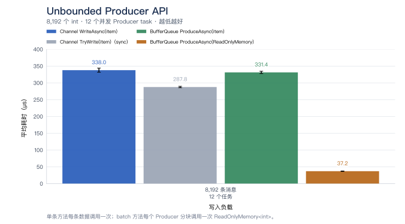

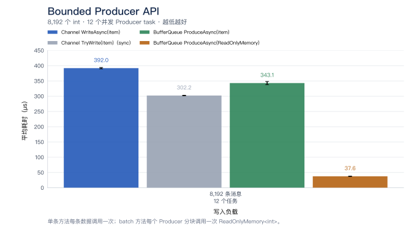

### 内存分配图

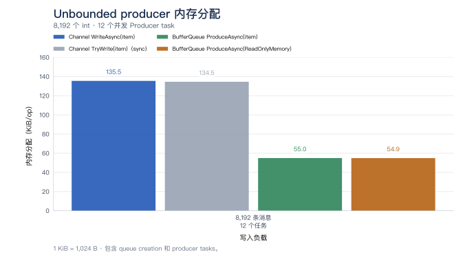

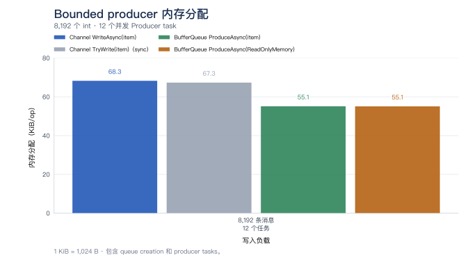

## 消费性能

### 测试配置

README 的消费主图使用本文的 12 Consumer 结果。本文也保留了 12 Partition、1 Consumer 的结果，
不能根据 Consumer 数量推断 Partition 数量。下方分别展示耗时图和内存分配图；
[单 Partition 报告](memory-single-partition.zh-CN.md)则提供独立的 1 Partition / 1 Consumer 参考。

本节测量预填充队列的消费路径，包含异步 BufferQueue 消费和 Channel 参考。表格同时展示
Auto Commit、Manual Commit，以及原生 Channel 参考。

原生 Channel `TryRead` 和 `ReadAllAsync` 不使用 `BatchSize`；每种模式和 Consumer 数量只展示一个代表值。
BufferQueue 和 Channel 数组聚合使用 `1、10、50、100、1000` 五个配置。

每次运行消费预填充的 8,192 个 `int`。BufferQueue 使用 12 个 partition，consumer 数量为 1 或 12。预填充后
complete Channel writer，确保 `ReadAllAsync` 有明确结束点。每个 consumer 在独立的 `Task.Run` 中运行。Channel reader 共享同一个 Channel，BufferQueue consumer
读取各自分配的 partition。Channel
reader 本地计数，所有 reader 完成后再汇总。BufferQueue 按分配给每个 consumer 的 batch 计数，并校验每个分配计数
和总数。每条消息没有业务处理；计时包含运行 reader 的 task scheduling。

主 CSV 中的 Producer、Auto Commit、Manual Commit 和原生 Channel 行均在 checkout `e63d152` 上重跑，该版本合并了
singleton 枚举器和部分批次数组优化。[运行记录](memory-multi-partition-run.json) 保留确切源码与 job 配置。
Manual Commit 在每个 batch 后调用 `CommitAsync`。BufferQueue 使用每个 batch 的 `Count()` 统计条数，不逐条枚举，
测量不包括业务处理和应用侧的 item 枚举分配。[foreach 测量](batch-enumeration.zh-CN.md)和
[稀疏批次测量](partial-batch-allocation.zh-CN.md)分别记录这些不同的 workload。

以一个 consumer、`BatchSize = 10` 为例，异步 unbounded BufferQueue 为 206.557 µs，固定 Channel `ReadAllAsync`
参考值为 552.609 µs；bounded 对应为 248.727 µs 和 528.048 µs。这是一个实测配置，不能据此声称 BufferQueue
在所有 batch size 或 consumer 数量下都更快。与 `TryRead` 对比时，应按 async 与 sync 接口的对比解读。

图表阅读说明：横轴将各档 BatchSize 配置等距排列，间距不代表数值差；耗时纵轴使用对数刻度。
点和线表示 mean，误差线或区间使用 BenchmarkDotNet 报告的 `Error`。
Channel baseline 固定为代表性的 `BatchSize = 1`，与 BufferQueue 的 `BatchSize` 无关。

消费图表同时展示两种 async BufferQueue 模式，以 `ReadAllAsync` 作为 Channel 主要对比，灰色 `TryRead` 线作为同步参考。Manual Commit 使用 `AutoCommit = false`，每个 batch 后调用
`CommitAsync`；Channel 没有内建的等价确认、checkpoint 或重放机制。

主要异步对比选择 `ChannelReader<T>.ReadAllAsync`，因为两边的方法都返回可以通过 `await foreach` 消费的异步流：

```csharp
// ChannelReader<T>
IAsyncEnumerable<T> ReadAllAsync(CancellationToken cancellationToken = default);
// IBufferPullConsumer<T>
IAsyncEnumerable<IReadOnlyList<T>> ConsumeAsync(CancellationToken cancellationToken = default);
```

Channel 每轮返回一条消息，BufferQueue 每轮返回一个 batch。当前 batch 是已生成的 `IReadOnlyList<T>`，可以直接使用
`Count` 和索引，同时继续支持 `foreach` 和 LINQ。`ReadAllAsync` 会持续读取直到已完成的 Channel 被读空，
并不是把全部数据收集成一个 batch。`ChannelReader<T>.ReadAsync` 返回单次读取的 `ValueTask<T>`，属于另一项单条异步对比；
`TryRead` 是同步参考，不是主要异步基线。

主 CSV 中保留的 113 行数据测于公开 batch 签名从 `IEnumerable<T>` 改为 `IReadOnlyList<T>` 之前。
签名调整后已验证重跑原有用例，但未替换这些原始记录。下表中的 20 行 Channel 数组聚合数据来自签名调整后的独立测量，
来源见[数组聚合运行记录](channel-batch-aggregation-run.json)。

bounded 的 BufferQueue 和 Channel 容量均为 8,192；队列已预填充，不测等待容量。

### 测量结果

`Mean`、`Error` 和 `StdDev` 的单位是 µs，保留三位小数；`Error` 为 99.9% 置信区间半宽。
内存分配按 `Allocated_B / 1024` 换算为 KiB，保留两位小数，表示每次 8,192 条消息操作的累计托管分配，不是峰值驻留内存。CSV 保留原始精度。

`Channel_ReadAllAsync_Batched` 行来自独立的 [Channel 数组聚合测量](channel-batch-aggregation.zh-CN.md)；
其余行来自本文的主 CSV。两次运行的来源保留在各自的运行记录中。原生 Channel 仅展示 `BatchSize=1` 代表行。

#### unbounded / 1 Consumer

| BatchSize | Method | Mean (µs) | Error (µs) | StdDev (µs) | Allocated (KiB) |
| ---: | --- | ---: | ---: | ---: | ---: |
| 1 | `Channel_ReadAllAsync_Batched` | 1227.838 | 27.349 | 30.398 | 257.15 |
| 1 | `BufferQueue_ConsumeAsync_AutoCommit` | 1099.643 | 20.685 | 22.133 | 193.34 |
| 1 | `BufferQueue_ConsumeAsync_ManualCommit` | 1120.218 | 22.587 | 26.011 | 193.34 |
| 10 | `Channel_ReadAllAsync_Batched` | 929.907 | 23.680 | 26.321 | 52.40 |
| 10 | `BufferQueue_ConsumeAsync_AutoCommit` | 206.557 | 12.821 | 14.250 | 52.77 |
| 10 | `BufferQueue_ConsumeAsync_ManualCommit` | 237.301 | 16.931 | 19.498 | 52.77 |
| 50 | `Channel_ReadAllAsync_Batched` | 837.535 | 24.350 | 28.041 | 37.02 |
| 50 | `BufferQueue_ConsumeAsync_AutoCommit` | 60.115 | 6.639 | 7.104 | 37.30 |
| 50 | `BufferQueue_ConsumeAsync_ManualCommit` | 63.995 | 6.303 | 7.259 | 37.30 |
| 100 | `Channel_ReadAllAsync_Batched` | 812.735 | 18.946 | 21.059 | 35.10 |
| 100 | `BufferQueue_ConsumeAsync_AutoCommit` | 42.929 | 2.912 | 2.991 | 35.34 |
| 100 | `BufferQueue_ConsumeAsync_ManualCommit` | 48.254 | 3.807 | 4.232 | 35.34 |
| 1000 | `Channel_ReadAllAsync_Batched` | 847.898 | 25.181 | 27.989 | 36.52 |
| 1000 | `BufferQueue_ConsumeAsync_AutoCommit` | 26.591 | 5.656 | 6.514 | 33.65 |
| 1000 | `BufferQueue_ConsumeAsync_ManualCommit` | 27.331 | 2.957 | 3.406 | 33.65 |

原生 Channel 代表值（取 `BatchSize=1` 行；该参数不影响这两个方法）：

| Method | Mean (µs) | Error (µs) | StdDev (µs) | Allocated (KiB) |
| --- | ---: | ---: | ---: | ---: |
| `Channel_TryRead` | 157.512 | 9.936 | 11.442 | 0.58 |
| `Channel_ReadAllAsync` | 552.609 | 11.754 | 13.064 | 0.93 |

#### unbounded / 12 Consumers

| BatchSize | Method | Mean (µs) | Error (µs) | StdDev (µs) | Allocated (KiB) |
| ---: | --- | ---: | ---: | ---: | ---: |
| 1 | `Channel_ReadAllAsync_Batched` | 3220.943 | 335.153 | 385.963 | 263.38 |
| 1 | `BufferQueue_ConsumeAsync_AutoCommit` | 1875.452 | 127.558 | 146.897 | 198.78 |
| 1 | `BufferQueue_ConsumeAsync_ManualCommit` | 2120.025 | 134.066 | 154.391 | 198.78 |
| 10 | `Channel_ReadAllAsync_Batched` | 3555.212 | 193.549 | 222.892 | 58.81 |
| 10 | `BufferQueue_ConsumeAsync_AutoCommit` | 271.154 | 33.109 | 38.129 | 58.22 |
| 10 | `BufferQueue_ConsumeAsync_ManualCommit` | 284.029 | 32.821 | 37.797 | 58.22 |
| 50 | `Channel_ReadAllAsync_Batched` | 3542.770 | 206.238 | 237.504 | 44.34 |
| 50 | `BufferQueue_ConsumeAsync_AutoCommit` | 61.096 | 5.389 | 5.990 | 42.75 |
| 50 | `BufferQueue_ConsumeAsync_ManualCommit` | 66.911 | 9.503 | 10.562 | 42.75 |
| 100 | `Channel_ReadAllAsync_Batched` | 3607.383 | 202.344 | 233.020 | 44.64 |
| 100 | `BufferQueue_ConsumeAsync_AutoCommit` | 50.456 | 8.731 | 10.054 | 40.72 |
| 100 | `BufferQueue_ConsumeAsync_ManualCommit` | 51.163 | 7.182 | 7.982 | 40.72 |
| 1000 | `Channel_ReadAllAsync_Batched` | 3654.890 | 204.607 | 235.626 | 50.53 |
| 1000 | `BufferQueue_ConsumeAsync_AutoCommit` | 34.381 | 5.178 | 5.963 | 39.03 |
| 1000 | `BufferQueue_ConsumeAsync_ManualCommit` | 35.608 | 4.696 | 4.822 | 39.09 |

原生 Channel 代表值（取 `BatchSize=1` 行；该参数不影响这两个方法）：

| Method | Mean (µs) | Error (µs) | StdDev (µs) | Allocated (KiB) |
| --- | ---: | ---: | ---: | ---: |
| `Channel_TryRead` | 3656.109 | 178.713 | 198.639 | 2.59 |
| `Channel_ReadAllAsync` | 3411.669 | 352.095 | 405.473 | 4.77 |

#### bounded / 1 Consumer

| BatchSize | Method | Mean (µs) | Error (µs) | StdDev (µs) | Allocated (KiB) |
| ---: | --- | ---: | ---: | ---: | ---: |
| 1 | `Channel_ReadAllAsync_Batched` | 1197.835 | 12.061 | 11.846 | 257.15 |
| 1 | `BufferQueue_ConsumeAsync_AutoCommit` | 1353.710 | 26.258 | 28.096 | 193.34 |
| 1 | `BufferQueue_ConsumeAsync_ManualCommit` | 1390.612 | 29.802 | 31.887 | 193.34 |
| 10 | `Channel_ReadAllAsync_Batched` | 900.465 | 29.514 | 33.989 | 52.40 |
| 10 | `BufferQueue_ConsumeAsync_AutoCommit` | 248.727 | 14.206 | 16.360 | 52.77 |
| 10 | `BufferQueue_ConsumeAsync_ManualCommit` | 261.925 | 15.151 | 17.448 | 52.77 |
| 50 | `Channel_ReadAllAsync_Batched` | 793.739 | 18.644 | 20.722 | 37.02 |
| 50 | `BufferQueue_ConsumeAsync_AutoCommit` | 71.242 | 4.861 | 5.403 | 37.30 |
| 50 | `BufferQueue_ConsumeAsync_ManualCommit` | 73.574 | 5.701 | 6.337 | 37.30 |
| 100 | `Channel_ReadAllAsync_Batched` | 779.517 | 15.272 | 17.588 | 35.10 |
| 100 | `BufferQueue_ConsumeAsync_AutoCommit` | 49.041 | 4.777 | 5.309 | 35.34 |
| 100 | `BufferQueue_ConsumeAsync_ManualCommit` | 52.502 | 7.014 | 8.078 | 35.34 |
| 1000 | `Channel_ReadAllAsync_Batched` | 810.886 | 23.922 | 27.548 | 36.52 |
| 1000 | `BufferQueue_ConsumeAsync_AutoCommit` | 27.448 | 4.515 | 5.199 | 33.65 |
| 1000 | `BufferQueue_ConsumeAsync_ManualCommit` | 29.387 | 3.965 | 4.072 | 33.65 |

原生 Channel 代表值（取 `BatchSize=1` 行；该参数不影响这两个方法）：

| Method | Mean (µs) | Error (µs) | StdDev (µs) | Allocated (KiB) |
| --- | ---: | ---: | ---: | ---: |
| `Channel_TryRead` | 139.754 | 7.058 | 8.128 | 0.58 |
| `Channel_ReadAllAsync` | 528.048 | 17.013 | 18.910 | 0.93 |

#### bounded / 12 Consumers

| BatchSize | Method | Mean (µs) | Error (µs) | StdDev (µs) | Allocated (KiB) |
| ---: | --- | ---: | ---: | ---: | ---: |
| 1 | `Channel_ReadAllAsync_Batched` | 2525.362 | 152.856 | 169.899 | 263.38 |
| 1 | `BufferQueue_ConsumeAsync_AutoCommit` | 1847.269 | 157.508 | 181.387 | 198.78 |
| 1 | `BufferQueue_ConsumeAsync_ManualCommit` | 2284.660 | 128.442 | 147.914 | 198.78 |
| 10 | `Channel_ReadAllAsync_Batched` | 2777.501 | 162.398 | 187.017 | 58.88 |
| 10 | `BufferQueue_ConsumeAsync_AutoCommit` | 325.134 | 32.184 | 37.063 | 58.22 |
| 10 | `BufferQueue_ConsumeAsync_ManualCommit` | 322.325 | 27.473 | 31.637 | 58.22 |
| 50 | `Channel_ReadAllAsync_Batched` | 2807.492 | 240.244 | 276.666 | 44.34 |
| 50 | `BufferQueue_ConsumeAsync_AutoCommit` | 77.631 | 4.574 | 5.268 | 42.75 |
| 50 | `BufferQueue_ConsumeAsync_ManualCommit` | 77.823 | 2.274 | 2.234 | 42.75 |
| 100 | `Channel_ReadAllAsync_Batched` | 2699.128 | 131.536 | 146.202 | 43.81 |
| 100 | `BufferQueue_ConsumeAsync_AutoCommit` | 46.269 | 4.805 | 5.533 | 40.72 |
| 100 | `BufferQueue_ConsumeAsync_ManualCommit` | 50.216 | 5.591 | 5.742 | 40.78 |
| 1000 | `Channel_ReadAllAsync_Batched` | 2696.101 | 220.518 | 253.949 | 54.53 |
| 1000 | `BufferQueue_ConsumeAsync_AutoCommit` | 37.191 | 6.692 | 7.707 | 39.03 |
| 1000 | `BufferQueue_ConsumeAsync_ManualCommit` | 38.730 | 6.940 | 7.714 | 39.09 |

原生 Channel 代表值（取 `BatchSize=1` 行；该参数不影响这两个方法）：

| Method | Mean (µs) | Error (µs) | StdDev (µs) | Allocated (KiB) |
| --- | ---: | ---: | ---: | ---: |
| `Channel_TryRead` | 1033.320 | 111.448 | 128.344 | 2.59 |
| `Channel_ReadAllAsync` | 2669.361 | 183.512 | 203.973 | 4.84 |

### 耗时图

耗时图使用本文的原生 Channel 参考和 BufferQueue 测量。

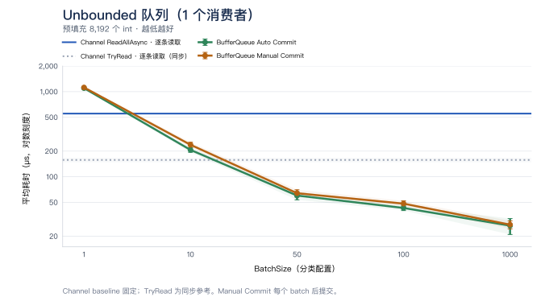

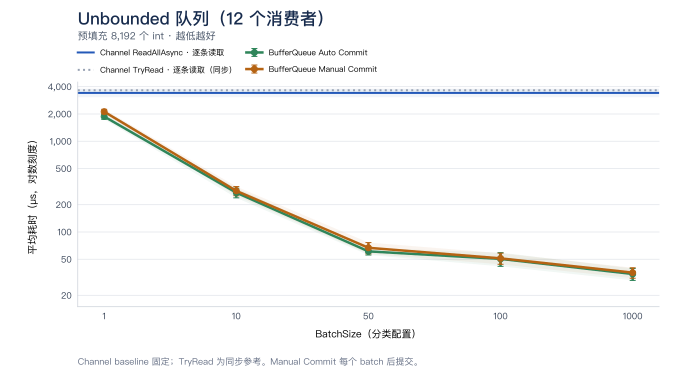

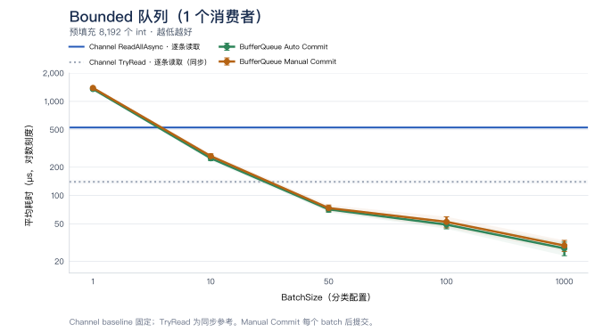

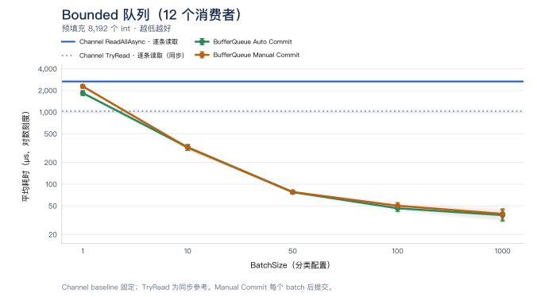

### 内存分配图

Consumer 图将 BenchmarkDotNet 的 allocation 统一转换为 `KiB/op`（`1 KiB = 1,024 B`）。消费测试从 12 个 partition
中消费预填充的 8,192 条消息，分别使用 1 个和 12 个 consumer；`BatchSize` 横轴按分类配置等距显示，纵轴使用对数刻度。
队列和 consumer 的 setup 不计入测量 allocation。数值表示每次消费 8,192 条消息的 benchmark operation 分配的托管内存，
不是峰值驻留内存，也不是单条消息 allocation。BatchSize 控制 BufferQueue 和 Channel 数组聚合；Auto/Manual 分配量基本一致，因此合并为一条曲线，采用 Auto Commit 测量值。

BufferQueue 分配独立批次快照，使返回的数据在后续 pull、commit、segment 回收以及异步业务处理后仍然有效。
元素按类型复制：值类型复制值，引用类型复制引用，不会深拷贝引用对象。原有 Channel 参考路径逐条读取，不创建 batch 容器。

新增的 `Channel_ReadAllAsync_Batched` 曲线也返回可独立保留的批次：通过 `ReadAllAsync` 填入新建的 `int[BatchSize]`，
batch iterator 返回已填充前缀的 `ReadOnlyMemory<int>` 视图。数组不池化或复用，最后一个不满批次也不额外裁剪复制。
这让双方都包含创建批次存储的成本，同时保留共享队列与分区的差异。Auto / Manual Commit 的分配量仍然接近；Channel 没有对应的 commit 功能。

原有系列在成功重跑 113 组后保留原记录值；新增 20 组数组聚合数据单独记录在[Channel 数组聚合测量](channel-batch-aggregation.zh-CN.md)。
该文档包含完整耗时、分配、原始数据，以及不满批次和并发组织的差异。README 消费内存图比较双方返回独立批次的成本，
耗时图仍使用原生 Channel 逐条读取作为参考。

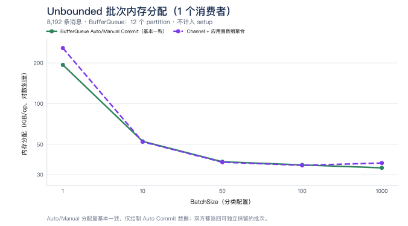

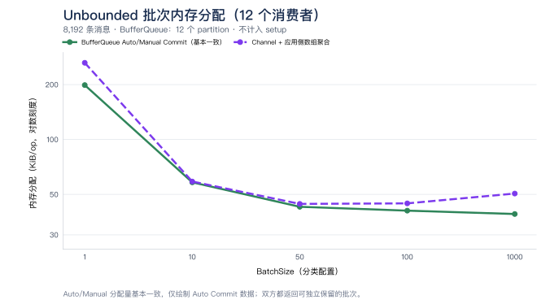

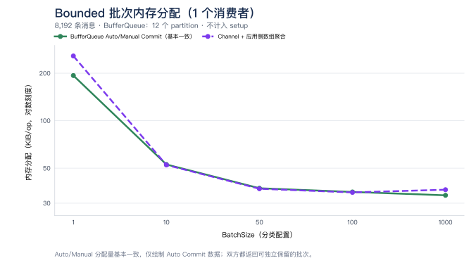

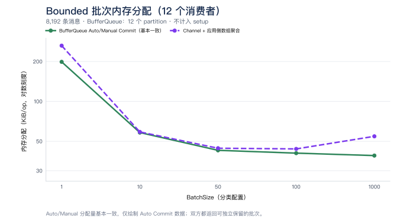

## 补充对比

### Single-reader Channel 对比

这个 benchmark 固定一个 consumer，对比默认 Channel 实现和 Channel 的 `SingleReader` 选项。BufferQueue 仍使用
12 个 partition 和一个 consumer。

Channel reference（固定的 `BatchSize = 1` 代表值）：

| Default TryRead (µs) | Default ReadAllAsync (µs) | SingleReader TryRead (µs) | SingleReader ReadAllAsync (µs) |
|---:|---:|---:|---:|
| 156.689 | 546.949 | 87.412 | 416.228 |

BufferQueue `ConsumeAsync`（`AutoCommit = true`）：

| BatchSize | Mean (µs) | Allocated (KiB) |
|---:|---:|---:|
| 1 | 1,078.955 | 192.64 |
| 10 | 205.803 | 52.08 |
| 50 | 56.551 | 36.61 |
| 100 | 42.820 | 34.64 |
| 1000 | 22.325 | 32.95 |

Channel 方法不会消费 `BatchSize` 大小的 batch；该参数只改变 BufferQueue 方法。`SingleReader = true` 是调用方
保证最多只有一个 reader 消费 Channel，不是 12-consumer 配置。

### Channel 逐条读取参考

以下保留原始对比：BufferQueue 返回批次快照，Channel 逐条读取。这些结果能衡量原生逐条数据交接的分配，
但 Channel 没有生成批次，因此对“返回可保留批次”的分配成本参考有限。该场景应看[数组聚合对比](channel-batch-aggregation.zh-CN.md)。
以下 Channel 参考线取自与 `BatchSize = 1` 一起记录的结果，保持水平；图中的 BatchSize 只影响 BufferQueue。

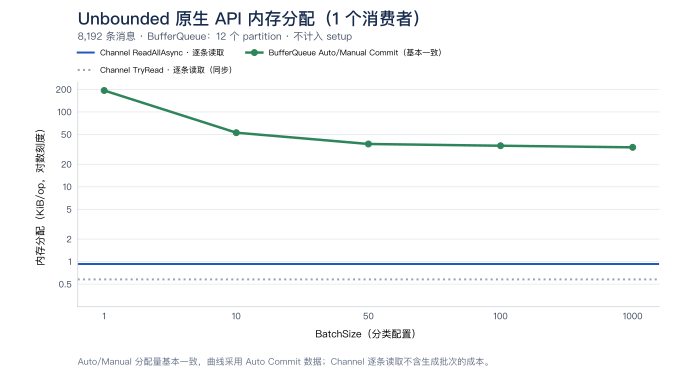

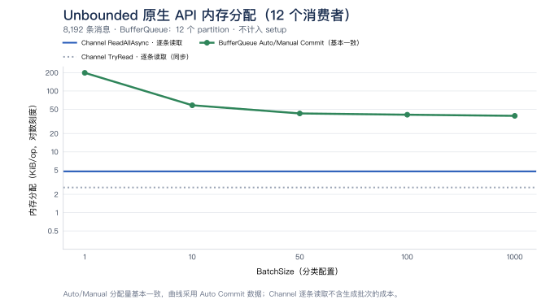

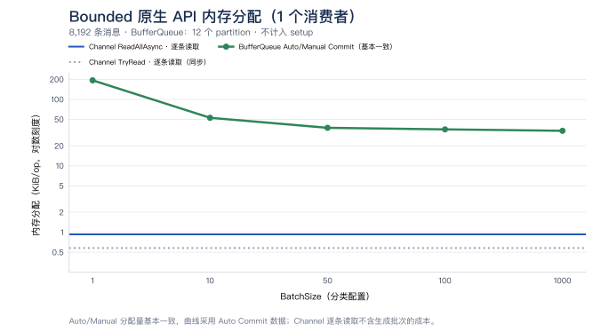

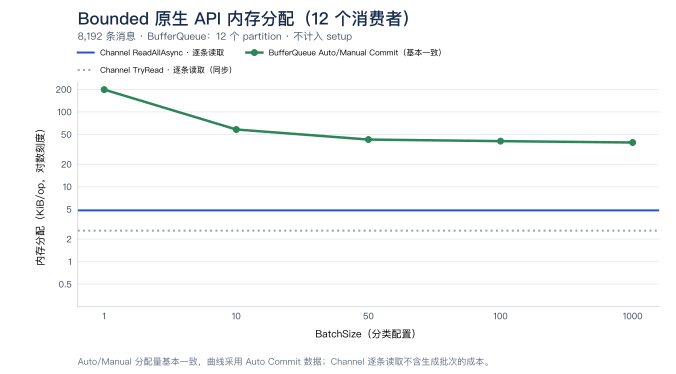

### PartitionKey 路由性能

以下是保留的历史路由测量，早于当前 consumer 对比，未使用当前消费 benchmark workload 重跑。下面的
[`MemoryBufferPartitionerBenchmark`](../../tests/BufferQueue.Benchmarks/MemoryBufferPartitionerBenchmark.cs)
测量完整的 Memory 模式 producer 路径，使用 `8` 个 partition、`8,192` 条消息重复 `832` 次、`6` 次预热和
`15` 次测量迭代。结果为单条写入耗时，运行环境为 macOS 27.0.1、ARM64 和 .NET 10.0.0；
所有路径均无托管内存分配。字符串 key 包含 `7` 个 UTF-16 码元；完整 key 哈希的耗时随 key 长度增加。

| 路由方式 | Mean | 相对轮询 |
| --- | ---: | ---: |
| 轮询 | `13.40 ns` | `1.00x` |
| `int` key | `12.03 ns` | `0.90x` |
| `string` key（XXH3-64，完整 UTF-16 key） | `12.94 ns` | `0.97x` |
| 自定义消息，取数值 `CustomerId` key | `11.19 ns` | `0.83x` |

通过以下命令运行该 producer 基准：

```bash
dotnet run -c Release --project tests/BufferQueue.Benchmarks/BufferQueue.Benchmarks.csproj -- --filter '*MemoryBufferPartitionerBenchmark*'
```

独立的 [`StringPartitionRoutingBenchmark`](../../tests/BufferQueue.Benchmarks/StringPartitionRoutingBenchmark.cs)
仅测量字符串路由，使用预先构造的 `4`、`9`、`64`、`120`、`121`、`256`、`1024` 个 UTF-16 码元的 key 和 `8` 个 partition。
`120`/`121` 两组覆盖 XXH3 的 `240` 字节长输入阈值两侧。
它使用一次启动、`6` 次预热和 `10` 次测量迭代，目标迭代时间为 `100 ms`。
其结果为单次路由耗时，不包含队列写入；上表数据来自 producer 基准。
通过以下命令运行 key 长度基准：

```bash
dotnet run -c Release --project tests/BufferQueue.Benchmarks/BufferQueue.Benchmarks.csproj -- --filter '*StringPartitionRoutingBenchmark*'
```

### Read-path 优化测量

下面保留早期 focused comparison，与本次重跑的 README 图表数据分开，这些历史实验没有在本轮重跑。
两组测试使用同一个历史 baseline，该 baseline 已包含 Frozen reader
lookup、minimum-reader scan、published segment range check 以及 producer lock-handoff fix。第二组不包含第一组的代码变更。

#### A：single-item reader path

`single-read-before` 和 `single-read-after` 对比确切配置为 `BatchSize = 1` 的 reader specialization。表格限定为
`PartitionNumber = 1 或 12`、`GroupCount = 1 或 2`，并覆盖两个 `bounded` 值。所有行的 allocation 不变。只有一个 consumer 消费数据；`GroupCount = 2` 时，第二个 group 保持空闲，
用于覆盖 retention 和查找路径，并非两个活跃 consumer 的吞吐测试。

| Method | Partitions | bounded | Groups | Before (us) | After (us) | Change | Allocation |
|---|---:|---|---:|---:|---:|---:|---:|
| AutoCommit | 1 | false | 1 | 1,150.40 | 1,038.29 | -9.7% | 192.2 KB |
| ManualCommit | 1 | false | 1 | 1,211.73 | 1,125.88 | -7.1% | 192.2 KB |
| AutoCommit | 1 | false | 2 | 1,164.23 | 1,080.87 | -7.2% | 192.2 KB |
| ManualCommit | 1 | false | 2 | 1,150.82 | 1,093.86 | -4.9% | 192.2 KB |
| AutoCommit | 1 | true | 1 | 1,386.09 | 1,314.30 | -5.2% | 192.2 KB |
| ManualCommit | 1 | true | 1 | 1,416.45 | 1,362.05 | -3.8% | 192.2 KB |
| AutoCommit | 1 | true | 2 | 1,386.86 | 1,338.85 | -3.5% | 192.2 KB |
| ManualCommit | 1 | true | 2 | 1,395.87 | 1,318.03 | -5.6% | 192.2 KB |
| AutoCommit | 12 | false | 1 | 1,141.83 | 1,056.00 | -7.5% | 192.2 KB |
| ManualCommit | 12 | false | 1 | 1,161.65 | 1,075.52 | -7.4% | 192.2 KB |
| AutoCommit | 12 | false | 2 | 1,143.07 | 1,085.14 | -5.1% | 192.2 KB |
| ManualCommit | 12 | false | 2 | 1,176.54 | 1,117.84 | -5.0% | 192.2 KB |
| AutoCommit | 12 | true | 1 | 1,399.46 | 1,324.05 | -5.4% | 192.2 KB |
| ManualCommit | 12 | true | 1 | 1,461.01 | 1,351.73 | -7.5% | 192.2 KB |
| AutoCommit | 12 | true | 2 | 1,363.69 | 1,352.77 | -0.8% | 192.2 KB |
| ManualCommit | 12 | true | 2 | 1,389.13 | 1,372.10 | -1.2% | 192.2 KB |

before/after 行保存在 [read-path-optimizations.csv](read-path-optimizations.csv) 中。

#### B：每次只有一个可用 item 的 sparse batch

`MemorySparseBatchBenchmark` 按顺序生产和消费，每次只生产一个 item，并验证每次 pull 恰好包含一个 item。
`BatchSize` 为 10、100 或 1000，但 available count 始终为 1。这个测试把 lazy allocation path 与并发吞吐隔离开。
after 版本只有在找到第二个 item 后才分配 batch array。

| Method | BatchSize | bounded | Before (ms) | After (ms) | Change | Before allocation | After allocation |
|---|---:|---|---:|---:|---:|---:|---:|
| AutoCommit | 10 | false | 2.104 | 1.998 | -5.0% | 772.6 KB | 196.6 KB |
| ManualCommit | 10 | false | 1.583 | 1.518 | -4.1% | 772.6 KB | 196.6 KB |
| AutoCommit | 10 | true | 2.846 | 2.702 | -5.1% | 772.6 KB | 196.6 KB |
| ManualCommit | 10 | true | 2.385 | 2.275 | -4.6% | 772.6 KB | 196.6 KB |
| AutoCommit | 100 | false | 2.162 | 1.997 | -7.6% | 3,652.6 KB | 196.6 KB |
| ManualCommit | 100 | false | 1.669 | 1.927 | +15.5% | 3,652.6 KB | 196.6 KB |
| AutoCommit | 100 | true | 2.888 | 2.805 | -2.9% | 3,652.6 KB | 196.6 KB |
| ManualCommit | 100 | true | 2.443 | 2.310 | -5.4% | 3,652.6 KB | 196.6 KB |
| AutoCommit | 1000 | false | 3.055 | 2.035 | -33.4% | 32,452.6 KB | 196.6 KB |
| ManualCommit | 1000 | false | 2.689 | 1.526 | -43.3% | 32,452.6 KB | 196.6 KB |
| AutoCommit | 1000 | true | 3.786 | 2.727 | -28.0% | 32,452.6 KB | 196.6 KB |
| ManualCommit | 1000 | true | 3.594 | 2.244 | -37.6% | 32,452.6 KB | 196.6 KB |

`BatchSize = 1000` 时 allocation 从 `32,452.6 KB` 降到 `196.6 KB`。这些是 BenchmarkDotNet 报告的二进制 KB，
1 KB 等于 1,024 bytes。完整 batch 场景没有显示出明确的大幅收益；这里的强收益特指每次只有一个 item 的 sparse 场景。

before/after 行保存在 [read-path-optimizations.csv](read-path-optimizations.csv) 中。

合并检查保存在 [read-path-optimizations.csv](read-path-optimizations.csv) 中。它保持 A 和 B 独立，同时检查两项
read-path 优化合并后的行为。

## 复现命令

Benchmark 源码：

- [Producer](../../tests/BufferQueue.Benchmarks/ChannelVsMemoryBufferQueueProduceBenchmark.cs)
- [Unbounded consume](../../tests/BufferQueue.Benchmarks/UnboundedChannelVsMemoryBufferQueueConsumeBenchmark.cs)
- [Bounded consume](../../tests/BufferQueue.Benchmarks/BoundedChannelVsMemoryBufferQueueConsumeBenchmark.cs)
- [Single-reader consume](../../tests/BufferQueue.Benchmarks/SingleReaderChannelVsMemoryBufferQueueConsumeBenchmark.cs)

分别、顺序运行 producer 和 consumer 类：

```sh
dotnet run --project tests/BufferQueue.Benchmarks -c Release -- --filter 'BufferQueue.Benchmarks.ChannelVsMemoryBufferQueueProduceBenchmark.*' --exporters json
dotnet run --project tests/BufferQueue.Benchmarks -c Release -- --filter 'BufferQueue.Benchmarks.UnboundedChannelVsMemoryBufferQueueConsumeBenchmark.*' --warmupCount 6 --iterationCount 20 --launchCount 1 --exporters json
dotnet run --project tests/BufferQueue.Benchmarks -c Release -- --filter 'BufferQueue.Benchmarks.BoundedChannelVsMemoryBufferQueueConsumeBenchmark.*' --warmupCount 6 --iterationCount 20 --launchCount 1 --exporters json
dotnet run --project tests/BufferQueue.Benchmarks -c Release -- --filter 'BufferQueue.Benchmarks.SingleReaderChannelVsMemoryBufferQueueConsumeBenchmark.*' --warmupCount 6 --iterationCount 20 --launchCount 1 --exporters json
```
