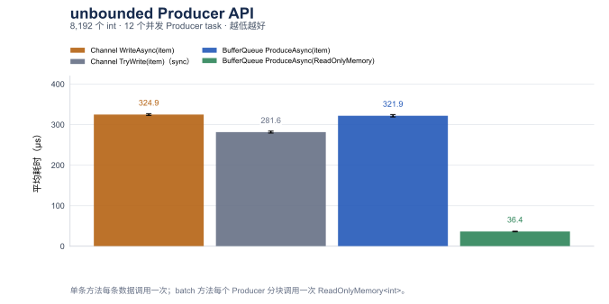
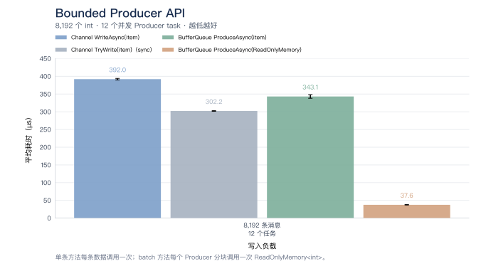
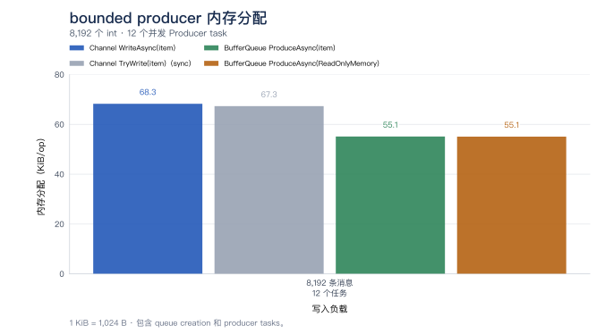
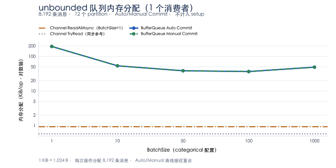
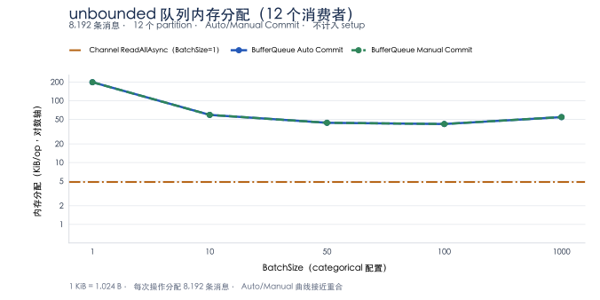
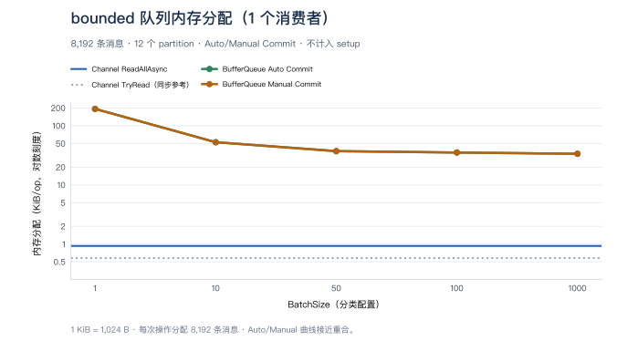
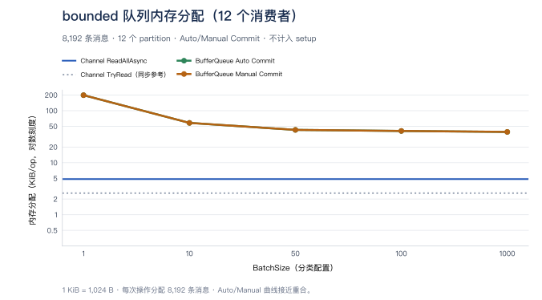

# Memory Queue 基准测试

[English](memory-queues.md)

这份报告记录根 README 图表背后的完整基准测试。汇总文件是
[memory-queues-results.csv](memory-queues-results.csv)，包含 8 行 producer 结果和 3 个消费 benchmark 类的 105
行结果。CSV 保留 mean、error、standard deviation、allocation 以及每个配置；下面的表格为便于阅读主要展示
mean 和 allocation。

除特别说明外，本报告使用 Apple M2 Max（12 核）、macOS 27.0.1 / Arm64、.NET 10.0.0、runtime 自带的
`System.Threading.Channels` 程序集 10.0.0.0（文件版本 10.0.25.52411）和 BenchmarkDotNet 0.15.8 Release 配置。
benchmark 项目没有单独引用 `System.Threading.Channels` 包，因此这些 Channel 数据使用测试 runtime 自带的程序集。

## Producer 对比

Producer benchmark 使用 12 个并发 `Task.Run` producer task 写入 8,192 个 `int`。Queue 创建和 task scheduling
都在计时方法内。Channel 的主比较使用异步 `WriteAsync`，同步 `TryWrite` 作为参考；BufferQueue 的 item 和
`ReadOnlyMemory<int>` batch 都使用异步 `ProduceAsync`。bounded capacity 足够容纳完整 workload，因此这里不测
producer 等待背压的路径。

| Mode | Method | Mean (µs) | Allocated (KiB) |
|---|---|---:|---:|
| unbounded | `Channel.WriteAsync(item)` | 337.960 | 135.47 |
| unbounded | `Channel.TryWrite(item)` | 287.757 | 134.53 |
| unbounded | `BufferQueue.ProduceAsync(item)` | 331.357 | 54.96 |
| unbounded | `BufferQueue.ProduceAsync(ReadOnlyMemory<int>)` | 37.201 | 54.90 |
| bounded | `Channel.WriteAsync(item)` | 391.972 | 68.27 |
| bounded | `Channel.TryWrite(item)` | 302.205 | 67.33 |
| bounded | `BufferQueue.ProduceAsync(item)` | 343.133 | 55.13 |
| bounded | `BufferQueue.ProduceAsync(ReadOnlyMemory<int>)` | 37.588 | 55.08 |





源码：[ChannelVsMemoryBufferQueueProduceBenchmark.cs](../../tests/BufferQueue.Benchmarks/ChannelVsMemoryBufferQueueProduceBenchmark.cs)。

### PartitionKey 路由性能

以下是保留的历史路由测量，早于当前 consumer 对比，未使用当前消费 benchmark workload 重跑。下面的
[`MemoryBufferPartitionerBenchmark`](../../tests/BufferQueue.Benchmarks/MemoryBufferPartitionerBenchmark.cs)
测量完整的 Memory 模式 producer 路径，使用 `8` 个 partition、`8,192` 条消息重复 `832` 次、`6` 次预热和
`15` 次测量迭代。结果为单条写入耗时，运行环境为 macOS 27.0.1、ARM64 和 .NET 10.0.0；
所有路径均无托管内存分配。字符串 key 包含 `7` 个 UTF-16 码元；完整 key 哈希的耗时随 key 长度增加。

| 路由方式 | Mean | 相对轮询 |
| --- | ---: | ---: |
| 轮询 | `13.40 ns` | `1.00x` |
| `int` key | `12.03 ns` | `0.90x` |
| `string` key（XXH3-64，完整 UTF-16 key） | `12.94 ns` | `0.97x` |
| 自定义消息，取数值 `CustomerId` key | `11.19 ns` | `0.83x` |

通过以下命令运行该 producer 基准：

```bash
dotnet run -c Release --project tests/BufferQueue.Benchmarks/BufferQueue.Benchmarks.csproj -- --filter '*MemoryBufferPartitionerBenchmark*'
```

独立的 [`StringPartitionRoutingBenchmark`](../../tests/BufferQueue.Benchmarks/StringPartitionRoutingBenchmark.cs)
仅测量字符串路由，使用预先构造的 `4`、`9`、`64`、`120`、`121`、`256`、`1024` 个 UTF-16 码元的 key 和 `8` 个 partition。
`120`/`121` 两组覆盖 XXH3 的 `240` 字节长输入阈值两侧。
它使用一次启动、`6` 次预热和 `10` 次测量迭代，目标迭代时间为 `100 ms`。
其结果为单次路由耗时，不包含队列写入；上表数据来自 producer 基准。
通过以下命令运行 key 长度基准：

```bash
dotnet run -c Release --project tests/BufferQueue.Benchmarks/BufferQueue.Benchmarks.csproj -- --filter '*StringPartitionRoutingBenchmark*'
```

## 主要消费对比

本节测量预填充队列的消费路径，包含异步 BufferQueue 消费和 Channel 参考。主要 BufferQueue 行使用
`AutoCommit = true`；Manual Commit 和同步 `TryRead` 参考在下面单独展示。

Channel 没有对应的 `BatchSize`；它的 baseline 按 consumer 数量只展示一次，与 BufferQueue 的配置无关。BufferQueue
使用 `1、10、50、100、1000` 五个配置。

每次运行消费预填充的 8,192 个 `int`。BufferQueue 使用 12 个 partition，consumer 数量为 1 或 12。预填充后
complete Channel writer，确保 `ReadAllAsync` 有明确结束点。每个 consumer 在独立的 `Task.Run` 中运行。Channel reader 共享同一个 Channel，BufferQueue consumer
读取各自分配的 partition。Channel
reader 本地计数，所有 reader 完成后再汇总。BufferQueue 按分配给每个 consumer 的 batch 计数，并校验每个分配计数
和总数。每条消息没有业务处理；计时包含运行 reader 的 task scheduling。

Producer、Auto Commit、Manual Commit 和 Channel 的所有行均在 checkout `e63d152` 上重跑，该版本合并了
singleton 枚举器和部分批次数组优化。[运行记录](memory-queues-run.json) 保留确切源码与 job 配置。
Manual Commit 在每个 batch 后调用 `CommitAsync`。BufferQueue 使用每个 batch 的 `Count()` 统计条数，不逐条枚举，
测量不包括业务处理和应用侧的 item 枚举分配。[foreach 测量](batch-enumeration.zh-CN.md)和
[稀疏批次测量](partial-batch-allocation.zh-CN.md)分别记录这些不同的 workload。

### unbounded

Channel 参考值固定使用 `BatchSize=1` 行；BatchSize 不控制 Channel：

| Consumers | TryRead (µs) | ReadAllAsync (µs) | TryRead allocated (B) | ReadAllAsync allocated (B) |
|---:|---:|---:|---:|---:|
| 1 | 157.512 | 552.609 | 592 | 952 |
| 12 | 3,656.109 | 3,411.669 | 2,656 | 4,880 |

BufferQueue `ConsumeAsync`，`AutoCommit=true`:

| BatchSize | Consumers | Mean (µs) | Allocated (KiB) |
|---:|---:|---:|---:|
| 1 | 1 | 1,099.643 | 193.34 |
| 1 | 12 | 1,875.452 | 198.78 |
| 10 | 1 | 206.557 | 52.77 |
| 10 | 12 | 271.154 | 58.22 |
| 50 | 1 | 60.115 | 37.30 |
| 50 | 12 | 61.096 | 42.75 |
| 100 | 1 | 42.929 | 35.34 |
| 100 | 12 | 50.456 | 40.72 |
| 1000 | 1 | 26.591 | 33.65 |
| 1000 | 12 | 34.381 | 39.03 |

BufferQueue `ConsumeAsync`，`AutoCommit=false`，每批后调用 `CommitAsync`:

| BatchSize | Consumers | Mean (µs) | Allocated (KiB) |
|---:|---:|---:|---:|
| 1 | 1 | 1,120.218 | 193.34 |
| 1 | 12 | 2,120.025 | 198.78 |
| 10 | 1 | 237.301 | 52.77 |
| 10 | 12 | 284.029 | 58.22 |
| 50 | 1 | 63.995 | 37.30 |
| 50 | 12 | 66.911 | 42.75 |
| 100 | 1 | 48.254 | 35.34 |
| 100 | 12 | 51.163 | 40.72 |
| 1000 | 1 | 27.331 | 33.65 |
| 1000 | 12 | 35.608 | 39.09 |

### bounded

bounded 的 BufferQueue 和 Channel 容量均为 8,192。队列预先填充，本节不测等待容量。

Channel 参考值固定使用 `BatchSize=1` 行；BatchSize 不控制 Channel：

| Consumers | TryRead (µs) | ReadAllAsync (µs) | TryRead allocated (B) | ReadAllAsync allocated (B) |
|---:|---:|---:|---:|---:|
| 1 | 139.754 | 528.048 | 592 | 952 |
| 12 | 1,033.320 | 2,669.361 | 2,656 | 4,952 |

BufferQueue `ConsumeAsync`，`AutoCommit=true`:

| BatchSize | Consumers | Mean (µs) | Allocated (KiB) |
|---:|---:|---:|---:|
| 1 | 1 | 1,353.710 | 193.34 |
| 1 | 12 | 1,847.269 | 198.78 |
| 10 | 1 | 248.727 | 52.77 |
| 10 | 12 | 325.134 | 58.22 |
| 50 | 1 | 71.242 | 37.30 |
| 50 | 12 | 77.631 | 42.75 |
| 100 | 1 | 49.041 | 35.34 |
| 100 | 12 | 46.269 | 40.72 |
| 1000 | 1 | 27.448 | 33.65 |
| 1000 | 12 | 37.191 | 39.03 |

BufferQueue `ConsumeAsync`，`AutoCommit=false`，每批后调用 `CommitAsync`:

| BatchSize | Consumers | Mean (µs) | Allocated (KiB) |
|---:|---:|---:|---:|
| 1 | 1 | 1,390.612 | 193.34 |
| 1 | 12 | 2,284.660 | 198.78 |
| 10 | 1 | 261.925 | 52.77 |
| 10 | 12 | 322.325 | 58.22 |
| 50 | 1 | 73.574 | 37.30 |
| 50 | 12 | 77.823 | 42.75 |
| 100 | 1 | 52.502 | 35.34 |
| 100 | 12 | 50.216 | 40.78 |
| 1000 | 1 | 29.387 | 33.65 |
| 1000 | 12 | 38.730 | 39.09 |

### Single-reader Channel 对比

这个 benchmark 固定一个 consumer，对比默认 Channel 实现和 Channel 的 `SingleReader` 选项。BufferQueue 仍使用
12 个 partition 和一个 consumer。

Channel reference（固定的 `BatchSize = 1` 代表值）：

| Default TryRead (µs) | Default ReadAllAsync (µs) | SingleReader TryRead (µs) | SingleReader ReadAllAsync (µs) |
|---:|---:|---:|---:|
| 156.689 | 546.949 | 87.412 | 416.228 |

BufferQueue `ConsumeAsync`（`AutoCommit = true`）：

| BatchSize | Mean (µs) | Allocated (KiB) |
|---:|---:|---:|
| 1 | 1,078.955 | 192.64 |
| 10 | 205.803 | 52.08 |
| 50 | 56.551 | 36.61 |
| 100 | 42.820 | 34.64 |
| 1000 | 22.325 | 32.95 |

Channel 方法不会消费 `BatchSize` 大小的 batch；该参数只改变 BufferQueue 方法。`SingleReader = true` 是调用方
保证最多只有一个 reader 消费 Channel，不是 12-consumer 配置。

以一个 consumer、`BatchSize = 10` 为例，异步 unbounded BufferQueue 为 206.557 µs，固定 Channel `ReadAllAsync`
参考值为 552.609 µs；bounded 对应为 248.727 µs 和 528.048 µs。这是一个实测配置，不能据此声称 BufferQueue
在所有 batch size 或 consumer 数量下都更快。与 `TryRead` 对比时，应按 async 与 sync 接口的对比解读。

图表阅读说明：横轴将各档 BatchSize 配置等距排列，间距不代表数值差；耗时纵轴使用对数刻度。
点和线表示 mean，误差线或区间使用 BenchmarkDotNet 报告的 `Error`。
Channel baseline 固定为代表性的 `BatchSize = 1`，与 BufferQueue 的 `BatchSize` 无关。

消费图表同时展示两种 async BufferQueue 模式，以 `ReadAllAsync` 作为 Channel 主要对比，灰色 `TryRead` 线作为同步参考。Manual Commit 使用 `AutoCommit = false`，每个 batch 后调用
`CommitAsync`；Channel 没有内建的等价确认、checkpoint 或重放机制。

主要异步对比选择 `ChannelReader<T>.ReadAllAsync`，因为两边的方法都返回可以通过 `await foreach` 消费的异步流：

```csharp
// ChannelReader<T>
IAsyncEnumerable<T> ReadAllAsync(CancellationToken cancellationToken = default);
// IBufferPullConsumer<T>
IAsyncEnumerable<IEnumerable<T>> ConsumeAsync(CancellationToken cancellationToken = default);
```

Channel 每轮返回一条消息，BufferQueue 每轮返回一个 batch。`ReadAllAsync` 会持续读取直到已完成的 Channel 被读空，
并不是把全部数据收集成一个 batch。`ChannelReader<T>.ReadAsync` 返回单次读取的 `ValueTask<T>`，属于另一项单条异步对比；
`TryRead` 是同步参考，不是主要异步基线。

## 内存分配

Producer allocation 的计时包含 queue/channel creation 和 producer task scheduling。测试使用 12 个 task 写入 8,192 条消息；
`Channel WriteAsync` 是 async baseline，`Channel TryWrite` 是同步参考，BufferQueue 的两个 bar 分别表示逐条和 batch producer API。
这些数值不是峰值驻留内存，也不是单条消息 allocation。




Consumer 图将 BenchmarkDotNet 的 allocation 统一转换为 `KiB/op`（`1 KiB = 1,024 B`）。消费测试从 12 个 partition
中消费预填充的 8,192 条消息，分别使用 1 个和 12 个 consumer；`BatchSize` 横轴按分类配置等距显示，纵轴使用对数刻度。
队列和 consumer 的 setup 不计入测量 allocation。数值表示每次消费 8,192 条消息的 benchmark operation 分配的托管内存，
不是峰值驻留内存，也不是单条消息 allocation。两条 Channel 参考线均取自与 `BatchSize = 1` 一起记录的结果，BatchSize 只影响 BufferQueue；Auto/Manual 曲线基本重合。









## Read-path 优化测量

下面保留早期 focused comparison，与本次重跑的 README 图表数据分开，这些历史实验没有在本轮重跑。
两组测试使用同一个历史 baseline，该 baseline 已包含 Frozen reader
lookup、minimum-reader scan、published segment range check 以及 producer lock-handoff fix。第二组不包含第一组的代码变更。

### A：single-item reader path

`single-read-before` 和 `single-read-after` 对比确切配置为 `BatchSize = 1` 的 reader specialization。表格限定为
`PartitionNumber = 1 或 12`、`GroupCount = 1 或 2`，并覆盖两个 `bounded` 值。所有行的 allocation 不变。只有一个 consumer 消费数据；`GroupCount = 2` 时，第二个 group 保持空闲，
用于覆盖 retention 和查找路径，并非两个活跃 consumer 的吞吐测试。

| Method | Partitions | bounded | Groups | Before (us) | After (us) | Change | Allocation |
|---|---:|---|---:|---:|---:|---:|---:|
| AutoCommit | 1 | false | 1 | 1,150.40 | 1,038.29 | -9.7% | 192.2 KB |
| ManualCommit | 1 | false | 1 | 1,211.73 | 1,125.88 | -7.1% | 192.2 KB |
| AutoCommit | 1 | false | 2 | 1,164.23 | 1,080.87 | -7.2% | 192.2 KB |
| ManualCommit | 1 | false | 2 | 1,150.82 | 1,093.86 | -4.9% | 192.2 KB |
| AutoCommit | 1 | true | 1 | 1,386.09 | 1,314.30 | -5.2% | 192.2 KB |
| ManualCommit | 1 | true | 1 | 1,416.45 | 1,362.05 | -3.8% | 192.2 KB |
| AutoCommit | 1 | true | 2 | 1,386.86 | 1,338.85 | -3.5% | 192.2 KB |
| ManualCommit | 1 | true | 2 | 1,395.87 | 1,318.03 | -5.6% | 192.2 KB |
| AutoCommit | 12 | false | 1 | 1,141.83 | 1,056.00 | -7.5% | 192.2 KB |
| ManualCommit | 12 | false | 1 | 1,161.65 | 1,075.52 | -7.4% | 192.2 KB |
| AutoCommit | 12 | false | 2 | 1,143.07 | 1,085.14 | -5.1% | 192.2 KB |
| ManualCommit | 12 | false | 2 | 1,176.54 | 1,117.84 | -5.0% | 192.2 KB |
| AutoCommit | 12 | true | 1 | 1,399.46 | 1,324.05 | -5.4% | 192.2 KB |
| ManualCommit | 12 | true | 1 | 1,461.01 | 1,351.73 | -7.5% | 192.2 KB |
| AutoCommit | 12 | true | 2 | 1,363.69 | 1,352.77 | -0.8% | 192.2 KB |
| ManualCommit | 12 | true | 2 | 1,389.13 | 1,372.10 | -1.2% | 192.2 KB |

before/after 行保存在 [read-path-optimizations.csv](read-path-optimizations.csv) 中。

### B：每次只有一个可用 item 的 sparse batch

`MemorySparseBatchBenchmark` 按顺序生产和消费，每次只生产一个 item，并验证每次 pull 恰好包含一个 item。
`BatchSize` 为 10、100 或 1000，但 available count 始终为 1。这个测试把 lazy allocation path 与并发吞吐隔离开。
after 版本只有在找到第二个 item 后才分配 batch array。

| Method | BatchSize | bounded | Before (ms) | After (ms) | Change | Before allocation | After allocation |
|---|---:|---|---:|---:|---:|---:|---:|
| AutoCommit | 10 | false | 2.104 | 1.998 | -5.0% | 772.6 KB | 196.6 KB |
| ManualCommit | 10 | false | 1.583 | 1.518 | -4.1% | 772.6 KB | 196.6 KB |
| AutoCommit | 10 | true | 2.846 | 2.702 | -5.1% | 772.6 KB | 196.6 KB |
| ManualCommit | 10 | true | 2.385 | 2.275 | -4.6% | 772.6 KB | 196.6 KB |
| AutoCommit | 100 | false | 2.162 | 1.997 | -7.6% | 3,652.6 KB | 196.6 KB |
| ManualCommit | 100 | false | 1.669 | 1.927 | +15.5% | 3,652.6 KB | 196.6 KB |
| AutoCommit | 100 | true | 2.888 | 2.805 | -2.9% | 3,652.6 KB | 196.6 KB |
| ManualCommit | 100 | true | 2.443 | 2.310 | -5.4% | 3,652.6 KB | 196.6 KB |
| AutoCommit | 1000 | false | 3.055 | 2.035 | -33.4% | 32,452.6 KB | 196.6 KB |
| ManualCommit | 1000 | false | 2.689 | 1.526 | -43.3% | 32,452.6 KB | 196.6 KB |
| AutoCommit | 1000 | true | 3.786 | 2.727 | -28.0% | 32,452.6 KB | 196.6 KB |
| ManualCommit | 1000 | true | 3.594 | 2.244 | -37.6% | 32,452.6 KB | 196.6 KB |

`BatchSize = 1000` 时 allocation 从 `32,452.6 KB` 降到 `196.6 KB`。这些是 BenchmarkDotNet 报告的二进制 KB，
1 KB 等于 1,024 bytes。完整 batch 场景没有显示出明确的大幅收益；这里的强收益特指每次只有一个 item 的 sparse 场景。

before/after 行保存在 [read-path-optimizations.csv](read-path-optimizations.csv) 中。

合并检查保存在 [read-path-optimizations.csv](read-path-optimizations.csv) 中。它保持 A 和 B 独立，同时检查两项
read-path 优化合并后的行为。

## 复现方式

Benchmark 源码：

- [Producer](../../tests/BufferQueue.Benchmarks/ChannelVsMemoryBufferQueueProduceBenchmark.cs)
- [Unbounded consume](../../tests/BufferQueue.Benchmarks/UnboundedChannelVsMemoryBufferQueueConsumeBenchmark.cs)
- [Bounded consume](../../tests/BufferQueue.Benchmarks/BoundedChannelVsMemoryBufferQueueConsumeBenchmark.cs)
- [Single-reader consume](../../tests/BufferQueue.Benchmarks/SingleReaderChannelVsMemoryBufferQueueConsumeBenchmark.cs)

分别、顺序运行 producer 和 consumer 类：

```sh
dotnet run --project tests/BufferQueue.Benchmarks -c Release -- --filter 'BufferQueue.Benchmarks.ChannelVsMemoryBufferQueueProduceBenchmark.*' --exporters json
dotnet run --project tests/BufferQueue.Benchmarks -c Release -- --filter 'BufferQueue.Benchmarks.UnboundedChannelVsMemoryBufferQueueConsumeBenchmark.*' --warmupCount 6 --iterationCount 20 --launchCount 1 --exporters json
dotnet run --project tests/BufferQueue.Benchmarks -c Release -- --filter 'BufferQueue.Benchmarks.BoundedChannelVsMemoryBufferQueueConsumeBenchmark.*' --warmupCount 6 --iterationCount 20 --launchCount 1 --exporters json
dotnet run --project tests/BufferQueue.Benchmarks -c Release -- --filter 'BufferQueue.Benchmarks.SingleReaderChannelVsMemoryBufferQueueConsumeBenchmark.*' --warmupCount 6 --iterationCount 20 --launchCount 1 --exporters json
```

Producer 的 fixed job 使用一次 launch、六次 warmup 和十五次测量。三个消费 job 使用一次 launch、六次 warmup、
二十次测量；`IterationSetup` 要求 invocation count 和 unroll factor 均为一。
[运行记录](memory-queues-run.json)保留源码哈希、确切配置和结果数量。
全部 113 行均在合并后的 checkout `e63d152b388a99069602a76131b9589bfd8b472c` 上刷新。

BenchmarkDotNet 报告了 short-iteration 和 environment-priority warnings。CSV 保留 error 和标准差；`Error` 是
报告的 99.9% 置信区间半宽。consumer 任务调度会增加波动，十二个 reader 时尤其明显。这些测量不能证明生产吞吐或
背压等待延迟。前面的历史路由、read-path 实验保留原测量和配置。
