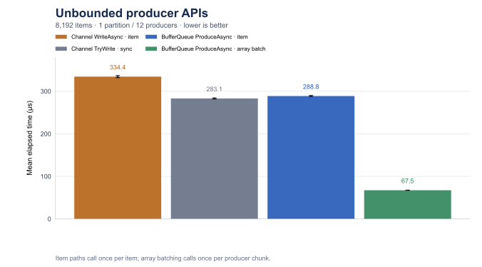
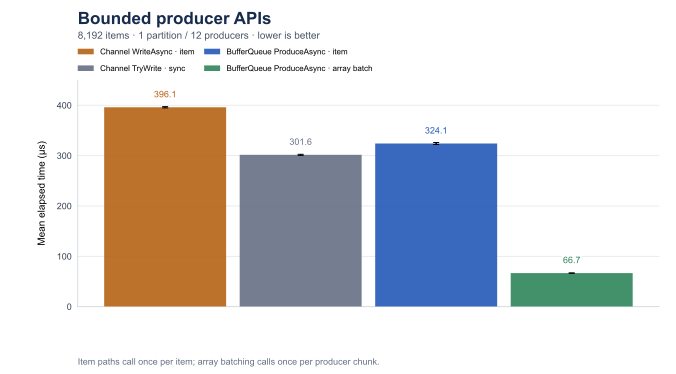
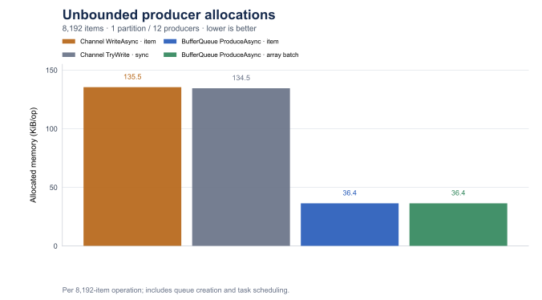
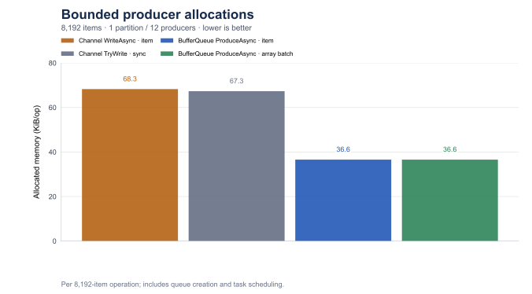
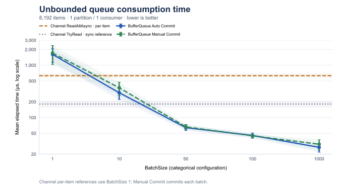
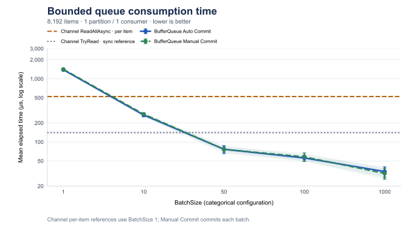
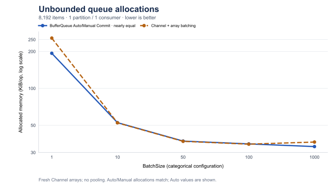
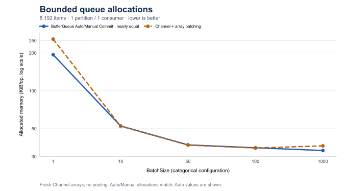

# Single-Partition Produce and Consume Benchmarks

[简体中文](memory-single-partition.zh-CN.md)

[Single Partition](memory-single-partition.md) | [Multiple Partitions](memory-multi-partition.md)

## Scope and Data

This report isolates one-partition producer and consumer topologies. It compares the Memory `BufferQueue` producer and
consume paths with the default `System.Threading.Channels.Channel<int>` paths on the same 8,192-item workload. It is a companion to the
[multi-partition benchmark](memory-multi-partition.md) and the [Channel batch-aggregation report](channel-batch-aggregation.md).

The consume result set is [memory-single-partition-consume-results.csv](memory-single-partition-consume-results.csv), and its reproducibility record
is [memory-single-partition-consume-run.json](memory-single-partition-consume-run.json). The producer result set and run record are
[memory-single-partition-produce-results.csv](memory-single-partition-produce-results.csv) and
[memory-single-partition-produce-run.json](memory-single-partition-produce-run.json). The consume CSV contains all 50 measured rows.
Its tables show the 30 rows whose result changes with `BatchSize`, plus one representative `BatchSize=1` row for each
native Channel method in each mode. Native Channel methods do not consume `BatchSize`; their other four repeated rows
remain in the CSV so the raw consume benchmark output is complete.

| Configuration | BufferQueue | Channel |
| --- | --- | --- |
| Partition | 1 | None; one shared instance |
| Producer tasks | 12 | 12 |
| Consumers | 1 | 1 |
| Messages / operation | 8,192 int | 8,192 int |

Production and consumption are measured separately. Single- and multi-partition results come from different runs and do not establish a partition-scaling speedup.

## Environment

### Producer Run

The Release job uses one launch, six warmups, and fifteen measured iterations with automatic invocation count. The
producer run record reports .NET 10.0.0, BenchmarkDotNet 0.15.8, source fingerprint
`66fa5020afed6abe3bc58a028db3f276b72b0cca6e2ce963b41ea92ee84848b3`, and base commit
`3243e7017e9275dd61bb753af716c7c0d23c5ab2`. All eight producer cases completed successfully.

### Consumer Run

The run used an Apple M2 Max with 12 physical/logical cores, macOS 27.0.1, Arm64, .NET 10.0.0
(`10.0.25.52411`), the runtime-provided `System.Threading.Channels` assembly, and BenchmarkDotNet 0.15.8.
The Release job used one launch, six warmups, twenty measured iterations, invocation count one, and unroll factor one.
The source/harness fingerprint is `66391d561864e944e22933f0b292e31921c491a07abcf249daac2ea192d25807` at base
commit `3243e7017e9275dd61bb753af716c7c0d23c5ab2`.

All 50 cases completed successfully and validated the exact total of 8,192 consumed values. The operations are short
and below BenchmarkDotNet's recommended 100 ms iteration duration. Treat the means as trends with the reported 99.9%
uncertainty, especially the noisy `Unbounded` `BatchSize=1` and `BatchSize=10` rows. The run record also notes that
high-priority setup was unavailable; CPU identity was verified separately with `sysctl`.

## Production Benchmarks

### Workload

The producer benchmark writes 8,192 `int` values with one BufferQueue partition and twelve concurrent producer tasks.
The twelve producer tasks are not twelve partitions: each task owns one precomputed chunk, with eleven chunks of 683
items and a final chunk of 679 items. The chunking is only a producer-concurrency detail; there is no consumer and no
`BatchSize` parameter in this benchmark.

The [`SinglePartitionChannelVsMemoryBufferQueueProduceBenchmark`](../../tests/BufferQueue.Benchmarks/SinglePartitionChannelVsMemoryBufferQueueProduceBenchmark.cs)
subclass changes only `PartitionCount` to `1` and inherits the timed methods from
[`ChannelVsMemoryBufferQueueProduceBenchmark`](../../tests/BufferQueue.Benchmarks/ChannelVsMemoryBufferQueueProduceBenchmark.cs):
`Channel_TryWrite_Concurrent`, `Channel_WriteAsync_Concurrent`, `MemoryBufferQueue_Produce_Concurrent`, and
`MemoryBufferQueue_Produce_ReadOnlyMemoryBatch_Concurrent`. Channel and BufferQueue each create twelve `Task.Run`
producer tasks inside the timed method, so queue creation and task scheduling are included. The `bounded` queues use
capacity `8192`; this workload fits completely and does not measure producer waiting. There are no consumer or
commit semantics in this section.

### Measurements

`Mean`, `Error`, and `StdDev` are in µs, rounded to three decimals; `Error` is the 99.9% confidence-interval half-width.
Allocation is `Allocated_B / 1024` in KiB, rounded to two decimals: cumulative managed allocation per 8,192-item operation, not peak resident memory. The CSV retains its original precision.

| Mode | Method | Mean (µs) | Error (µs) | StdDev (µs) | Allocated (KiB) |
| --- | --- | ---: | ---: | ---: | ---: |
| unbounded | `Channel_TryWrite_Concurrent` | 283.093 | 1.300 | 1.015 | 134.53 |
| unbounded | `Channel_WriteAsync_Concurrent` | 334.382 | 2.388 | 2.117 | 135.47 |
| unbounded | `MemoryBufferQueue_Produce_Concurrent` | 288.760 | 1.210 | 1.010 | 36.41 |
| unbounded | `MemoryBufferQueue_Produce_ReadOnlyMemoryBatch_Concurrent` | 67.457 | 0.281 | 0.249 | 36.40 |
| bounded | `Channel_TryWrite_Concurrent` | 301.635 | 1.090 | 0.966 | 67.33 |
| bounded | `Channel_WriteAsync_Concurrent` | 396.067 | 1.234 | 1.154 | 68.27 |
| bounded | `MemoryBufferQueue_Produce_Concurrent` | 324.122 | 1.959 | 1.636 | 36.59 |
| bounded | `MemoryBufferQueue_Produce_ReadOnlyMemoryBatch_Concurrent` | 66.681 | 0.364 | 0.323 | 36.58 |

### Time Charts





### Allocation Charts





## Consumption Benchmarks

### Workload

Each operation drains 8,192 prefetched `int` values with exactly one BufferQueue partition and one consumer. The
BufferQueue queue uses the default `SegmentSize=1024`. The `bounded` queue uses `BoundedCapacity=8192`; the
`unbounded` queue leaves capacity unset. The Channel is also prefilled with 8,192 values and its writer is completed
before the timed consume method starts. Queue/channel creation, prefill, consumer registration, and writer completion
are excluded from timing.

This is strictly a one-partition, one-consumer measurement. BufferQueue rejects a consumer count greater than the partition count for a
consumer group, so a one-partition group cannot provide a valid multi-consumer case. Removing multi-partition
parallelism makes this a topology comparison, not a claim that the implementations have identical features or
delivery semantics. It also cannot establish a partition-count speedup across separate runs.

The subclasses only change the topology and inherit the timed methods and setup from the original benchmark classes:

- [`SinglePartitionUnboundedChannelVsMemoryBufferQueueConsumeBenchmark`](../../tests/BufferQueue.Benchmarks/SinglePartitionUnboundedChannelVsMemoryBufferQueueConsumeBenchmark.cs)
  overrides `ConsumerCounts` to `[1]` and `PartitionCount` to `1`.
- [`SinglePartitionBoundedChannelVsMemoryBufferQueueConsumeBenchmark`](../../tests/BufferQueue.Benchmarks/SinglePartitionBoundedChannelVsMemoryBufferQueueConsumeBenchmark.cs)
  makes the same overrides for the bounded case.
- The inherited setup and paths are in [`UnboundedChannelVsMemoryBufferQueueConsumeBenchmark`](../../tests/BufferQueue.Benchmarks/UnboundedChannelVsMemoryBufferQueueConsumeBenchmark.cs)
  and [`BoundedChannelVsMemoryBufferQueueConsumeBenchmark`](../../tests/BufferQueue.Benchmarks/BoundedChannelVsMemoryBufferQueueConsumeBenchmark.cs):
  `Channel_TryRead`, `Channel_ReadAllAsync`, `Channel_ReadAllAsync_Batched`,
  `BufferQueue_ConsumeAsync_AutoCommit`, and `BufferQueue_ConsumeAsync_ManualCommit`.
- The fresh-array Channel adapter is [`ChannelBatchConsumption`](../../tests/BufferQueue.Benchmarks/ChannelBatchConsumption.cs).

`AutoCommit` advances BufferQueue progress after a successful pull. The manual path sets `AutoCommit=false` and calls
`CommitAsync` after every returned batch. Channel has no acknowledgement, checkpoint, or replay equivalent.

The methods have deliberately different meanings:

- `Channel_TryRead` is a synchronous `TryRead` loop, used as a low-level reference.
- `Channel_ReadAllAsync` is the native asynchronous one-item stream. Each `await foreach` iteration returns one item.
- `Channel_ReadAllAsync_Batched` is an application-side adapter: it reads through native `ReadAllAsync`, allocates a
  fresh `int[BatchSize]` for each non-empty batch, and yields the populated memory. It is not a Channel API mode and
  does not implement sparse live-stream batch-fill latency.
- BufferQueue `ConsumeAsync` returns an already materialized read-only batch. The benchmark counts each batch with
  `Count()` and does not add per-item business processing.

The Channel is the default multi-reader configuration, not a `SingleReader` specialization. The run record reports
`SingleReader=false` and `SingleWriter=false`; no `SingleReader=true` claim is made here.

### Measurements

`Mean`, `Error`, and `StdDev` are in µs, rounded to three decimals; `Error` is the 99.9% confidence-interval half-width.
Allocation is `Allocated_B / 1024` in KiB, rounded to two decimals: cumulative managed allocation per 8,192-item operation, not peak resident memory. The CSV retains its original precision.

Native Channel methods do not depend on `BatchSize`; their other repeated measurements remain in the CSV.

#### unbounded / 1 Consumer

| BatchSize | Method | Mean (µs) | Error (µs) | StdDev (µs) | Allocated (KiB) |
| ---: | --- | ---: | ---: | ---: | ---: |
| 1 | `Channel_ReadAllAsync_Batched` | 1507.956 | 221.997 | 246.749 | 257.15 |
| 1 | `BufferQueue_ConsumeAsync_AutoCommit` | 1609.792 | 474.692 | 507.915 | 193.34 |
| 1 | `BufferQueue_ConsumeAsync_ManualCommit` | 1706.778 | 675.209 | 750.493 | 193.34 |
| 10 | `Channel_ReadAllAsync_Batched` | 1268.794 | 272.697 | 303.102 | 52.40 |
| 10 | `BufferQueue_ConsumeAsync_AutoCommit` | 298.041 | 77.415 | 86.047 | 52.55 |
| 10 | `BufferQueue_ConsumeAsync_ManualCommit` | 371.633 | 103.915 | 119.669 | 52.55 |
| 50 | `Channel_ReadAllAsync_Batched` | 886.965 | 29.600 | 32.901 | 37.02 |
| 50 | `BufferQueue_ConsumeAsync_AutoCommit` | 64.210 | 7.754 | 8.619 | 37.18 |
| 50 | `BufferQueue_ConsumeAsync_ManualCommit` | 66.383 | 7.493 | 8.629 | 37.18 |
| 100 | `Channel_ReadAllAsync_Batched` | 864.789 | 31.862 | 36.692 | 35.10 |
| 100 | `BufferQueue_ConsumeAsync_AutoCommit` | 45.516 | 5.361 | 6.174 | 35.26 |
| 100 | `BufferQueue_ConsumeAsync_ManualCommit` | 44.814 | 3.132 | 3.481 | 35.26 |
| 1000 | `Channel_ReadAllAsync_Batched` | 904.929 | 46.187 | 53.189 | 36.52 |
| 1000 | `BufferQueue_ConsumeAsync_AutoCommit` | 27.032 | 5.218 | 5.584 | 33.55 |
| 1000 | `BufferQueue_ConsumeAsync_ManualCommit` | 30.932 | 6.821 | 7.855 | 33.55 |

Native Channel representatives (`BatchSize=1` rows; this parameter does not affect either method):

| Method | Mean (µs) | Error (µs) | StdDev (µs) | Allocated (KiB) |
| --- | ---: | ---: | ---: | ---: |
| `Channel_TryRead` | 181.580 | 27.159 | 30.187 | 0.58 |
| `Channel_ReadAllAsync` | 631.877 | 57.636 | 56.606 | 0.93 |

#### bounded / 1 Consumer

| BatchSize | Method | Mean (µs) | Error (µs) | StdDev (µs) | Allocated (KiB) |
| ---: | --- | ---: | ---: | ---: | ---: |
| 1 | `Channel_ReadAllAsync_Batched` | 1272.683 | 41.281 | 47.539 | 257.15 |
| 1 | `BufferQueue_ConsumeAsync_AutoCommit` | 1385.706 | 46.468 | 53.512 | 193.34 |
| 1 | `BufferQueue_ConsumeAsync_ManualCommit` | 1414.088 | 33.790 | 38.913 | 193.34 |
| 10 | `Channel_ReadAllAsync_Batched` | 968.745 | 38.795 | 44.676 | 52.40 |
| 10 | `BufferQueue_ConsumeAsync_AutoCommit` | 266.721 | 18.061 | 20.799 | 52.55 |
| 10 | `BufferQueue_ConsumeAsync_ManualCommit` | 275.213 | 15.201 | 17.506 | 52.55 |
| 50 | `Channel_ReadAllAsync_Batched` | 824.457 | 25.305 | 27.077 | 37.02 |
| 50 | `BufferQueue_ConsumeAsync_AutoCommit` | 76.554 | 11.162 | 12.854 | 37.18 |
| 50 | `BufferQueue_ConsumeAsync_ManualCommit` | 76.561 | 7.342 | 8.455 | 37.18 |
| 100 | `Channel_ReadAllAsync_Batched` | 829.031 | 27.801 | 32.016 | 35.10 |
| 100 | `BufferQueue_ConsumeAsync_AutoCommit` | 55.773 | 5.774 | 6.178 | 35.26 |
| 100 | `BufferQueue_ConsumeAsync_ManualCommit` | 58.087 | 9.037 | 10.407 | 35.26 |
| 1000 | `Channel_ReadAllAsync_Batched` | 863.548 | 32.554 | 37.489 | 36.52 |
| 1000 | `BufferQueue_ConsumeAsync_AutoCommit` | 34.059 | 6.408 | 7.122 | 33.55 |
| 1000 | `BufferQueue_ConsumeAsync_ManualCommit` | 31.798 | 6.123 | 6.552 | 33.55 |

Native Channel representatives (`BatchSize=1` rows; this parameter does not affect either method):

| Method | Mean (µs) | Error (µs) | StdDev (µs) | Allocated (KiB) |
| --- | ---: | ---: | ---: | ---: |
| `Channel_TryRead` | 140.754 | 7.224 | 8.319 | 0.58 |
| `Channel_ReadAllAsync` | 523.572 | 13.895 | 15.444 | 0.93 |

### Time Charts

Time charts show means and reported uncertainty; native Channel reference lines use the fixed representative `BatchSize=1` rows.





### Allocation Charts

The `BatchSize=1000` rows should not be read as a claim that every batch is full. In this prefilled 8,192-item run,
there are eight full batches and a final remainder of 192 items. The Channel adapter still allocates `int[1000]` for
that final batch and exposes a 192-item prefix; BufferQueue crosses existing segment boundaries to fill batches and
allocates only 192 items for the last tail. This contributes to the measured 36.52 KiB versus 33.55 KiB per operation.





## Supplementary Comparisons

### 12 Partitions, 1 Consumer Reference

These are historical rows from the 12-partition report, retained as context rather than a same-run comparison. They
use the original 12-partition benchmark and therefore include a different topology. Do not infer a partition-count
speedup by comparing these charts with the new one-partition, one-consumer charts; the run records, source revisions,
and execution conditions differ.


For the full historical tables and the original workload discussion, see [memory-multi-partition.md](memory-multi-partition.md). For
the fresh-array Channel interpretation, see [channel-batch-aggregation.md](channel-batch-aggregation.md).

## Reproduction

### Production Command

```sh
dotnet run --project tests/BufferQueue.Benchmarks -c Release -- --filter '*SinglePartitionChannelVsMemoryBufferQueueProduceBenchmark*' --exporters json
```

### Consumption Command

```sh
dotnet run --project tests/BufferQueue.Benchmarks -c Release -- --filter '*SinglePartition*ConsumeBenchmark*' --warmupCount 6 --iterationCount 20 --launchCount 1 --exporters json
```
