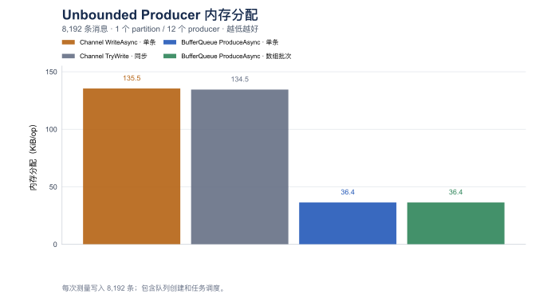
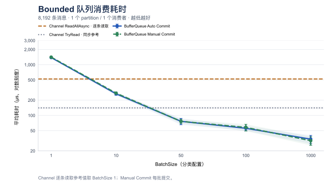

# 单 Partition 生产和消费基准测试

[English](memory-single-partition.md)

[单 Partition](memory-single-partition.zh-CN.md) | [多 Partition](memory-multi-partition.zh-CN.md)

## 测试范围与数据

本报告隔离单 partition 的生产和消费拓扑，在同一组 8,192 条消息的负载上比较 Memory `BufferQueue` 的生产、消费路径与
默认 `System.Threading.Channels.Channel<int>` 路径。它是[多 Partition 基准测试](memory-multi-partition.zh-CN.md)和
[Channel 批量聚合报告](channel-batch-aggregation.zh-CN.md)的配套报告。

消费结果集在 [memory-single-partition-consume-results.csv](memory-single-partition-consume-results.csv)，可复现记录在
[memory-single-partition-consume-run.json](memory-single-partition-consume-run.json)。生产结果集和运行记录在
[memory-single-partition-produce-results.csv](memory-single-partition-produce-results.csv)和
[memory-single-partition-produce-run.json](memory-single-partition-produce-run.json)。生产 CSV 包含 8 行测量结果，消费 CSV 包含全部 50 行；下表列出随
`BatchSize` 变化的 30 行，以及每个模式中两个原生 Channel 方法各自一个 `BatchSize=1` 代表行。原生 Channel 方法不消费
`BatchSize`；其余四个重复行仍保留在 CSV 中，因此原始消费基准测试输出是完整的。

| 配置 | BufferQueue | Channel |
| --- | --- | --- |
| Partition | 1 | 无；一个共享实例 |
| Producer tasks | 12 | 12 |
| Consumers | 1 | 1 |
| Messages / operation | 8,192 int | 8,192 int |

写入和消费分别测量；单 Partition 与多 Partition 来自不同运行，不能据此计算分区扩展的加速比。

## 测试环境

### 写入运行记录

Release 作业使用一次 launch、六次 warmup 和十五次测量迭代，invocation count 由 BenchmarkDotNet 自动选择。生产运行记录使用
.NET 10.0.0、BenchmarkDotNet 0.15.8，源码指纹为 `66fa5020afed6abe3bc58a028db3f276b72b0cca6e2ce963b41ea92ee84848b3`，
base commit 为 `3243e7017e9275dd61bb753af716c7c0d23c5ab2`。8 个生产用例均成功完成。

### 消费运行记录

本次运行使用 Apple M2 Max（12 个物理/逻辑 core）、macOS 27.0.1、Arm64、.NET 10.0.0
（`10.0.25.52411`）、运行时提供的 `System.Threading.Channels` 程序集，以及 BenchmarkDotNet 0.15.8。
Release job 使用一次 launch、六次 warmup、二十次测量迭代、invocation count 为 1、unroll factor 为 1。
源码/ harness 指纹为 `66391d561864e944e22933f0b292e31921c491a07abcf249daac2ea192d25807`，base commit 为
`3243e7017e9275dd61bb753af716c7c0d23c5ab2`。

全部 50 个用例均成功完成，并校验消费总数准确为 8,192。操作很短，低于 BenchmarkDotNet 建议的 100 ms iteration
时长。应结合报告的 99.9% 不确定度将均值作为趋势解读，尤其注意 `Unbounded` 的 `BatchSize=1` 和 `BatchSize=10`
行噪声较大。运行记录还说明高优先级设置不可用；CPU 信息通过 `sysctl` 另行验证。

## 写入性能

### 测试配置

生产基准测试使用一个 BufferQueue partition 和 12 个并发生产任务写入 8,192 个 `int`。12 个生产任务并不代表 12 个
partition：每个任务使用一个预先切好的数据块，其中 11 个数据块各有 683 条，最后一个有 679 条。数据块划分只是生产并发
细节；这个基准测试没有 consumer，也没有 `BatchSize` 参数。

[`SinglePartitionChannelVsMemoryBufferQueueProduceBenchmark`](../../tests/BufferQueue.Benchmarks/SinglePartitionChannelVsMemoryBufferQueueProduceBenchmark.cs)
只将 `PartitionCount` 覆盖为 `1`，并继承 [`ChannelVsMemoryBufferQueueProduceBenchmark`](../../tests/BufferQueue.Benchmarks/ChannelVsMemoryBufferQueueProduceBenchmark.cs)
的计时方法：`Channel_TryWrite_Concurrent`、`Channel_WriteAsync_Concurrent`、
`MemoryBufferQueue_Produce_Concurrent` 和 `MemoryBufferQueue_Produce_ReadOnlyMemoryBatch_Concurrent`。Channel 和 BufferQueue
都在计时方法内创建 12 个 `Task.Run` 生产任务，因此 queue 创建和任务调度计入计时。`bounded` queue 的容量为 `8192`；
完整负载可以放入容量，不测 producer 等待。这里没有 consumer 或 commit 语义。

### 测量结果

`Mean`、`Error` 和 `StdDev` 的单位是 µs，保留三位小数；`Error` 为 99.9% 置信区间半宽。
内存分配按 `Allocated_B / 1024` 换算为 KiB，保留两位小数，表示每次 8,192 条消息操作的累计托管分配，不是峰值驻留内存。CSV 保留原始精度。

| Mode | Method | Mean (µs) | Error (µs) | StdDev (µs) | Allocated (KiB) |
| --- | --- | ---: | ---: | ---: | ---: |
| unbounded | `Channel_TryWrite_Concurrent` | 283.093 | 1.300 | 1.015 | 134.53 |
| unbounded | `Channel_WriteAsync_Concurrent` | 334.382 | 2.388 | 2.117 | 135.47 |
| unbounded | `MemoryBufferQueue_Produce_Concurrent` | 288.760 | 1.210 | 1.010 | 36.41 |
| unbounded | `MemoryBufferQueue_Produce_ReadOnlyMemoryBatch_Concurrent` | 67.457 | 0.281 | 0.249 | 36.40 |
| bounded | `Channel_TryWrite_Concurrent` | 301.635 | 1.090 | 0.966 | 67.33 |
| bounded | `Channel_WriteAsync_Concurrent` | 396.067 | 1.234 | 1.154 | 68.27 |
| bounded | `MemoryBufferQueue_Produce_Concurrent` | 324.122 | 1.959 | 1.636 | 36.59 |
| bounded | `MemoryBufferQueue_Produce_ReadOnlyMemoryBatch_Concurrent` | 66.681 | 0.364 | 0.323 | 36.58 |

### 耗时图


### 内存分配图




## 消费性能

### 测试配置

每次操作消费 8,192 条预填充的 `int`，BufferQueue 恰好使用一个 partition 和一个 consumer。
BufferQueue 使用默认的 `SegmentSize=1024`。`bounded` 队列使用 `BoundedCapacity=8192`；`unbounded` 队列不设置容量。
Channel 也预填充 8,192 条数据，并在计时消费方法开始前完成 writer。Queue/channel 创建、预填充、consumer 注册和
writer 完成都不计入计时。

这是严格的 1 个 partition、1 个 consumer 测量。BufferQueue 对一个 consumer group 拒绝大于 partition 数量的 consumer，
因此一个 partition 不能提供有效的多 consumer 用例。移除多 partition 并行只构成拓扑对比，并不表示两种实现具有相同的
功能或投递语义，也不能根据不同运行建立 partition 数量带来的加速结论。

两个子类只改变拓扑，计时方法和初始化均继承自原始基准测试类：

- [`SinglePartitionUnboundedChannelVsMemoryBufferQueueConsumeBenchmark`](../../tests/BufferQueue.Benchmarks/SinglePartitionUnboundedChannelVsMemoryBufferQueueConsumeBenchmark.cs)
  将 `ConsumerCounts` 覆盖为 `[1]`，将 `PartitionCount` 覆盖为 `1`。
- [`SinglePartitionBoundedChannelVsMemoryBufferQueueConsumeBenchmark`](../../tests/BufferQueue.Benchmarks/SinglePartitionBoundedChannelVsMemoryBufferQueueConsumeBenchmark.cs)
  对 bounded 用例做相同覆盖。
- 继承的初始化和路径在 [`UnboundedChannelVsMemoryBufferQueueConsumeBenchmark`](../../tests/BufferQueue.Benchmarks/UnboundedChannelVsMemoryBufferQueueConsumeBenchmark.cs)
  与 [`BoundedChannelVsMemoryBufferQueueConsumeBenchmark`](../../tests/BufferQueue.Benchmarks/BoundedChannelVsMemoryBufferQueueConsumeBenchmark.cs) 中：
  `Channel_TryRead`、`Channel_ReadAllAsync`、`Channel_ReadAllAsync_Batched`、
  `BufferQueue_ConsumeAsync_AutoCommit` 和 `BufferQueue_ConsumeAsync_ManualCommit`。
- 新数组 Channel 适配器是 [`ChannelBatchConsumption`](../../tests/BufferQueue.Benchmarks/ChannelBatchConsumption.cs)。

`AutoCommit` 在一次成功 pull 后推进 BufferQueue 的进度。手动路径设置 `AutoCommit=false`，并在每个返回 batch 后调用
`CommitAsync`。Channel 没有对应的确认、checkpoint 或 replay 机制。

这些路径的具体含义如下：

- `Channel_TryRead` 是同步 `TryRead` 循环，用作底层参考。
- `Channel_ReadAllAsync` 是原生异步单条数据流；每次 `await foreach` 迭代返回一条数据。
- `Channel_ReadAllAsync_Batched` 是应用侧适配器：通过原生 `ReadAllAsync` 读取，在每个非空 batch 分配新的
  `int[BatchSize]`，再返回已填充的 memory。它不是 Channel API 模式，也不实现稀疏实时数据流的凑批延迟。
- BufferQueue `ConsumeAsync` 返回已生成的只读 batch。基准测试使用 `Count()` 统计每个 batch，不添加逐条业务处理。

Channel 使用默认的多 reader 配置，而不是 `SingleReader` 专用配置。运行记录报告
`SingleReader=false` 和 `SingleWriter=false`；本文不作 `SingleReader=true` 的结论。

### 测量结果

`Mean`、`Error` 和 `StdDev` 的单位是 µs，保留三位小数；`Error` 为 99.9% 置信区间半宽。
内存分配按 `Allocated_B / 1024` 换算为 KiB，保留两位小数，表示每次 8,192 条消息操作的累计托管分配，不是峰值驻留内存。CSV 保留原始精度。

原生 Channel 方法不受 `BatchSize` 控制，其余重复测量保留在 CSV 中。

#### unbounded / 1 Consumer

| BatchSize | Method | Mean (µs) | Error (µs) | StdDev (µs) | Allocated (KiB) |
| ---: | --- | ---: | ---: | ---: | ---: |
| 1 | `Channel_ReadAllAsync_Batched` | 1507.956 | 221.997 | 246.749 | 257.15 |
| 1 | `BufferQueue_ConsumeAsync_AutoCommit` | 1609.792 | 474.692 | 507.915 | 193.34 |
| 1 | `BufferQueue_ConsumeAsync_ManualCommit` | 1706.778 | 675.209 | 750.493 | 193.34 |
| 10 | `Channel_ReadAllAsync_Batched` | 1268.794 | 272.697 | 303.102 | 52.40 |
| 10 | `BufferQueue_ConsumeAsync_AutoCommit` | 298.041 | 77.415 | 86.047 | 52.55 |
| 10 | `BufferQueue_ConsumeAsync_ManualCommit` | 371.633 | 103.915 | 119.669 | 52.55 |
| 50 | `Channel_ReadAllAsync_Batched` | 886.965 | 29.600 | 32.901 | 37.02 |
| 50 | `BufferQueue_ConsumeAsync_AutoCommit` | 64.210 | 7.754 | 8.619 | 37.18 |
| 50 | `BufferQueue_ConsumeAsync_ManualCommit` | 66.383 | 7.493 | 8.629 | 37.18 |
| 100 | `Channel_ReadAllAsync_Batched` | 864.789 | 31.862 | 36.692 | 35.10 |
| 100 | `BufferQueue_ConsumeAsync_AutoCommit` | 45.516 | 5.361 | 6.174 | 35.26 |
| 100 | `BufferQueue_ConsumeAsync_ManualCommit` | 44.814 | 3.132 | 3.481 | 35.26 |
| 1000 | `Channel_ReadAllAsync_Batched` | 904.929 | 46.187 | 53.189 | 36.52 |
| 1000 | `BufferQueue_ConsumeAsync_AutoCommit` | 27.032 | 5.218 | 5.584 | 33.55 |
| 1000 | `BufferQueue_ConsumeAsync_ManualCommit` | 30.932 | 6.821 | 7.855 | 33.55 |

原生 Channel 代表值（取 `BatchSize=1` 行；该参数不影响这两个方法）：

| Method | Mean (µs) | Error (µs) | StdDev (µs) | Allocated (KiB) |
| --- | ---: | ---: | ---: | ---: |
| `Channel_TryRead` | 181.580 | 27.159 | 30.187 | 0.58 |
| `Channel_ReadAllAsync` | 631.877 | 57.636 | 56.606 | 0.93 |

#### bounded / 1 Consumer

| BatchSize | Method | Mean (µs) | Error (µs) | StdDev (µs) | Allocated (KiB) |
| ---: | --- | ---: | ---: | ---: | ---: |
| 1 | `Channel_ReadAllAsync_Batched` | 1272.683 | 41.281 | 47.539 | 257.15 |
| 1 | `BufferQueue_ConsumeAsync_AutoCommit` | 1385.706 | 46.468 | 53.512 | 193.34 |
| 1 | `BufferQueue_ConsumeAsync_ManualCommit` | 1414.088 | 33.790 | 38.913 | 193.34 |
| 10 | `Channel_ReadAllAsync_Batched` | 968.745 | 38.795 | 44.676 | 52.40 |
| 10 | `BufferQueue_ConsumeAsync_AutoCommit` | 266.721 | 18.061 | 20.799 | 52.55 |
| 10 | `BufferQueue_ConsumeAsync_ManualCommit` | 275.213 | 15.201 | 17.506 | 52.55 |
| 50 | `Channel_ReadAllAsync_Batched` | 824.457 | 25.305 | 27.077 | 37.02 |
| 50 | `BufferQueue_ConsumeAsync_AutoCommit` | 76.554 | 11.162 | 12.854 | 37.18 |
| 50 | `BufferQueue_ConsumeAsync_ManualCommit` | 76.561 | 7.342 | 8.455 | 37.18 |
| 100 | `Channel_ReadAllAsync_Batched` | 829.031 | 27.801 | 32.016 | 35.10 |
| 100 | `BufferQueue_ConsumeAsync_AutoCommit` | 55.773 | 5.774 | 6.178 | 35.26 |
| 100 | `BufferQueue_ConsumeAsync_ManualCommit` | 58.087 | 9.037 | 10.407 | 35.26 |
| 1000 | `Channel_ReadAllAsync_Batched` | 863.548 | 32.554 | 37.489 | 36.52 |
| 1000 | `BufferQueue_ConsumeAsync_AutoCommit` | 34.059 | 6.408 | 7.122 | 33.55 |
| 1000 | `BufferQueue_ConsumeAsync_ManualCommit` | 31.798 | 6.123 | 6.552 | 33.55 |

原生 Channel 代表值（取 `BatchSize=1` 行；该参数不影响这两个方法）：

| Method | Mean (µs) | Error (µs) | StdDev (µs) | Allocated (KiB) |
| --- | ---: | ---: | ---: | ---: |
| `Channel_TryRead` | 140.754 | 7.224 | 8.319 | 0.58 |
| `Channel_ReadAllAsync` | 523.572 | 13.895 | 15.444 | 0.93 |

### 耗时图

耗时图展示均值和报告的误差；原生 Channel 参考线固定使用 `BatchSize=1` 的代表行。




### 内存分配图

在这次预填充的 8,192 条消息测量中，`BatchSize=1000` 会得到 8 个完整 batch，最后剩余 192 条。Channel 适配器为最后一个
batch 仍分配 `int[1000]`，但只返回其中 192 条；BufferQueue 会跨越已有 segment 的边界凑满 batch，
最后一批只分配 192 项。这也是两者每次操作分别分配 36.52 KiB 和 33.55 KiB 的原因之一。


## 补充对比

### 12 Partition / 1 Consumer 参考

以下是 12 partition 报告中的历史行，用作上下文而不是同一次运行的对比。它们来自原始 12-partition 基准测试，
因此拓扑不同。不要把这些图表与新的 1 个 partition、1 个 consumer 图表直接比较并推导 partition 加速；两者的运行记录、
源码版本和执行条件不同。


完整历史表格和原始负载讨论见 [memory-multi-partition.zh-CN.md](memory-multi-partition.zh-CN.md)。新数组 Channel 的解释见
[channel-batch-aggregation.zh-CN.md](channel-batch-aggregation.zh-CN.md)。

## 复现命令

### 写入命令

```sh
dotnet run --project tests/BufferQueue.Benchmarks -c Release -- --filter '*SinglePartitionChannelVsMemoryBufferQueueProduceBenchmark*' --exporters json
```

### 消费命令

```sh
dotnet run --project tests/BufferQueue.Benchmarks -c Release -- --filter '*SinglePartition*ConsumeBenchmark*' --warmupCount 6 --iterationCount 20 --launchCount 1 --exporters json
```
